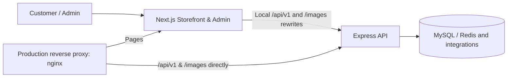

<div align="center">


# LaptopShop — Smart Laptop Shopping Experience

**Find the right laptop. Compare confidently. Shop seamlessly.**

A full-featured laptop e-commerce frontend built with **Next.js 16**, **React 19**, and **TypeScript** — from product discovery and AI-assisted recommendations to checkout and after-sales support.

[](https://nextjs.org/)
[](https://react.dev/)
[](https://www.typescriptlang.org/)
[](https://pnpm.io/)
[](https://github.com/QuocDuy21-10/laptopshop-web/actions/workflows/ci.yml)

[Explore Features](#-features) · [Tech Stack](#-tech-stack) · [Quick Start](#-quick-start) · [Architecture](#-architecture) · [Deployment](#-deployment)


</div>

> **Repository scope:** This repository contains the customer-facing storefront and admin frontend. The companion backend lives in [laptopshop-api](https://github.com/QuocDuy21-10/laptopshop-api).

## ✨ About the project

**LaptopShop** is a laptop-focused e-commerce experience designed to help customers discover products, evaluate technical specifications, make informed purchasing decisions, and manage orders and post-purchase requests in one place. It also provides a dedicated administration interface for day-to-day store operations.

The application combines responsive shopping interfaces with typed API integration, reusable UI components, server-side rendering capabilities, and automated code quality checks.

## 🧭 Contents

- [Features](#-features)
- [Tech stack](#-tech-stack)
- [Architecture](#-architecture)
- [Project structure](#-project-structure)
- [Quick start](#-quick-start)
- [Available commands](#-available-commands)
- [Testing and quality](#-testing-and-quality)
- [Deployment](#-deployment)
- [Security notes](#-security-notes)
- [Related resources](#-related-resources)

## 🚀 Features

### Customer storefront

| Area                   | Capabilities                                                                       |
| ---------------------- | ---------------------------------------------------------------------------------- |
| 🛍️ Product discovery   | Browse laptops, view product details, search and filter by specifications.         |
| ⚖️ Product comparison  | Compare laptop specifications to support purchase decisions.                       |
| 🤖 AI laptop advisor   | Explore an AI-assisted laptop recommendation experience.                           |
| ❤️ Wishlist            | Save products of interest and access price-alert experiences.                      |
| 🛒 Shopping & checkout | Manage a cart, place orders, and use the checkout and bank-transfer payment flows. |
| 🎁 Promotions          | Discover promotions and discounted products.                                       |
| ⭐ Reviews             | Read product reviews and interact with review-related features.                    |
| 👤 Accounts            | Authentication, account settings, orders, and notifications.                       |
| 🛡️ After-sales         | View warranty information and submit after-sales requests.                         |
| 📬 Newsletter          | Access newsletter-related customer flows.                                          |

### Administration

| Module               | Focus                                                |
| -------------------- | ---------------------------------------------------- |
| Dashboard            | Store operations overview.                           |
| Catalog & promotions | Products, promotion campaigns, and homepage banners. |
| Sales & payments     | Orders and payments.                                 |
| Inventory            | Stock and inventory operations.                      |
| Customers & feedback | Users and product reviews.                           |
| Customer care        | After-sales requests and notifications.              |
| Communications       | Newsletter management.                               |

> These groups reflect existing application routes and feature areas. End-to-end business availability depends on backend configuration and external integrations; this table is not a certification of production readiness.

## 🧰 Tech stack

Versions below are taken from the repository's `package.json` on `main` when this document was prepared.

| Layer                  | Technology           | Version               |
| ---------------------- | -------------------- | --------------------- |
| Framework              | Next.js (App Router) | `16.4.2`              |
| UI library             | React / React DOM    | `19.3.1`              |
| Language               | TypeScript           | `5.9.3`               |
| Package manager        | pnpm                 | `11.24.0`             |
| Runtime (Docker / CI)  | Node.js              | `22`                  |
| UI components          | Ant Design           | `6.6.6`               |
| UI primitives          | Radix UI             | Package-specific      |
| Icons                  | Lucide React         | `1.59.0`              |
| Styles                 | Sass / SCSS Modules  | `1.105.2`             |
| Animations             | Motion               | `14.3.0`              |
| Async server state     | TanStack Query       | `5.104.4`             |
| Forms                  | React Hook Form      | `7.90.0`              |
| Validation             | Zod                  | `4.6.7`               |
| API client             | openapi-fetch        | `0.16.0`              |
| API type generation    | openapi-typescript   | `7.13.0`              |
| Charts                 | Recharts             | `3.10.1`              |
| Notifications          | Sonner               | `2.0.8`               |
| Unit/component testing | Vitest               | `5.0.5`               |
| Linting                | ESLint / Stylelint   | `10.13.0` / `17.16.0` |
| Formatting             | Prettier             | `3.9.10`              |

## 🏗️ Architecture



- **Development:** Next.js proxies `/api/v1/*` and `/images/*` to `API_ORIGIN`. Browser requests remain same-origin, which supports first-party authentication cookies.
- **Production:** nginx forwards API and image requests **directly to Express**, while page requests go to Next.js. This preserves client IP handling for API rate limiting rather than losing it through the Next rewrite path.
- **Next.js build:** `API_ORIGIN` must be available **at build time**, because rewrites are compiled into the application. It is also supplied at runtime for server-side API calls.
- **Deployment output:** The frontend uses Next.js `standalone` mode.

## 🗂️ Project structure

```text
laptopshop-web/
├── public/
│   ├── banners/             # Storefront hero assets
│   └── brand/               # Brand logos and icons
├── src/
│   ├── app/
│   │   ├── (storefront)/    # Product discovery, cart, checkout, account, advisor
│   │   ├── (auth)/          # Login, registration, password recovery
│   │   └── (admin)/         # Store management routes
│   ├── components/          # Reusable UI components
│   ├── features/            # Domain-driven frontend features
│   ├── lib/                 # API clients, utilities, shared services
│   ├── providers/           # React context and providers
│   └── styles/              # Shared styles and tokens
├── tests/                   # Automated tests
├── deploy/                  # nginx configuration
├── .github/workflows/       # CI pipeline
├── .env.example             # Example environment variables
├── DESIGN.md                # Visual design guidance
├── Dockerfile               # Multi-stage production build
└── docker-compose.example.yml
```

## ⚡ Quick start

### Prerequisites

- **Node.js 22** (matches the CI pipeline and Docker images)
- **pnpm 11.24.0** (as declared in `package.json`)
- A running [LaptopShop API](https://github.com/QuocDuy21-10/laptopshop-api) instance

### 1. Clone and install

```bash
git clone https://github.com/QuocDuy21-10/laptopshop-web.git
cd laptopshop-web
corepack enable
pnpm install --frozen-lockfile
```

### 2. Configure the environment

```bash
cp .env.example .env.local
```

Set the following value in `.env.local`:

```dotenv
API_ORIGIN=http://localhost:8080
```

`API_ORIGIN` is the address where the **Next.js server** reaches the API. The browser uses the frontend's own `/api/v1` path, not this internal origin directly.

### 3. Run the development server

Start the backend first, then run:

```bash
pnpm dev
```

Open **http://localhost:3000**.

> The backend needs its own database, Redis, and environment configuration. Refer to the backend repository for those prerequisites. Never commit `.env.local` or real credentials.

## 🧪 Available commands

| Command           | Description                                       |
| ----------------- | ------------------------------------------------- |
| `pnpm dev`        | Start the Next.js development server.             |
| `pnpm build`      | Create a production build.                        |
| `pnpm start`      | Serve the production build.                       |
| `pnpm lint`       | Run ESLint checks.                                |
| `pnpm lint:css`   | Lint SCSS files.                                  |
| `pnpm typecheck`  | Generate Next.js types and run TypeScript checks. |
| `pnpm test`       | Execute Vitest tests once.                        |
| `pnpm test:watch` | Run Vitest in watch mode.                         |
| `pnpm format`     | Apply Prettier formatting.                        |
| `pnpm gen:api`    | Regenerate typed API definitions from OpenAPI.    |

By default, `pnpm gen:api` uses `http://localhost:8080/api-docs.json`. Override `OPENAPI_URL` if needed:

```bash
OPENAPI_URL=http://localhost:8080/api-docs.json pnpm gen:api
```

## ✅ Testing and quality

The GitHub Actions CI workflow runs on pushes to `main` and `develop`, and on pull requests. It performs:

```bash
pnpm install --frozen-lockfile
pnpm lint
pnpm lint:css
pnpm typecheck
pnpm test
pnpm build
```

Checks validate the frontend, but passing CI alone does not prove that live payments, email, inventory concurrency, or third-party integrations are production-ready.

## 🐳 Deployment

A sample Docker Compose setup is provided:

```bash
docker compose -f docker-compose.example.yml up -d --build
```

**Important:** The sample file includes the backend compose file at `../nodejs-pro/docker-compose.yml`. That relative directory must exist, or the include path must be adjusted for your local checkout. The backend environment file is also required.

Production configuration checklist:

- Provide `API_ORIGIN` as a Docker **build argument** and runtime variable.
- Use nginx to route `/api/v1/` and `/images/` directly to Express, with all other routes forwarded to Next.js.
- Configure backend `CORS_ORIGINS` to match the public site origin.
- Terminate HTTPS at the edge / reverse proxy and use secure authentication cookies.
- Supply production secrets only via secure deployment environment configuration.
- Confirm callback URLs, payment integrations, storage, and domain settings for the actual deployment.

See [Dockerfile](Dockerfile), [docker-compose.example.yml](docker-compose.example.yml), and [nginx configuration](deploy/nginx.conf).

## 🔐 Security notes

- Do not store credentials or `.env.local` in source control.
- Authentication and authorization must always be enforced by the backend, not just UI route guards.
- Validate prices, discounts, stock limits, orders, and payments on the server.
- Use HTTPS, secure cookie settings, and appropriate reverse-proxy forwarding in production.
- Use the backend as the source of truth for payment and fulfillment status.

## 📚 Related resources

- **Backend:** [laptopshop-api](https://github.com/QuocDuy21-10/laptopshop-api)
- **Design system:** [DESIGN.md](DESIGN.md)
- **Project guidance:** [AGENTS.md](AGENTS.md) · [CLAUDE.md](CLAUDE.md)
- **CI:** [GitHub Actions](https://github.com/QuocDuy21-10/laptopshop-web/actions/workflows/ci.yml)

---

<div align="center">

**LaptopShop — Built for better laptop shopping experiences.**

<sub>Designed and developed with modern web technologies.</sub>

</div>
