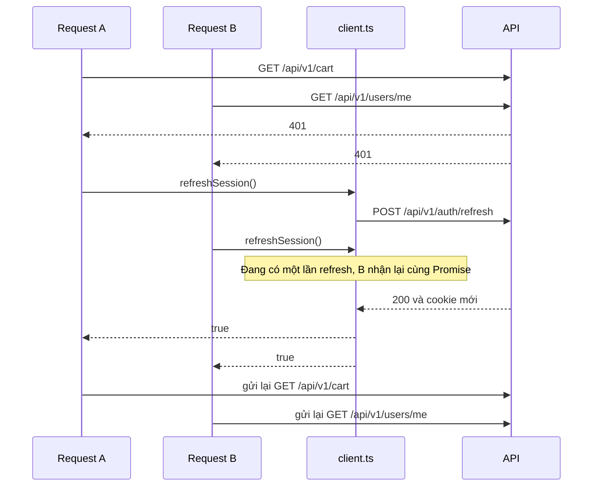

# Phiên đăng nhập

Trang này giải thích cách frontend giữ và làm mới phiên đăng nhập. Frontend không bao giờ đọc token trong JavaScript; toàn bộ phiên nằm trong cookie do backend cấp.

## Các cookie

Backend đặt ba cookie khi đăng nhập ([auth.cookies.ts](https://github.com/QuocDuy21-10/laptopshop-api/blob/main/src/modules/auth/auth.cookies.ts)).

| Cookie | HttpOnly | Path | Dùng để làm gì |
| --- | --- | --- | --- |
| `access_token` | Có | `/` | Chứng nhận ngắn hạn gửi kèm mọi request. Proxy của Next chỉ kiểm tra cookie này có tồn tại. |
| `refresh_token` | Có | `/api/v1/auth` | Chỉ được trình duyệt gửi tới các endpoint auth, dùng để xin phiên mới. |
| `logged_in` | Không | `/` | Dấu hiệu "có phiên", không chứa bí mật. Giúp khách vãng lai bỏ qua lần gọi `/users/me`. |

Cả ba dùng `SameSite=Lax`; `Secure` được bật khi backend chạy ở `production`. Vì JavaScript không đọc được `access_token` và `refresh_token`, frontend không thể và không cần xử lý token.

## Người dùng hiện tại

Hook `useMe` gọi `GET /api/v1/users/me` và là nguồn sự thật về trạng thái đăng nhập ở phía client ([useMe.ts](https://github.com/QuocDuy21-10/laptopshop-web/blob/main/src/features/account/useMe.ts)).

- Nếu `shouldCheckSession()` trả `false`, hook trả `null` mà không gọi API (khách vãng lai).
- Nếu API trả `401`, hook trả `null` thay vì lỗi.
- Kết quả được giữ 60 giây (`staleTime`).

`shouldCheckSession` ([session-hint.ts](https://github.com/QuocDuy21-10/laptopshop-web/blob/main/src/lib/session-hint.ts)) cho phép gọi khi cookie `logged_in` tồn tại. Nếu không có cookie, nó cho phép đúng một lần thử trong mỗi tab (lưu cờ ở `sessionStorage`, khóa `laptopshop.session.probed`) để phiên cũ chưa có cookie vẫn được nhận ra; sau đó khách bị bỏ qua. Nếu `sessionStorage` bị chặn, nó luôn cho phép gọi.

## Refresh single-flight

Access token hết hạn sớm. Khi một request nhận `401`, `authFetch` thử làm mới phiên rồi gửi lại request đó một lần ([client.ts](https://github.com/QuocDuy21-10/laptopshop-web/blob/main/src/lib/api/client.ts#L15-L37)).

Diễn giải:

- Hai request cùng nhận `401` nhưng chỉ có **một** lần gọi `POST /api/v1/auth/refresh`. Biến `refreshing` giữ Promise đang chạy, request thứ hai dùng lại Promise đó.
- Khi refresh xong, mỗi request gửi lại bản sao của chính nó (`request.clone()` được tạo trước lần gửi đầu, nên body vẫn còn).
- Request tới `/api/v1/auth/*` không bao giờ được làm mới hay gửi lại, nên đăng nhập sai mật khẩu hiện lỗi ngay thay vì lặp vô hạn.

### Khi refresh thất bại

1. `refreshSession()` trả `false` (API trả lỗi hoặc mất mạng).
2. `authFetch` gọi `onSessionExpired()` và trả lại phản hồi `401` gốc, không gửi lại.
3. Handler (đăng ký trong [Providers.tsx](https://github.com/QuocDuy21-10/laptopshop-web/blob/main/src/providers/Providers.tsx#L29-L35)) đặt dữ liệu `me` thành `null`; nếu trang hiện tại thuộc nhóm được bảo vệ thì chuyển tới `/login?next=<trang hiện tại>`.

### Vì sao không được thêm đường refresh thứ hai

Backend xoay refresh token mỗi lần dùng. Nếu một token đã bị thu hồi xuất hiện lại, backend coi đó là dấu hiệu bị đánh cắp và thu hồi toàn bộ chuỗi phiên ([token.service.ts](https://github.com/QuocDuy21-10/laptopshop-api/blob/main/src/modules/auth/token.service.ts#L58-L82)). Hai lần refresh chạy song song sẽ làm lần thứ hai dùng token đã bị lần thứ nhất thu hồi, dẫn đến người dùng bị đăng xuất. Vì vậy mọi lần làm mới phải đi qua `refreshSession()`. Nếu thấy người dùng bị đăng xuất ngẫu nhiên, xem [runbook phiên bị thu hồi](../10-operations/runbooks/session-revoked.md).

Các hành vi trên được test trong [client.test.ts](https://github.com/QuocDuy21-10/laptopshop-web/blob/main/tests/lib/client.test.ts): làm mới một lần rồi gửi lại cả body, chia sẻ một lần refresh giữa nhiều `401` đồng thời, báo hết phiên khi refresh thất bại, không làm mới cho endpoint auth.

## Tình huống ngoại lệ

| Tình huống | Điều xảy ra |
| --- | --- |
| Refresh thành công nhưng request gửi lại vẫn `401` | Phản hồi `401` đó được trả về như lỗi bình thường; không refresh lần nữa. |
| Mất mạng khi đang refresh | Coi như refresh thất bại, người dùng bị chuyển về đăng nhập nếu đang ở trang riêng tư. |
| `sessionStorage` bị chặn | `shouldCheckSession` luôn cho phép gọi `/users/me`. |
| Trình duyệt chặn cookie | Không có `access_token`, proxy chuyển mọi route riêng tư về `/login`. |

## Đọc tiếp

- [Routing và bảo vệ route](routing-and-guards.md)
- [Tài liệu tính năng Auth](../04-features/auth.md)
- [Mô hình bảo mật](../11-security/security-model.md)
