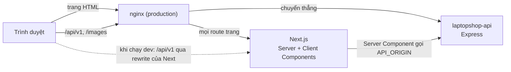

# Tổng quan kiến trúc

Repo này là một ứng dụng Next.js (App Router) gồm hai phần dùng chung một codebase: storefront cho khách hàng và trang quản trị `/admin`. Ứng dụng không có cơ sở dữ liệu riêng; mọi dữ liệu nghiệp vụ đến từ backend [laptopshop-api](https://github.com/QuocDuy21-10/laptopshop-api) qua đường dẫn `/api/v1`.

## Bức tranh tổng thể

- Server Component của Next gọi API trực tiếp bằng `API_ORIGIN` để dựng HTML.
- Component chạy trong trình duyệt gọi cùng origin `/api/v1/*`. Ở production, nginx chuyển thẳng đường dẫn này tới Express; ở máy dev, Next rewrite sang `API_ORIGIN`.
- Sơ đồ chi tiết hơn nằm ở [C4 Container](../07-diagrams/c4-container.md).

## Ai chịu trách nhiệm điều gì

| Việc | Frontend (repo này) | Backend (`laptopshop-api`) |
| --- | --- | --- |
| Hiển thị giao diện, điều hướng | Có | Không |
| Kiểm tra form để người dùng sửa sớm (Zod) | Có | Có, và là bản quyết định |
| Xác thực, cấp và làm mới phiên | Chỉ gọi API và giữ cookie | Có |
| Phân quyền (ai được làm gì) | Chỉ ẩn hoặc chuyển hướng để thuận tiện | Có, trả `403` khi vi phạm |
| Tính giá, giảm giá, tổng tiền | Chỉ hiển thị | Có |
| Tồn kho, trạng thái đơn, trạng thái thanh toán | Chỉ hiển thị và gửi thao tác | Có |
| Lưu đệm dữ liệu để giao diện nhanh | Có (Next, TanStack Query) | Không |

## Cấu trúc `src/`

| Thư mục | Nội dung |
| --- | --- |
| [src/app](https://github.com/QuocDuy21-10/laptopshop-web/tree/main/src/app) | Route và layout, chia ba route group: `(storefront)`, `(auth)`, `(admin)`. |
| [src/features](https://github.com/QuocDuy21-10/laptopshop-web/tree/main/src/features) | Mã theo nghiệp vụ: hook gọi API, schema form, component riêng của module. |
| [src/components](https://github.com/QuocDuy21-10/laptopshop-web/tree/main/src/components) | Thành phần dùng chung, chia `ui` (nút, hộp thoại...), `layout` (header, footer...), `app`, `brand`. |
| [src/lib](https://github.com/QuocDuy21-10/laptopshop-web/tree/main/src/lib) | Client API, xử lý lỗi, query key, tiện ích định dạng và an toàn. |
| [src/providers](https://github.com/QuocDuy21-10/laptopshop-web/tree/main/src/providers) | `Providers.tsx`: TanStack Query, hộp thoại đăng nhập, toast. |
| [src/styles](https://github.com/QuocDuy21-10/laptopshop-web/tree/main/src/styles) | Token thiết kế và mixin SCSS dùng chung. |
| [src/proxy.ts](https://github.com/QuocDuy21-10/laptopshop-web/blob/main/src/proxy.ts) | Chặn người chưa có cookie đăng nhập khỏi các route riêng tư. |

Ba route group chia như sau.

| Route group | Layout | Nội dung |
| --- | --- | --- |
| `(storefront)` | `SiteShell` (header, footer) | Trang chủ, sản phẩm, giỏ hàng, đặt hàng, tài khoản... |
| `(auth)` | Khung riêng, không có header storefront | Đăng nhập, đăng ký, quên mật khẩu. |
| `(admin)` | `AdminProviders` + `AdminGuard` + `AdminShell` (Ant Design) | Mọi trang dưới `/admin`. |

Layout gốc [layout.tsx](https://github.com/QuocDuy21-10/laptopshop-web/blob/main/src/app/layout.tsx) nạp font, bọc `Providers` và đặt `export const dynamic = "force-dynamic"`, nghĩa là mọi trang render theo từng request. Hệ quả với cache được giải thích ở [Rendering và cache](rendering-and-caching.md).

## Đọc tiếp

- [Rendering và cache](rendering-and-caching.md)
- [Phiên đăng nhập](auth-session.md)
- [Routing và bảo vệ route](routing-and-guards.md)
- [Lớp gọi API](../06-api-and-data/api-layer.md)
- [Các sơ đồ hệ thống](../07-diagrams/README.md)
