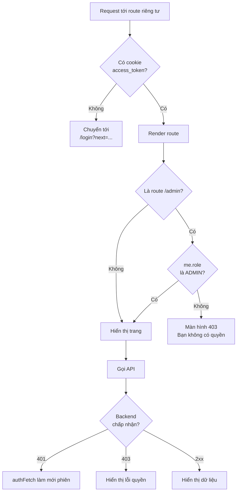

# Routing và bảo vệ route

Trang này mô tả các tầng chặn người dùng chưa đăng nhập hoặc không đủ quyền, và vì sao chỉ tầng cuối cùng (backend) mới là ranh giới bảo mật thật.

## Ba tầng bảo vệ

| Tầng | Ở đâu | Kiểm tra gì | Mục đích |
| --- | --- | --- | --- |
| 1. Proxy | [proxy.ts](https://github.com/QuocDuy21-10/laptopshop-web/blob/main/src/proxy.ts) | Có cookie `access_token` hay không | Chuyển người chưa đăng nhập đi sớm, trước khi render. |
| 2. Guard phía client | `AdminGuard` ([AdminGuard.tsx](https://github.com/QuocDuy21-10/laptopshop-web/blob/main/src/features/admin/AdminGuard.tsx)) và xử lý hết phiên ([Providers.tsx](https://github.com/QuocDuy21-10/laptopshop-web/blob/main/src/providers/Providers.tsx#L29-L35)) | Vai trò của người dùng hiện tại, phiên còn hay hết | Hiển thị đúng giao diện, tránh nháy nội dung. |
| 3. Backend | `laptopshop-api` | Token hợp lệ, vai trò, quyền sở hữu dữ liệu | Ranh giới bảo mật thật; trả `401` hoặc `403`. |

Hai tầng đầu chỉ phục vụ trải nghiệm. Mã trong `AdminGuard` ghi rõ "UX only: the API answers 403 to non-admins, which is the real boundary".

## Tầng 1: proxy

Proxy chạy trước khi render các route sau và chuyển về đăng nhập nếu thiếu cookie `access_token`:

```ts
matcher: ["/cart", "/checkout", "/wishlist", "/account/:path*", "/admin/:path*"]
```

Địa chỉ chuyển tới là `/login?next=<đường dẫn và query ban đầu, đã mã hóa>`.



Diễn giải:

- Có cookie chưa chắc phiên còn hiệu lực. Nếu token hết hạn, trang vẫn render và lần gọi API đầu tiên nhận `401` sẽ kích hoạt [refresh](auth-session.md#refresh-single-flight).
- Người dùng thường mở `/admin` vẫn qua được proxy (có cookie) và bị chặn ở `AdminGuard`, rồi nếu cố gọi API quản trị thì bị backend từ chối.

> [!NOTE]
> Danh sách trong `matcher` phải là mảng literal do yêu cầu của Next, nên được lặp lại trong [guarded-routes.ts](https://github.com/QuocDuy21-10/laptopshop-web/blob/main/src/lib/guarded-routes.ts) (`GUARDED_PREFIXES`) và hai nơi phải giữ đồng bộ. Hai nơi khác nhau về cách khớp: `matcher` khớp chính xác `/cart`, `/checkout`, `/wishlist`, còn `isGuardedPath` khớp theo tiền tố. Hiện chưa có route con nào dưới ba đường dẫn này nên chưa gây khác biệt. Nếu thêm route con, cần sửa `matcher`. Hành vi của `matcher` ở đây suy ra từ cú pháp matcher của Next, chưa kiểm tra bằng cách thêm route thử.

Test: [proxy.test.ts](https://github.com/QuocDuy21-10/laptopshop-web/blob/main/tests/proxy.test.ts) kiểm tra chuyển hướng kèm `next`, cho qua khi có token, và bảo vệ đủ năm nhóm route.

## Tầng 2: guard phía client

### Trang quản trị

Layout `/admin` bọc nội dung theo thứ tự `AntdRegistry`, `AdminProviders`, `AdminGuard`, `AdminShell` ([layout.tsx](https://github.com/QuocDuy21-10/laptopshop-web/blob/main/src/app/%28admin%29/admin/layout.tsx)). `AdminGuard` dùng `useMe` và có bốn trạng thái:

| Trạng thái `useMe` | Hiển thị |
| --- | --- |
| Đang tải | Vòng xoay tải |
| Lỗi tải phiên | Màn hình lỗi "Không tải được phiên đăng nhập" kèm nút "Thử lại" |
| `role` khác `"ADMIN"` (kể cả chưa đăng nhập) | Màn hình 403 "Bạn không có quyền truy cập trang quản trị" |
| `role` là `"ADMIN"` | Nội dung quản trị |

Trong schema, `role` là một chuỗi (`string`), và guard so sánh với `"ADMIN"`. Danh sách vai trò chi tiết xem [tài liệu Admin](../04-features/admin.md).

### Khi phiên hết hạn giữa chừng

Khi refresh thất bại, handler đăng ký trong `Providers` đặt `me = null` và, nếu `isGuardedPath(pathname)` đúng, chuyển người dùng tới `loginHref(pathname + search)`. Trang công khai không bị chuyển, người dùng chỉ thấy trạng thái chưa đăng nhập.

## Tham số `next` và chống chuyển hướng ngoài trang

Sau khi đăng nhập hoặc đăng ký, người dùng được đưa về đường dẫn `next`. Giá trị này đi qua `safeNext` ([safe-next.ts](https://github.com/QuocDuy21-10/laptopshop-web/blob/main/src/lib/safe-next.ts)), chỉ chấp nhận đường dẫn cùng site:

| Giá trị `next` | Kết quả |
| --- | --- |
| `/account/orders?page=2` | Giữ nguyên |
| `https://evil.example/` | `/` (không bắt đầu bằng `/`) |
| `//evil.example` | `/` (bắt đầu bằng `//`) |
| `/\evil.example` | `/` (bắt đầu bằng `/\`) |
| Rỗng hoặc thiếu | `/` |

`safeNext` được dùng ở trang [login](https://github.com/QuocDuy21-10/laptopshop-web/blob/main/src/app/%28auth%29/login/page.tsx) và [register](https://github.com/QuocDuy21-10/laptopshop-web/blob/main/src/app/%28auth%29/register/page.tsx). `loginHref(next)` là hàm tạo liên kết đăng nhập có `next` đã mã hóa, dùng ở handler hết phiên, menu tài khoản, hộp thoại mời đăng nhập và trang yêu thích. Riêng `proxy.ts` tự dựng địa chỉ với cùng định dạng `?next=`.

## Hộp thoại mời đăng nhập (AuthPrompt)

Khi khách vãng lai bấm thao tác cần đăng nhập, `AuthPromptProvider` mở hộp thoại thay vì chuyển trang ngay ([AuthPromptProvider.tsx](https://github.com/QuocDuy21-10/laptopshop-web/blob/main/src/features/auth/AuthPrompt/AuthPromptProvider.tsx)). Có bốn lý do: `cart`, `wishlist`, `review`, `helpful`. Với `cart` và `wishlist`, thao tác được lưu lại và thực hiện tiếp sau khi đăng nhập; `review` và `helpful` thì không. Chi tiết ở [Giỏ hàng](../04-features/cart.md) và [Auth](../04-features/auth.md).

## Đọc tiếp

- [Phiên đăng nhập](auth-session.md)
- [Danh sách route](../12-reference/routes.md)
- [Mô hình bảo mật](../11-security/security-model.md)
