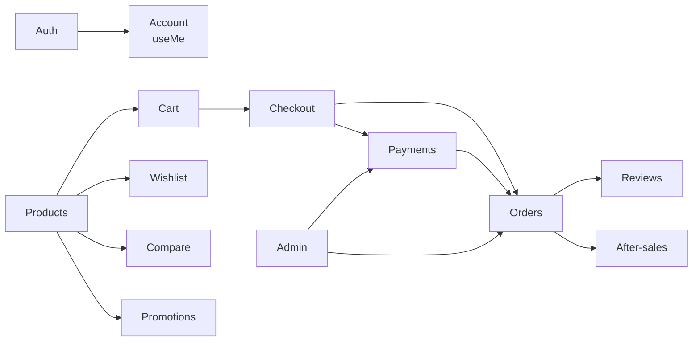

# Danh sách module

Ứng dụng chia thành 18 module nghiệp vụ trong [src/features](https://github.com/QuocDuy21-10/laptopshop-web/tree/main/src/features). Mười bốn module đã có tài liệu đầy đủ theo [mẫu feature](https://github.com/QuocDuy21-10/laptopshop-web/blob/main/docs/templates/feature.md); các module còn lại nằm trong [Lộ trình](../12-reference/roadmap.md).

## Đã có tài liệu

| Module | Mô tả | Route chính | Data dictionary |
| --- | --- | --- | --- |
| [Auth](auth.md) | Đăng ký, đăng nhập, quên mật khẩu, hộp thoại mời đăng nhập | `/login`, `/register`, `/forgot-password` | [auth](../06-api-and-data/data-dictionary/auth.md) |
| [Products](products.md) | Tìm, lọc, sắp xếp, chi tiết sản phẩm, gợi ý tìm kiếm | `/products`, `/products/[id]` | [products](../06-api-and-data/data-dictionary/products.md) |
| [Cart](cart.md) | Giỏ hàng, thêm vào giỏ, ý định chờ đăng nhập | `/cart` | [cart](../06-api-and-data/data-dictionary/cart.md) |
| [Checkout](checkout.md) | Báo giá, mã giảm giá, đặt hàng, chống đặt trùng | `/checkout` | [checkout](../06-api-and-data/data-dictionary/checkout.md) |
| [Payments](payments.md) | Thanh toán chuyển khoản bằng mã QR, theo dõi trạng thái, đối soát | `/account/orders/[id]/payment`, `/admin/payments` | [payments](../06-api-and-data/data-dictionary/payments.md) |
| [Orders](orders.md) | Danh sách, chi tiết, hủy đơn | `/account/orders` | [orders](../06-api-and-data/data-dictionary/orders.md) |
| [After-sales](after-sales.md) | Yêu cầu bảo hành và hỗ trợ kỹ thuật theo thiết bị, báo giá, tin nhắn, ảnh | `/account/after-sales`, `/account/warranties`, `/admin/after-sales` | [after-sales](../06-api-and-data/data-dictionary/after-sales.md) |
| [Reviews](reviews.md) | Đánh giá có ảnh, bình chọn hữu ích, trả lời chính thức, kiểm duyệt | trang chi tiết sản phẩm, `/admin/reviews` | [reviews](../06-api-and-data/data-dictionary/reviews.md) |
| [Wishlist](wishlist.md) | Danh sách yêu thích, cảnh báo giá, ý định chờ đăng nhập | `/wishlist` | [wishlist](../06-api-and-data/data-dictionary/wishlist.md) |
| [Promotions](promotions.md) | Mã giảm giá, giảm tự động, Flash Sale, giá đã giảm | `/promotions`, `/admin/promotions` | [promotions](../06-api-and-data/data-dictionary/promotions.md) |
| [Home](home.md) | Các khối trang chủ, banner do admin điều khiển, cô lập lỗi từng khối | `/`, `/admin/home-banners` | [home](../06-api-and-data/data-dictionary/home.md) |
| [Notifications](notifications.md) | Thông báo trong ứng dụng, tùy chọn kênh, Web Push, thử lại gửi thất bại | `/account/notifications`, `/admin/notifications` | [notifications](../06-api-and-data/data-dictionary/notifications.md) |
| [Compare](compare.md) | So sánh thông số tối đa 4 laptop, danh sách lưu ở trình duyệt | `/compare` | [compare](../06-api-and-data/data-dictionary/compare.md) |
| [Admin](admin.md) | Khung quản trị và các module vận hành | `/admin/*` | [admin](../06-api-and-data/data-dictionary/admin.md) |

## Chưa có tài liệu riêng

| Module | Mô tả (theo route và mã nguồn) | Route chính |
| --- | --- | --- |
| account | Hồ sơ người dùng, hook `useMe` | `/account` |
| advisor | Tư vấn chọn laptop theo ngân sách và nhu cầu | `/advisor` |
| newsletter | Đăng ký, xác nhận, hủy nhận ưu đãi qua email | `/newsletter/confirm`, `/newsletter/unsubscribe` |
| store-info | Thông tin cửa hàng hiển thị ở chân trang | chân trang |

Mọi route liệt kê ở [Danh sách route](../12-reference/routes.md).

## Quan hệ giữa các module

Các mũi tên mô tả luồng người dùng đi qua các module; phụ thuộc mã nguồn thực tế giữa các feature ở [Component frontend](../07-diagrams/components.md).

## Cấu trúc một trang tính năng

Mỗi trang tính năng theo cùng 13 mục: Tổng quan, Actors và use cases, Hành trình người dùng, Luồng nghiệp vụ, Business rules, Sơ đồ, API requests/responses, Data contracts, UI states và xử lý lỗi, Edge cases, Bảo mật, Tham chiếu mã nguồn, Tài liệu liên quan. Mục không áp dụng được ghi rõ lý do thay vì bỏ trống.
