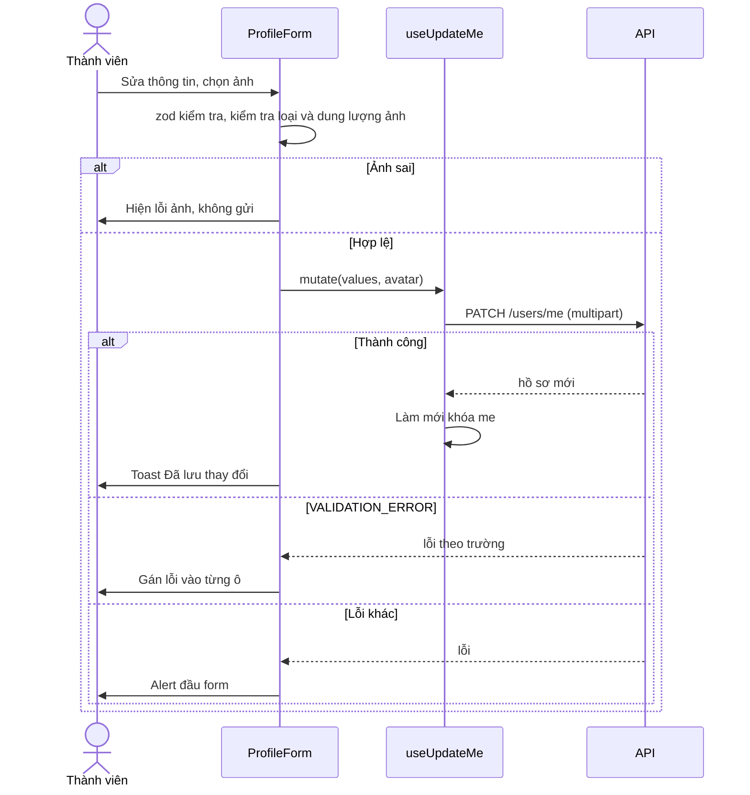

# Tài khoản (Account)

Trang hồ sơ `/account` cho thành viên xem và sửa họ tên, số điện thoại, địa chỉ, ảnh đại diện. Module này cũng cung cấp hook `useMe` (thông tin phiên đăng nhập) được dùng khắp ứng dụng. Email là tên đăng nhập và không sửa được ở đây. Xác minh email nằm ở phần cài đặt thông báo.

## Tổng quan

| Mục | Giá trị |
| --- | --- |
| Mã nguồn | [src/features/account](https://github.com/QuocDuy21-10/laptopshop-web/tree/main/src/features/account) |
| Route | `/account` (cần đăng nhập; [page.tsx](https://github.com/QuocDuy21-10/laptopshop-web/blob/main/src/app/%28storefront%29/account/page.tsx)) |
| Điều hướng tài khoản | [AccountNav](https://github.com/QuocDuy21-10/laptopshop-web/blob/main/src/components/layout/AccountNav/AccountNav.tsx): Hồ sơ, Đơn hàng, Bảo hành, Hậu mãi, Thông báo |
| Hook dùng chung | `useMe`, dùng cho wishlist, thông báo, giỏ, đánh giá, header |
| Backend | [users](https://github.com/QuocDuy21-10/laptopshop-api/tree/main/src/modules/users), [email-verification](https://github.com/QuocDuy21-10/laptopshop-api/tree/main/src/modules/email-verification) |
| Test | [ProfileForm.test.tsx](https://github.com/QuocDuy21-10/laptopshop-web/blob/main/tests/features/ProfileForm.test.tsx) |

## Actors và use cases

| Actor | Use case | Route |
| --- | --- | --- |
| Thành viên | Xem và sửa hồ sơ, đổi ảnh đại diện | `/account` |
| Thành viên | Xác minh email bằng mã 6 chữ số | `/account/notifications/settings` ([Notifications](notifications.md)) |
| Mọi trang | Biết người dùng đang đăng nhập hay không (`useMe`) | |

## Hành trình người dùng

1. Thành viên vào `/account`; trang hiện biểu mẫu với dữ liệu hiện có.
2. Sửa họ tên, số điện thoại, địa chỉ; tùy chọn chọn ảnh đại diện mới.
3. Bấm "Lưu thay đổi"; thành công hiện toast "Đã lưu thay đổi" và dữ liệu `useMe` được làm mới.
4. Để bật thông báo email, người dùng xác minh email ở cài đặt thông báo.

## Luồng nghiệp vụ

| Việc | Frontend | Backend |
| --- | --- | --- |
| Lấy hồ sơ | `GET /users/me` | Trả `Me` của phiên |
| Cập nhật | `PATCH /users/me` dạng multipart (trường văn bản và `avatar`) | Kiểm tra, lưu, trả hồ sơ mới |
| Ảnh đại diện | Kiểm tra loại và dung lượng trước khi gửi | Multer kiểm tra lại loại và dung lượng |
| Xác minh email | Hộp thoại OTP | Sinh, gửi, kiểm tra mã; xem [Notifications](notifications.md) |
| Hỏi phiên | `useMe` bỏ qua cuộc gọi nếu không có dấu hiệu đăng nhập | |

## Business rules

| Quy tắc | Thực thi bởi | Nguồn |
| --- | --- | --- |
| Họ tên bắt buộc, tối đa 255 ký tự | Web (zod); API chỉ yêu cầu 1 đến 255 khi có gửi | [schema.ts](https://github.com/QuocDuy21-10/laptopshop-web/blob/main/src/features/account/schema.ts#L4), [users.schema.ts](https://github.com/QuocDuy21-10/laptopshop-api/blob/main/src/modules/users/users.schema.ts#L5) |
| Số điện thoại: 8 đến 20 ký tự gồm chữ số, `+ ( ) . -` và khoảng trắng, hoặc để trống | Web; API chỉ giới hạn 20 ký tự | [schema.ts](https://github.com/QuocDuy21-10/laptopshop-web/blob/main/src/features/account/schema.ts#L5-L8), [users.schema.ts](https://github.com/QuocDuy21-10/laptopshop-api/blob/main/src/modules/users/users.schema.ts#L6) |
| Địa chỉ tối đa 255 ký tự | Web và API | [schema.ts](https://github.com/QuocDuy21-10/laptopshop-web/blob/main/src/features/account/schema.ts#L9), [users.schema.ts](https://github.com/QuocDuy21-10/laptopshop-api/blob/main/src/modules/users/users.schema.ts#L7) |
| Ảnh đại diện: PNG hoặc JPEG, tối đa 3 MB | Web và API | [schema.ts](https://github.com/QuocDuy21-10/laptopshop-web/blob/main/src/features/account/schema.ts#L13-L14), [multer.ts](https://github.com/QuocDuy21-10/laptopshop-api/blob/main/src/middlewares/multer.ts#L19-L26) |
| Người dùng không tự sửa email, vai trò hay loại tài khoản: `updateMeBody` chỉ nhận `fullName`, `phone`, `address` | API | [users.schema.ts](https://github.com/QuocDuy21-10/laptopshop-api/blob/main/src/modules/users/users.schema.ts#L4-L8) |
| Mã xác minh email gồm đúng 6 chữ số | Web và API | [email-verification.schema.ts](https://github.com/QuocDuy21-10/laptopshop-api/blob/main/src/modules/email-verification/email-verification.schema.ts#L3-L5) |
| Yêu cầu mã mới phải cách ít nhất 60 giây (`EMAIL_OTP_RATE_LIMITED`, 429) | API | [email-verification.service.ts](https://github.com/QuocDuy21-10/laptopshop-api/blob/main/src/modules/email-verification/email-verification.service.ts#L47-L57) |
| Nhập sai mã từ 5 lần thì khóa (`EMAIL_OTP_LOCKED`, 429); mã hết hạn là `EMAIL_OTP_EXPIRED` | API | [email-verification.service.ts](https://github.com/QuocDuy21-10/laptopshop-api/blob/main/src/modules/email-verification/email-verification.service.ts#L105-L116) |
| Email đã xác minh thì không yêu cầu lại (`EMAIL_ALREADY_VERIFIED`, 409) | API | [email-verification.service.ts](https://github.com/QuocDuy21-10/laptopshop-api/blob/main/src/modules/email-verification/email-verification.service.ts#L44-L45) |
| Gửi email tắt hoặc chưa cấu hình: `EMAIL_DELIVERY_UNAVAILABLE` (503) | API | [email-verification.service.ts](https://github.com/QuocDuy21-10/laptopshop-api/blob/main/src/modules/email-verification/email-verification.service.ts#L28-L37) |
| `useMe` chỉ gọi API khi có cookie `logged_in`, hoặc một lần mỗi tab nếu chưa có; 401 coi là chưa đăng nhập | Web | [useMe.ts](https://github.com/QuocDuy21-10/laptopshop-web/blob/main/src/features/account/useMe.ts#L10-L23), [session-hint.ts](https://github.com/QuocDuy21-10/laptopshop-web/blob/main/src/lib/session-hint.ts#L10-L21) |

## Sơ đồ

Lỗi theo trường đi qua `applyFieldErrors`; lỗi còn lại qua `errorMessage` ([ProfileForm.tsx](https://github.com/QuocDuy21-10/laptopshop-web/blob/main/src/features/account/ProfileForm/ProfileForm.tsx#L38-L47)).

## API requests/responses

| Method | Path | Auth | Request | Response | Lỗi thường gặp |
| --- | --- | --- | --- | --- | --- |
| GET | `/api/v1/users/me` | Có | | `{ data: Me }` | `401` (web coi là chưa đăng nhập) |
| PATCH | `/api/v1/users/me` | Có | multipart: `fullName`, `phone`, `address`, `avatar` | hồ sơ mới | `400 VALIDATION_ERROR` |
| POST | `/api/v1/me/email-verification/request` | Có | | `{ accepted }` | `409 EMAIL_ALREADY_VERIFIED`, `429 EMAIL_OTP_RATE_LIMITED`, `503 EMAIL_DELIVERY_UNAVAILABLE` |
| POST | `/api/v1/me/email-verification/confirm` | Có | `{ code }` | `{ verified }` | `400 EMAIL_OTP_INVALID`, `400 EMAIL_OTP_EXPIRED`, `429 EMAIL_OTP_LOCKED` |

## Data contracts

`Me` và `ProfileInput` ở [Data dictionary: Account](../06-api-and-data/data-dictionary/account.md). Hai endpoint xác minh email được gọi từ [Notifications](notifications.md).

## UI states và xử lý lỗi

- Đang tải: `Skeleton`. Lỗi: `Alert` qua `errorMessage`. `me` là `null` (phiên đã hết): vẫn hiện `Skeleton` vì bộ xử lý phiên hết hạn đang chuyển tới trang đăng nhập ([AccountProfile.tsx](https://github.com/QuocDuy21-10/laptopshop-web/blob/main/src/features/account/AccountProfile.tsx#L12-L16)).
- Nút "Lưu thay đổi" có trạng thái đang gửi. Ô email bị khóa và chỉ đọc ([ProfileForm.tsx](https://github.com/QuocDuy21-10/laptopshop-web/blob/main/src/features/account/ProfileForm/ProfileForm.tsx#L82)).
- Ảnh sai loại hoặc quá 3 MB: thông báo "Chỉ chấp nhận ảnh JPEG hoặc PNG" hoặc "Ảnh tối đa 3 MB" kèm `role="alert"`, và không cho gửi ([ProfileForm.tsx](https://github.com/QuocDuy21-10/laptopshop-web/blob/main/src/features/account/ProfileForm/ProfileForm.tsx#L29-L40)).
- Ô trống (số điện thoại, địa chỉ) được gửi dưới dạng chuỗi rỗng, theo cách `toFormData` bỏ qua `null` và `undefined` ([multipart.ts](https://github.com/QuocDuy21-10/laptopshop-web/blob/main/src/lib/api/multipart.ts#L4-L8)).

## Edge cases

- Chọn lại ảnh hoặc bỏ chọn: ảnh cũ bị xóa khỏi trạng thái trước khi kiểm tra ảnh mới ([ProfileForm.tsx](https://github.com/QuocDuy21-10/laptopshop-web/blob/main/src/features/account/ProfileForm/ProfileForm.tsx#L29-L36)).
- Người dùng mới chưa có họ tên: ô họ tên trống và bắt buộc khi lưu; đánh giá công khai cũng cần họ tên ([Reviews](reviews.md)).
- Khách chưa đăng nhập: `useMe` trả `null` không gọi API nếu không có dấu hiệu phiên (tránh 401 thừa).
- Admin đổi email của người dùng: tùy chọn email thông báo bị tắt và mã OTP đang chờ bị hủy ([Notifications](notifications.md)).

## Bảo mật

- `/account/*` bị chặn ở [proxy.ts](https://github.com/QuocDuy21-10/laptopshop-web/blob/main/src/proxy.ts) khi chưa có cookie phiên; quyền thật do backend (`authenticate`).
- Cookie `logged_in` chỉ là gợi ý cho giao diện, không chứa bí mật ([session-hint.ts](https://github.com/QuocDuy21-10/laptopshop-web/blob/main/src/lib/session-hint.ts#L1-L2)).
- Người dùng chỉ sửa được hồ sơ của chính mình; không có trường email, vai trò trong body nên không thể leo quyền qua endpoint này.
- Ảnh đại diện được kiểm tra loại ở cả hai phía.

## Tham chiếu mã nguồn

- Web: [useMe.ts](https://github.com/QuocDuy21-10/laptopshop-web/blob/main/src/features/account/useMe.ts), [useUpdateMe.ts](https://github.com/QuocDuy21-10/laptopshop-web/blob/main/src/features/account/useUpdateMe.ts), [schema.ts](https://github.com/QuocDuy21-10/laptopshop-web/blob/main/src/features/account/schema.ts), [ProfileForm.tsx](https://github.com/QuocDuy21-10/laptopshop-web/blob/main/src/features/account/ProfileForm/ProfileForm.tsx).
- Backend: [users.schema.ts](https://github.com/QuocDuy21-10/laptopshop-api/blob/main/src/modules/users/users.schema.ts), [users.service.ts](https://github.com/QuocDuy21-10/laptopshop-api/blob/main/src/modules/users/users.service.ts), [email-verification.service.ts](https://github.com/QuocDuy21-10/laptopshop-api/blob/main/src/modules/email-verification/email-verification.service.ts).
- Cấu trúc bảng thuộc backend: [schema.prisma](https://github.com/QuocDuy21-10/laptopshop-api/blob/main/prisma/schema.prisma).

> [!WARNING]
> **Chưa xác minh:** (1) đường dẫn lưu và cách phục vụ ảnh đại diện (`avatar` chỉ biết là chuỗi đường dẫn); (2) thời hạn hiệu lực của mã OTP (`expiresAt`) và nội dung email; (3) cách `getMeHandler` tính `cartItemCount` trong `Me`; (4) việc đổi mật khẩu khi đang đăng nhập (chưa thấy trong module này).

## Tài liệu liên quan

- [Auth](auth.md): đăng nhập, phiên, làm mới token.
- [Notifications](notifications.md): xác minh email và cài đặt kênh.
- [Orders](orders.md), [After-sales](after-sales.md): các mục khác trong khu tài khoản.
