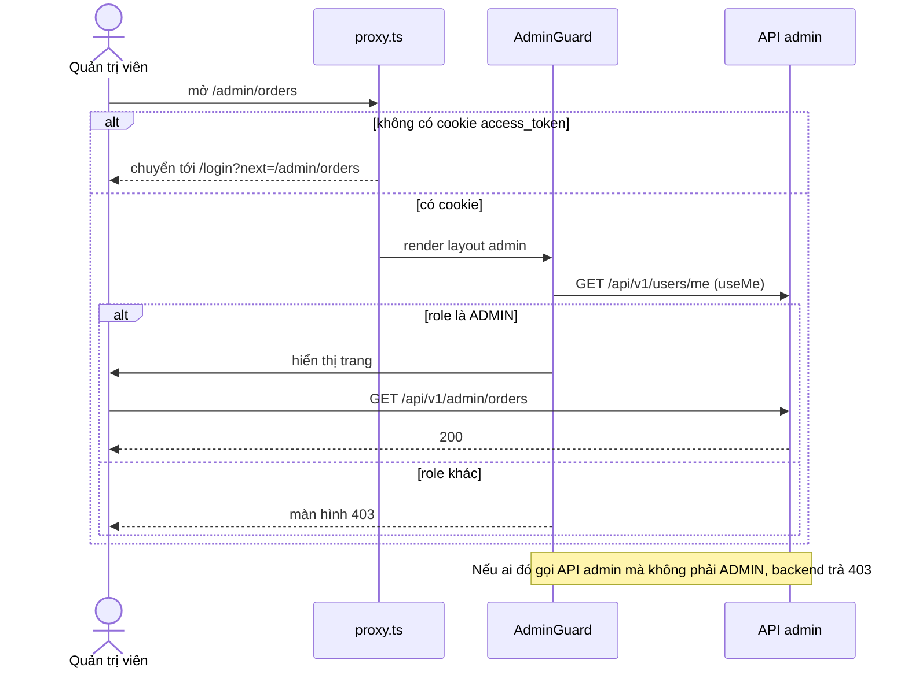
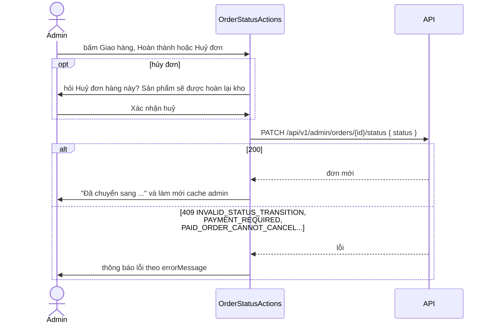

# Quản trị (Admin)

Trang quản trị nằm dưới `/admin`, dành cho nhân viên cửa hàng có vai trò `ADMIN`. Đây là phần duy nhất của ứng dụng dùng Ant Design (CSS-in-JS), tách biệt hẳn khỏi storefront. Trang này mô tả khung dùng chung và ba nghiệp vụ trọng tâm: **đơn hàng**, **sản phẩm** và **kho**. Các module còn lại được tóm tắt trong bảng.

## Tổng quan

| Mục | Giá trị |
| --- | --- |
| Mã nguồn | [src/features/admin](https://github.com/QuocDuy21-10/laptopshop-web/tree/main/src/features/admin), [src/app/%28admin%29/admin](https://github.com/QuocDuy21-10/laptopshop-web/tree/main/src/app/%28admin%29/admin) |
| Route | `/admin` và các route con (25 trang) |
| Thư viện | Ant Design 6.6.6, `@ant-design/nextjs-registry`, Recharts (xem [Tech stack](../03-tech-stack/stack.md)) |
| Theme | [theme.ts](https://github.com/QuocDuy21-10/laptopshop-web/blob/main/src/features/admin/theme.ts) phản chiếu token trong `_tokens.scss` |

## Actors và use cases

| Actor | Use case |
| --- | --- |
| Quản trị viên (`ADMIN`) | Xem số liệu tổng quan; quản lý đơn, thanh toán, sản phẩm, kho, khuyến mãi, người dùng, đánh giá, hậu mãi, banner, thông báo, bản tin |
| Người dùng thường | Không có quyền; vào `/admin` thấy màn hình 403 |
| Khách vãng lai | Bị chuyển về `/login?next=...` |

## Hành trình người dùng

1. Quản trị viên đăng nhập, vào `/admin` và thấy trang tổng quan.
2. Menu bên trái chia nhóm: **Bán hàng**, **Danh mục**, **Khách hàng**, **Hệ thống**.
3. Mỗi danh sách có bộ lọc và phân trang lưu trên URL, nên tải lại hoặc quay lại vẫn giữ nguyên trạng thái.
4. Thao tác thay đổi (lưu, đổi trạng thái, xóa) có thông báo kết quả; thao tác nguy hiểm có hộp thoại xác nhận.

## Luồng nghiệp vụ

| Việc | Frontend | Backend |
| --- | --- | --- |
| Truy cập | `AdminGuard` kiểm tra `role` | Mọi `/api/v1/admin/*` yêu cầu đăng nhập và vai trò `ADMIN` |
| Danh sách | Lưu bộ lọc, trang trên URL | Lọc, phân trang, sắp xếp |
| Thay đổi dữ liệu | Gọi API, làm mới nhóm cache `admin` | Kiểm tra và áp dụng |
| Xuất dữ liệu | `downloadCsv` | Sinh file CSV |

## Business rules

| Quy tắc | Thực thi bởi | Nguồn |
| --- | --- | --- |
| Mọi route `/api/v1/admin/*` yêu cầu đăng nhập và vai trò `ADMIN` | API | [routes/index.ts](https://github.com/QuocDuy21-10/laptopshop-api/blob/main/src/routes/index.ts#L92) |
| `AdminGuard` chỉ cho vai trò `ADMIN` vào; đây là kiểm tra tiện lợi, không phải ranh giới bảo mật | Web | [AdminGuard.tsx](https://github.com/QuocDuy21-10/laptopshop-web/blob/main/src/features/admin/AdminGuard.tsx#L9-L38) |
| Mỗi trang danh sách có 10 mục | Web | `ADMIN_PAGE_SIZE` trong [useListParams.ts](https://github.com/QuocDuy21-10/laptopshop-web/blob/main/src/features/admin/useListParams.ts#L5) |
| Bộ lọc và trang nằm trên URL; đổi bộ lọc đưa về trang 1; gõ trong ô tìm kiếm dùng `replace` để không tạo nhiều mục lịch sử | Web | cùng file |
| Mutation của admin làm mới nhóm cache `admin` (mọi danh sách, chi tiết, dashboard); đã xác nhận ở sản phẩm, kho, thanh toán | Web | chú thích trong [query-keys.ts](https://github.com/QuocDuy21-10/laptopshop-web/blob/main/src/lib/api/query-keys.ts), [products/hooks.ts](https://github.com/QuocDuy21-10/laptopshop-web/blob/main/src/features/admin/products/hooks.ts#L32) |
| Màu và kiểu chữ của Ant Design lấy từ theme phản chiếu token | Web | [theme.ts](https://github.com/QuocDuy21-10/laptopshop-web/blob/main/src/features/admin/theme.ts) |

## Sơ đồ

### Các tầng truy cập

Chi tiết các tầng ở [Routing và bảo vệ route](../02-architecture/routing-and-guards.md).

### Chuyển trạng thái đơn hàng (admin)

## Các module

| Module | Route | Chức năng chính | Hook (thư mục) | Ghi chú nổi bật |
| --- | --- | --- | --- | --- |
| Tổng quan | `/admin` | Số người dùng, sản phẩm, đơn, doanh thu, sắp hết hàng, hết hàng; đơn theo trạng thái; biểu đồ doanh số | `dashboard` | Liên kết tới danh sách đã lọc (ví dụ `/admin/orders?status=...`) |
| Đơn hàng | `/admin/orders`, `/admin/orders/[id]` | Lọc theo trạng thái, tìm kiếm, khoảng ngày; xuất CSV; đổi trạng thái | `orders` | Xem mục "Đơn hàng" bên dưới |
| Đối soát thanh toán | `/admin/payments` | Giao dịch bất thường; đơn chờ xác minh | `payments` | Xem [Payments](payments.md) |
| Khuyến mãi | `/admin/promotions` (+ `new`, `[id]`) | Tạo, sửa, đổi trạng thái; xem thống kê, lượt dùng, phân bổ flash sale | `promotions` | Loại `COUPON`, `AUTOMATIC`, `FLASH_SALE`; trạng thái `DRAFT`, `ACTIVE`, `PAUSED`, `ENDED` (theo backend) |
| Sản phẩm | `/admin/products` (+ `new`, `[id]`) | Danh sách, tạo, sửa, xóa | `products` | Xem mục "Sản phẩm" bên dưới |
| Kho hàng | `/admin/inventory` (+ `receipts`) | Nhật ký kho; phiếu nhập; điều chỉnh tồn kho | `inventory` | Xem mục "Kho" bên dưới |
| Người dùng | `/admin/users` (+ `[id]`) | Danh sách, thêm, sửa, xóa; gán vai trò | `users` | `CANNOT_CHANGE_OWN_ROLE`, `CANNOT_DELETE_SELF`, `USER_HAS_ORDERS` |
| Đăng ký nhận tin | `/admin/newsletter` | Danh sách người đăng ký | `newsletter` | Trạng thái `PENDING`, `CONFIRMED`, `UNSUBSCRIBED` (theo backend) |
| Đánh giá | `/admin/reviews` (+ `[id]`) | Kiểm duyệt (ẩn, hiện), trả lời chính thức, thống kê | `reviews` | Trạng thái `PUBLISHED`, `HIDDEN` (theo backend) |
| Bảo hành và hậu mãi | `/admin/after-sales` (+ `[id]`) | Danh sách yêu cầu, phân công, trạng thái từng thiết bị, báo giá, tin nhắn, ghi chú, ảnh đính kèm, xác minh bảo hành | `after-sales` | Loại `WARRANTY`, `TECHNICAL_SUPPORT` |
| Banner trang chủ | `/admin/home-banners` (+ `new`, `[id]`) | Tạo, sửa, xóa banner, tải ảnh | `home-banners` | Vị trí `HERO`, `SIDE` (theo backend) |
| Thông báo | `/admin/notifications` | Xem tình trạng vận hành và thử lại gửi thông báo thất bại | `notifications` | Gọi `GET /admin/notifications/operations` và `POST /admin/notification-deliveries/{id}/retry` |

Các trang chi tiết riêng cho khuyến mãi, người dùng, đánh giá, hậu mãi, banner, thông báo và bản tin chưa được viết (xem [Lộ trình](../12-reference/roadmap.md)); bảng trên chỉ tổng hợp từ route, hook và nhãn.

### Đơn hàng

- Bộ lọc: trạng thái (`PENDING`, `SHIPPING`, `COMPLETED`, `CANCELLED`), từ khóa `q`, khoảng ngày `from` và `to`. Cùng bộ lọc này được dùng cho nút "Xuất CSV" (`GET /api/v1/admin/orders/export.csv`).
- Hành động theo trạng thái ([transitions.ts](https://github.com/QuocDuy21-10/laptopshop-web/blob/main/src/features/admin/orders/transitions.ts)):

  | Trạng thái hiện tại | Hành động |
  | --- | --- |
  | `PENDING` | "Giao hàng" (sang `SHIPPING`), "Huỷ đơn" |
  | `SHIPPING` | "Hoàn thành" (sang `COMPLETED`), "Huỷ đơn" |
  | `COMPLETED`, `CANCELLED` | Không có |

- Hủy đơn có hộp thoại xác nhận "Huỷ đơn hàng này? Sản phẩm sẽ được hoàn lại kho."
- Quy tắc phía backend: giao hoặc hoàn thành đơn chuyển khoản chưa thanh toán thành công bị từ chối `PAYMENT_REQUIRED`; đơn chuyển khoản đã thanh toán không hủy được; đơn COD khi hoàn thành tự đặt thanh toán thành công và tính ngày bảo hành ([orders.service.ts](https://github.com/QuocDuy21-10/laptopshop-api/blob/main/src/modules/orders/orders.service.ts#L337-L417)). Sơ đồ ở [State machine](../07-diagrams/state-machines.md).
- Bảng `NEXT_STATUS` của web phản chiếu `TRANSITIONS` của backend; nếu hai bên lệch nhau, backend quyết định.

### Sản phẩm

- Danh sách, tạo và sửa dùng `multipart/form-data` vì có ảnh ([multipart.ts](https://github.com/QuocDuy21-10/laptopshop-web/blob/main/src/lib/api/multipart.ts)).
- Quy tắc form ([ProductForm.tsx](https://github.com/QuocDuy21-10/laptopshop-web/blob/main/src/features/admin/products/ProductForm.tsx)):
  - Tên: bắt buộc, tối đa 255 ký tự. Mô tả ngắn: bắt buộc, tối đa 255. Mô tả chi tiết: bắt buộc.
  - Giá: số nguyên từ 1 đến 2.147.483.647 (cột `INT` của MySQL).
  - Hãng và nhu cầu: bắt buộc.
  - Số lượng: nhập khi tạo mới (0 đến 2.147.483.647). Khi sửa, số lượng chỉ xem; đổi tồn kho phải qua "Điều chỉnh kho" để có nhật ký.
  - Ảnh: JPEG hoặc PNG, một ảnh; khi sửa để trống thì giữ ảnh cũ.
  - Một số thông số (hãng CPU, hãng GPU, loại GPU...) phụ thuộc việc đã nhập CPU hoặc GPU tương ứng.
- Khi bỏ trống một thông số lúc sửa, form gửi chuỗi rỗng để backend xóa giá trị (vì `toFormData` bỏ qua `null`).
- Xóa sản phẩm đã có lịch sử đơn hoặc kho bị từ chối `PRODUCT_IN_USE`; thông báo gợi ý ẩn sản phẩm thay vì xóa.

### Kho

- **Nhật ký kho** (`/admin/inventory`): danh sách biến động tồn kho, lọc theo sản phẩm. Lý do biến động ([labels.ts](https://github.com/QuocDuy21-10/laptopshop-web/blob/main/src/features/admin/inventory/labels.ts)): `OPENING` Số dư đầu kỳ, `INITIAL` Tồn ban đầu, `ORDER` Bán hàng, `ORDER_CANCEL` Huỷ đơn, `RESTOCK` Nhập hàng, `CORRECTION` Điều chỉnh kiểm kê.
- **Điều chỉnh tồn kho** (`StockAdjustModal`): chọn loại "Nhập hàng" (`RESTOCK`, số dương) hoặc "Điều chỉnh kiểm kê" (`CORRECTION`, khác 0); số lượng thay đổi tối đa 10.000; ghi chú bắt buộc, tối đa 500 ký tự. Gửi kèm `Idempotency-Key`: cùng nội dung thì giữ cùng khóa, nội dung đổi thì khóa mới, nên bấm lại sau lỗi mạng không điều chỉnh hai lần. Backend từ chối nếu tồn kho sẽ âm.
- **Phiếu nhập kho** (`/admin/inventory/receipts`): tạo phiếu nháp, sửa, rồi "post" để cộng kho. Trạng thái `DRAFT` rồi `POSTED`. Phiếu có `version` để chống ghi đè: hai người sửa cùng lúc thì người sau nhận `RECEIPT_VERSION_CONFLICT` ("Phiếu đã được người khác cập nhật. Đã tải lại bản mới nhất."). Phiếu rỗng không post được (`EMPTY_RECEIPT`). Mỗi dòng: số lượng 1 đến 10.000, giá vốn tùy chọn; một sản phẩm chỉ xuất hiện một lần trong phiếu ([inventory-receipts.service.ts](https://github.com/QuocDuy21-10/laptopshop-api/blob/main/src/modules/inventory/inventory-receipts.service.ts)).
- Post phiếu ghi biến động với lý do `RESTOCK` cho từng dòng.

## API requests/responses

Mỗi module gọi các endpoint `GET/POST/PATCH/PUT/DELETE /api/v1/admin/...` theo bảng bên dưới (trích từ hook của từng module).

| Module | Endpoint |
| --- | --- |
| Tổng quan | `GET /dashboard`, `GET /dashboard/sales` |
| Đơn hàng | `GET /orders`, `GET /orders/{id}`, `PATCH /orders/{id}/status`, `GET /orders/export.csv` |
| Thanh toán | xem [Payments](payments.md) |
| Sản phẩm | `GET /products`, `GET /products/{id}`, `POST /products` (multipart), `PATCH /products/{id}` (multipart), `DELETE /products/{id}` |
| Kho | `GET /inventory/movements`, `POST /inventory/adjustments`, `GET/POST /inventory/receipts`, `GET/PATCH /inventory/receipts/{id}`, `POST /inventory/receipts/{id}/post` |
| Khuyến mãi | `GET/POST /promotions`, `GET/PATCH /promotions/{id}`, `PATCH /promotions/{id}/state`, `GET /promotions/{id}/summary`, `GET /promotions/{id}/allocations` |
| Người dùng | `GET /users`, `GET /users/{id}`, `POST /users` (multipart), `PATCH /users/{id}` (multipart), `DELETE /users/{id}`, `GET /roles` |
| Bản tin | `GET /newsletter/subscribers` |
| Đánh giá | `GET /reviews`, `GET /reviews/summary`, `GET /reviews/{id}`, `PATCH /reviews/{id}/moderation`, `PUT /reviews/{id}/reply`, `DELETE /reviews/{id}/reply` |
| Hậu mãi | `GET /after-sales` (+ `/summary`, `/assignees`, `/{id}`), `PATCH /after-sales/{id}/assign`, `PATCH .../items/{itemId}/status`, `POST .../items/{itemId}/quotes`, `POST .../items/{itemId}/warranty-verifications`, `POST /after-sales/{id}/messages`, `POST /after-sales/{id}/notes`, tệp đính kèm (multipart) |
| Banner | `GET/POST /home-banners`, `GET/PATCH/DELETE /home-banners/{id}`, ảnh: `POST` (multipart) và `DELETE /home-banners/{id}/image` |
| Thông báo | `GET /notifications/operations`, `POST /notification-deliveries/{id}/retry` |

Tiền tố chung là `/api/v1/admin`. Nguồn: các `hooks.ts` trong [src/features/admin](https://github.com/QuocDuy21-10/laptopshop-web/tree/main/src/features/admin). Kiểu request và response nằm trong [schema.d.ts](https://github.com/QuocDuy21-10/laptopshop-web/blob/main/src/lib/api/schema.d.ts).

## Data contracts

Chi tiết ở [Data dictionary: Admin](../06-api-and-data/data-dictionary/admin.md), phạm vi: form sản phẩm, điều chỉnh tồn kho, đổi trạng thái đơn, form người dùng và vai trò.

## UI states và xử lý lỗi

| Tình huống | Hiển thị |
| --- | --- |
| Đang kiểm tra phiên | Vòng xoay tải |
| Không tải được phiên | "Không tải được phiên đăng nhập" kèm nút "Thử lại" |
| Không phải `ADMIN` | Màn hình 403 "Bạn không có quyền truy cập trang quản trị." |
| Lỗi API khi thao tác | Thông báo (`message.error`) qua `errorMessage` |
| Lỗi theo từng ô của form | Dưới ô tương ứng; nội dung cố định "Giá trị không hợp lệ" (`setServerErrors`) |
| Xuất CSV | Nút "Xuất CSV" có trạng thái loading; lỗi hiện qua thông báo; `EXPORT_TOO_LARGE`: "Quá nhiều dòng để xuất. Hãy thu hẹp bộ lọc." |
| Điều hướng bằng bàn phím, đọc màn hình | Nút phân trang trước và sau có nhãn truy cập ("Trang trước", "Trang sau"); ô tìm kiếm có nhãn ẩn "Tìm kiếm" |

## Edge cases

- Layout `/admin` đặt `robots: { index: false }`; tiêu đề trang theo mẫu "%s | Quản trị LaptopShop".
- Trên màn hình hẹp, menu chuyển thành ngăn kéo (`AdminShell` dùng `Grid.useBreakpoint`).
- `AdminGuard` coi người chưa đăng nhập là không phải `ADMIN` (cùng màn hình 403) nếu lọt qua proxy với cookie hết hạn.
- Menu đánh dấu mục đang chọn theo tiền tố đường dẫn; `/admin` chỉ được chọn khi không khớp mục nào khác.
- Đổi vai trò của chính mình hoặc xóa chính mình bị backend từ chối (`CANNOT_CHANGE_OWN_ROLE`, `CANNOT_DELETE_SELF`).

> Mô hình vai trò chỉ có hai vai trò `ADMIN` và `USER` ([seed.ts](https://github.com/QuocDuy21-10/laptopshop-api/blob/main/src/config/seed.ts#L18-L22)). Toàn bộ router `/admin` đi qua `requireRole("ADMIN")` ([index.ts](https://github.com/QuocDuy21-10/laptopshop-api/blob/main/src/routes/index.ts#L92), [require-role.ts](https://github.com/QuocDuy21-10/laptopshop-api/blob/main/src/middlewares/require-role.ts#L4-L13)); không có quyền chi tiết hơn.

> [!WARNING]
> **Chưa xác minh:** hành vi chi tiết của các module khuyến mãi, hậu mãi, đánh giá, banner, thông báo, bản tin và người dùng; bảng trên chỉ phản ánh route, endpoint và enum. Xem [Lộ trình](../12-reference/roadmap.md).

## Bảo mật

- Ranh giới thật là backend: `authenticate` rồi `requireRole("ADMIN")` cho toàn bộ `/api/v1/admin/*`. `AdminGuard` và proxy chỉ để trải nghiệm.
- Thao tác nguy hiểm yêu cầu xác nhận (hủy đơn, giải phóng đơn chờ xác minh với `confirmation: "RELEASE_STOCK"`).
- Điều chỉnh tồn kho yêu cầu ghi chú và dùng khóa idempotency, để có nhật ký kiểm toán và không lặp.
- Phiếu nhập và ca đối soát dùng `version` chống ghi đè đồng thời.
- Trang admin không đánh chỉ mục tìm kiếm.
- CSS-in-JS (Ant Design) chỉ nạp ở nhánh `/admin`, không ảnh hưởng storefront.

## Tham chiếu mã nguồn

| Nội dung | File |
| --- | --- |
| Layout và bảo vệ | [admin/layout.tsx](https://github.com/QuocDuy21-10/laptopshop-web/blob/main/src/app/%28admin%29/admin/layout.tsx), [AdminGuard.tsx](https://github.com/QuocDuy21-10/laptopshop-web/blob/main/src/features/admin/AdminGuard.tsx), [AdminProviders.tsx](https://github.com/QuocDuy21-10/laptopshop-web/blob/main/src/features/admin/AdminProviders.tsx) |
| Khung và điều hướng | [AdminShell.tsx](https://github.com/QuocDuy21-10/laptopshop-web/blob/main/src/features/admin/AdminShell/AdminShell.tsx#L30-L72) |
| Dùng chung | [useListParams.ts](https://github.com/QuocDuy21-10/laptopshop-web/blob/main/src/features/admin/useListParams.ts), [pagination.ts](https://github.com/QuocDuy21-10/laptopshop-web/blob/main/src/features/admin/pagination.ts), [ExportCsvButton.tsx](https://github.com/QuocDuy21-10/laptopshop-web/blob/main/src/features/admin/ExportCsvButton.tsx), [form-errors.ts](https://github.com/QuocDuy21-10/laptopshop-web/blob/main/src/features/admin/form-errors.ts), [StatusTags.tsx](https://github.com/QuocDuy21-10/laptopshop-web/blob/main/src/features/admin/StatusTags.tsx) |
| Đơn hàng | [admin/orders](https://github.com/QuocDuy21-10/laptopshop-web/tree/main/src/features/admin/orders) |
| Sản phẩm | [admin/products](https://github.com/QuocDuy21-10/laptopshop-web/tree/main/src/features/admin/products) |
| Kho | [admin/inventory](https://github.com/QuocDuy21-10/laptopshop-web/tree/main/src/features/admin/inventory) |
| Test | [tests/features/admin](https://github.com/QuocDuy21-10/laptopshop-web/tree/main/tests/features/admin) |
| Backend | [routes/index.ts](https://github.com/QuocDuy21-10/laptopshop-api/blob/main/src/routes/index.ts), [src/modules/inventory](https://github.com/QuocDuy21-10/laptopshop-api/tree/main/src/modules/inventory) |

## Tài liệu liên quan

- [Routing và bảo vệ route](../02-architecture/routing-and-guards.md)
- [Thanh toán (Payments)](payments.md)
- [Đơn hàng (Orders)](orders.md)
- [Data dictionary: Admin](../06-api-and-data/data-dictionary/admin.md)
