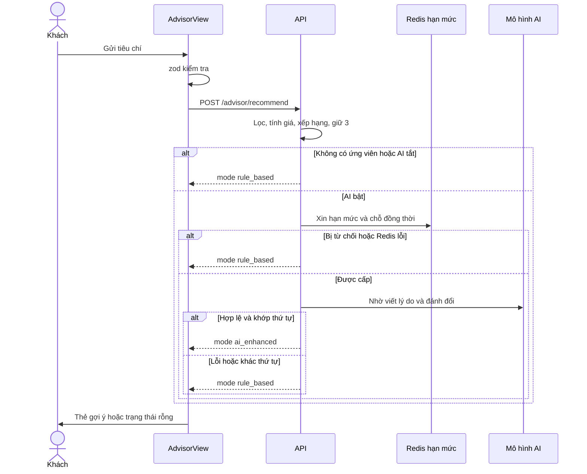

# Tư vấn chọn laptop (Advisor)

Khách trả lời vài câu hỏi (ngân sách, nhu cầu chính, ưu tiên, RAM tối thiểu, tác vụ, ghi chú) và nhận tối đa 3 laptop phù hợp kèm điểm, lý do và đánh đổi. Backend lọc, tính giá, xếp hạng bằng quy tắc; một mô hình AI (tùy cấu hình) chỉ viết lại lý do và đánh đổi. Nếu AI tắt hoặc không dùng được, kết quả vẫn trả theo quy tắc. Trang công khai, không cần đăng nhập.

## Tổng quan

| Mục | Giá trị |
| --- | --- |
| Mã nguồn | [src/features/advisor](https://github.com/QuocDuy21-10/laptopshop-web/tree/main/src/features/advisor) |
| Route | `/advisor` ([page.tsx](https://github.com/QuocDuy21-10/laptopshop-web/blob/main/src/app/%28storefront%29/advisor/page.tsx)) |
| Lối vào | Khối "Chưa biết chọn laptop nào?" ở trang chủ ([Home](home.md)); nút "Tư vấn chọn laptop" ở hero mặc định |
| Backend | [src/modules/advisor](https://github.com/QuocDuy21-10/laptopshop-api/tree/main/src/modules/advisor) |
| Test | [tests/features/advisor](https://github.com/QuocDuy21-10/laptopshop-web/tree/main/tests/features/advisor) |

## Actors và use cases

| Actor | Use case | Nơi thao tác |
| --- | --- | --- |
| Khách vãng lai, thành viên | Nhập tiêu chí, nhận gợi ý | `/advisor` |
| Khách vãng lai, thành viên | Hủy khi đang chờ, sửa tiêu chí và gửi lại | `/advisor` |
| Khách vãng lai, thành viên | Mở sản phẩm gợi ý | thẻ gợi ý |

## Hành trình người dùng

1. Khách mở `/advisor` và điền biểu mẫu; ghi chú và RAM tối thiểu là tùy chọn.
2. Bấm gửi: biểu mẫu ẩn, hiện khung chờ (skeleton) kèm nút "Hủy và sửa tiêu chí".
3. Có kết quả: tiêu đề "Laptop phù hợp với bạn" nhận focus; mỗi thẻ hiện điểm "Phù hợp N/100", giá tư vấn, lý do, tối đa 2 đánh đổi.
4. Không có laptop phù hợp: thông báo "Chưa tìm thấy laptop phù hợp" kèm các gợi ý nới tiêu chí và nút "Sửa tiêu chí".
5. Lỗi mạng hoặc máy chủ: biểu mẫu giữ nguyên dữ liệu đã nhập, hiện lỗi và nút "Thử lại".

## Luồng nghiệp vụ

| Việc | Frontend | Backend |
| --- | --- | --- |
| Kiểm tra đầu vào | zod trước khi gửi | zod `strict` kiểm tra lại, đồng nhất với web |
| Lấy ứng viên | | Duyệt sản phẩm theo lô (mặc định 200) |
| Tính giá | | Giá hiệu lực kèm khuyến mãi tự động, loại ứng viên vượt ngân sách |
| Xếp hạng | | Chấm điểm theo trọng số, giữ 3 tốt nhất |
| Giải thích | Hiển thị | Quy tắc, hoặc AI nếu bật, qua cổng kiểm tra và hạn mức |
| Thử lại, hủy | `AbortController` hủy yêu cầu cũ | |

## Business rules

| Quy tắc | Thực thi bởi | Nguồn |
| --- | --- | --- |
| Ngân sách nguyên từ 5.000.000 đến 200.000.000 | Web và API | [schema.ts](https://github.com/QuocDuy21-10/laptopshop-web/blob/main/src/features/advisor/schema.ts#L10), [advisor.schema.ts](https://github.com/QuocDuy21-10/laptopshop-api/blob/main/src/modules/advisor/advisor.schema.ts#L26) |
| Nhu cầu chính: `CODING`, `GAMING`, `OFFICE`, `CREATIVE` | Web và API | [advisor.schema.ts](https://github.com/QuocDuy21-10/laptopshop-api/blob/main/src/modules/advisor/advisor.schema.ts#L6) |
| Ưu tiên: tối đa 3, không trùng (`PERFORMANCE`, `PORTABILITY`, `BATTERY`, `DISPLAY`, `VALUE`) | Web và API | [advisor.schema.ts](https://github.com/QuocDuy21-10/laptopshop-api/blob/main/src/modules/advisor/advisor.schema.ts#L7-L28) |
| RAM tối thiểu chỉ 8, 16 hoặc 32 GB | Web và API | [advisor.schema.ts](https://github.com/QuocDuy21-10/laptopshop-api/blob/main/src/modules/advisor/advisor.schema.ts#L29) |
| Tác vụ: tối đa 5, không trùng (`DOCKER_VM`, `ESPORTS`, `AAA_GAMING`, `PHOTO_VIDEO`, `CAD_3D`) | Web và API | [advisor.schema.ts](https://github.com/QuocDuy21-10/laptopshop-api/blob/main/src/modules/advisor/advisor.schema.ts#L14-L34) |
| Ghi chú tối đa 500 ký tự; chuỗi rỗng coi như không có | Web và API | [advisor.schema.ts](https://github.com/QuocDuy21-10/laptopshop-api/blob/main/src/modules/advisor/advisor.schema.ts#L35-L38) |
| Kết quả tối đa 3 laptop, xếp theo điểm, rồi giá thấp hơn, rồi mã nhỏ hơn | API | [advisor.ranking.ts](https://github.com/QuocDuy21-10/laptopshop-api/blob/main/src/modules/advisor/advisor.ranking.ts#L200-L208) |
| Chỉ ứng viên có giá hiệu lực không vượt ngân sách | API | [advisor.service.ts](https://github.com/QuocDuy21-10/laptopshop-api/blob/main/src/modules/advisor/advisor.service.ts#L93-L95) |
| Giá tư vấn đã gồm khuyến mãi tự động, chưa gồm Flash Sale; giá cuối xác nhận lúc thanh toán | API và web (nhãn) | [advisor.pricing.ts](https://github.com/QuocDuy21-10/laptopshop-api/blob/main/src/modules/advisor/advisor.pricing.ts), [AdvisorRecommendationCard.tsx](https://github.com/QuocDuy21-10/laptopshop-web/blob/main/src/features/advisor/AdvisorRecommendationCard/AdvisorRecommendationCard.tsx#L18) |
| AI chỉ viết lại `reason` và `tradeoffs`; thứ tự và sản phẩm do quy tắc quyết định, AI trả khác thứ tự thì bỏ | API | [advisor.service.ts](https://github.com/QuocDuy21-10/laptopshop-api/blob/main/src/modules/advisor/advisor.service.ts#L45-L67), [advisor.service.ts](https://github.com/QuocDuy21-10/laptopshop-api/blob/main/src/modules/advisor/advisor.service.ts#L135) |
| AI chỉ chạy khi cờ `ADVISOR_AI_ENABLED` bật (mặc định tắt), có khóa và mô hình cấu hình | API | [env.ts](https://github.com/QuocDuy21-10/laptopshop-api/blob/main/src/config/env.ts#L152-L160), [env.ts](https://github.com/QuocDuy21-10/laptopshop-api/blob/main/src/config/env.ts#L306-L320) |
| Hạn mức AI theo ngày (mặc định): khách 5, người dùng 10, toàn hệ thống 30; đồng thời tối đa 2 | API | [env.ts](https://github.com/QuocDuy21-10/laptopshop-api/blob/main/src/config/env.ts#L163-L168), [advisor.admission.ts](https://github.com/QuocDuy21-10/laptopshop-api/blob/main/src/modules/advisor/advisor.admission.ts#L5-L19) |
| Hết hạn mức, hết chỗ đồng thời, Redis lỗi, đầu vào bị cổng chặn, hoặc AI lỗi: trả kết quả theo quy tắc (`rule_based`), không báo lỗi | API | [advisor.service.ts](https://github.com/QuocDuy21-10/laptopshop-api/blob/main/src/modules/advisor/advisor.service.ts#L115-L146) |
| Định danh người gọi: đã đăng nhập theo mã người dùng, khách theo HMAC của IP | API | [advisor.identity.ts](https://github.com/QuocDuy21-10/laptopshop-api/blob/main/src/modules/advisor/advisor.identity.ts#L4-L17) |
| Khi `mode` là `rule_based`, web hiện ghi chú "Đề xuất theo tiêu chí hiện tại" | Web | [AdvisorResults.tsx](https://github.com/QuocDuy21-10/laptopshop-web/blob/main/src/features/advisor/AdvisorResults/AdvisorResults.tsx#L35) |

## Sơ đồ

Chỉ lỗi ở bước lọc hoặc xếp hạng, hoặc lỗi kiểm tra đầu vào, mới trả lỗi HTTP; mọi lỗi của lớp AI đều lùi về `rule_based` ([advisor.service.ts](https://github.com/QuocDuy21-10/laptopshop-api/blob/main/src/modules/advisor/advisor.service.ts#L114-L146)).

## API requests/responses

| Method | Path | Auth | Request | Response | Lỗi thường gặp |
| --- | --- | --- | --- | --- | --- |
| POST | `/api/v1/advisor/recommend` | Tùy chọn | `AdvisorRequest` | `{ data: AdvisorResult }` | `400 VALIDATION_ERROR` (web gán lỗi theo trường); giới hạn tần suất theo route |

Web truyền `signal` để hủy yêu cầu ([hooks.ts](https://github.com/QuocDuy21-10/laptopshop-web/blob/main/src/features/advisor/hooks.ts#L8-L14)).

## Data contracts

`AdvisorRequest`, `AdvisorResult`, `AdvisorRecommendation` ở [Data dictionary: Advisor](../06-api-and-data/data-dictionary/advisor.md).

## UI states và xử lý lỗi

- Chờ: skeleton có `role="status"` và nút "Hủy và sửa tiêu chí" ([AdvisorResults.tsx](https://github.com/QuocDuy21-10/laptopshop-web/blob/main/src/features/advisor/AdvisorResults/AdvisorResults.tsx#L14-L21)).
- Rỗng: `EmptyState` với `suggestions` của backend nối thành một đoạn ([AdvisorResults.tsx](https://github.com/QuocDuy21-10/laptopshop-web/blob/main/src/features/advisor/AdvisorResults/AdvisorResults.tsx#L23-L29)).
- Lỗi `VALIDATION_ERROR` gán vào từng trường qua `applyFieldErrors`; lỗi khác hiện ở đầu form qua `errorMessage`, kèm nút "Thử lại" ([AdvisorForm.tsx](https://github.com/QuocDuy21-10/laptopshop-web/blob/main/src/features/advisor/AdvisorForm/AdvisorForm.tsx#L70-L73), [AdvisorForm.tsx](https://github.com/QuocDuy21-10/laptopshop-web/blob/main/src/features/advisor/AdvisorForm/AdvisorForm.tsx#L112)).
- Biểu mẫu chỉ ẩn (không gỡ) khi có kết quả, nên "Sửa tiêu chí" giữ câu trả lời ([AdvisorView.tsx](https://github.com/QuocDuy21-10/laptopshop-web/blob/main/src/features/advisor/AdvisorView/AdvisorView.tsx#L68-L71)).
- Focus chuyển vào tiêu đề kết quả khi có kết quả ([AdvisorView.tsx](https://github.com/QuocDuy21-10/laptopshop-web/blob/main/src/features/advisor/AdvisorView/AdvisorView.tsx#L20-L22)).

## Edge cases

- Bấm gửi nhiều lần liên tiếp: chỉ một yêu cầu chạy (`submittingRef`); gửi mới sau khi sửa sẽ hủy yêu cầu cũ và bỏ qua kết quả cũ nhờ số thứ tự ([AdvisorView.tsx](https://github.com/QuocDuy21-10/laptopshop-web/blob/main/src/features/advisor/AdvisorView/AdvisorView.tsx#L29-L51)).
- Rời trang khi đang chờ: yêu cầu bị hủy ([AdvisorView.tsx](https://github.com/QuocDuy21-10/laptopshop-web/blob/main/src/features/advisor/AdvisorView/AdvisorView.tsx#L24-L27)).
- Ngân sách quá thấp so với kho: có thể không có gợi ý, hiện trạng thái rỗng với gợi ý nới tiêu chí.
- Hết hạn mức AI không làm người dùng thấy lỗi; chỉ khác ở nội dung lý do (quy tắc thay vì AI).

## Bảo mật

- Endpoint công khai, `optionalAuthenticate`; IP khách được băm HMAC bằng bí mật máy chủ nên không lưu IP thô trong khóa Redis ([advisor.identity.ts](https://github.com/QuocDuy21-10/laptopshop-api/blob/main/src/modules/advisor/advisor.identity.ts#L10-L14)).
- Có cổng kiểm tra đầu vào trước khi gửi cho mô hình (`inspectAdvisorProviderInput`); nếu không an toàn thì bỏ AI ([advisor.service.ts](https://github.com/QuocDuy21-10/laptopshop-api/blob/main/src/modules/advisor/advisor.service.ts#L116-L120)).
- Khóa API của nhà cung cấp AI chỉ ở backend.

## Tham chiếu mã nguồn

- Web: [schema.ts](https://github.com/QuocDuy21-10/laptopshop-web/blob/main/src/features/advisor/schema.ts), [hooks.ts](https://github.com/QuocDuy21-10/laptopshop-web/blob/main/src/features/advisor/hooks.ts), [AdvisorView.tsx](https://github.com/QuocDuy21-10/laptopshop-web/blob/main/src/features/advisor/AdvisorView/AdvisorView.tsx), [AdvisorResults.tsx](https://github.com/QuocDuy21-10/laptopshop-web/blob/main/src/features/advisor/AdvisorResults/AdvisorResults.tsx).
- Backend: [advisor.service.ts](https://github.com/QuocDuy21-10/laptopshop-api/blob/main/src/modules/advisor/advisor.service.ts), [advisor.schema.ts](https://github.com/QuocDuy21-10/laptopshop-api/blob/main/src/modules/advisor/advisor.schema.ts), [advisor.ranking.ts](https://github.com/QuocDuy21-10/laptopshop-api/blob/main/src/modules/advisor/advisor.ranking.ts), [advisor.admission.ts](https://github.com/QuocDuy21-10/laptopshop-api/blob/main/src/modules/advisor/advisor.admission.ts).

> [!WARNING]
> **Chưa xác minh:** (1) công thức chấm điểm và trọng số chi tiết (`advisor.ranking.ts`, `advisor.hardware-profile.ts`); (2) nội dung nhắc lệnh và quy tắc kiểm tra đầu ra của nhà cung cấp AI (`groq-advisor.provider.ts`, `advisor-output.schema.ts`); (3) giới hạn tần suất theo route (`advisorLimiter`) và mã lỗi khi vượt; (4) cách `inspectAdvisorProviderInput` quyết định "không an toàn"; (5) các tùy chọn và nhãn của `AdvisorForm`.

## Tài liệu liên quan

- [Home](home.md): khối mời tư vấn.
- [Products](products.md), [Promotions](promotions.md): giá và khuyến mãi tự động.
- [Biến môi trường](../12-reference/env-vars.md)
