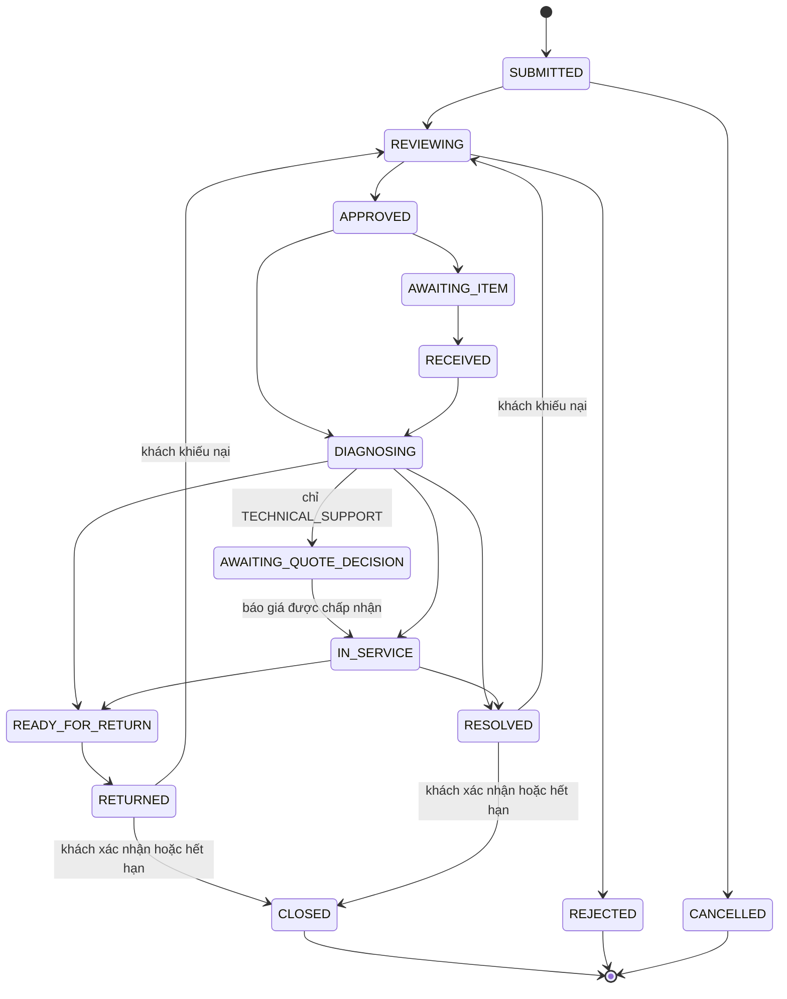
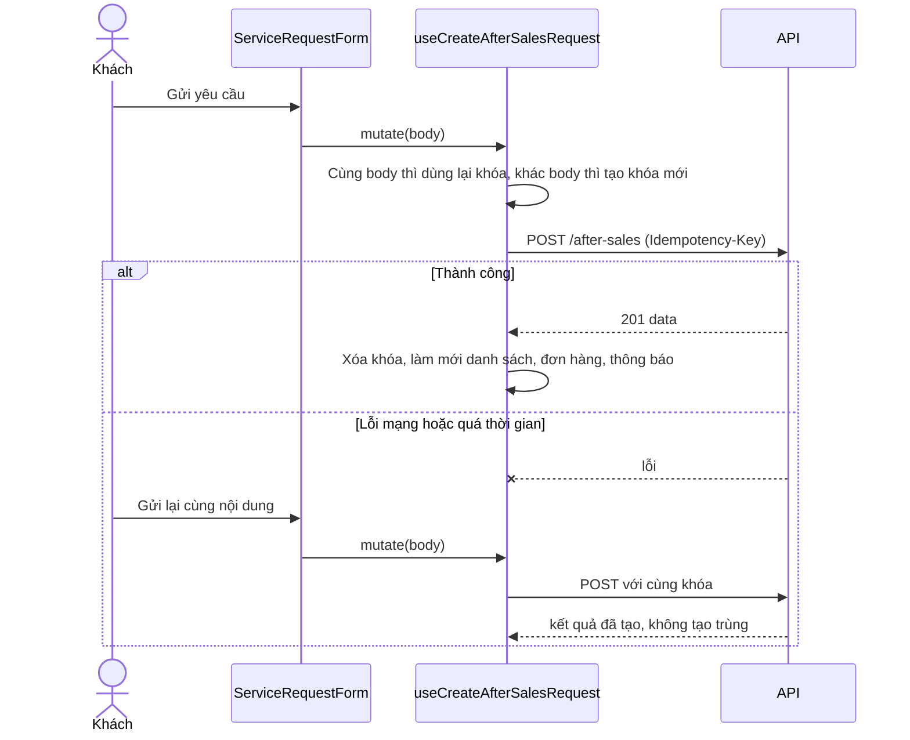

# Hậu mãi (After-sales)

Khách gửi yêu cầu bảo hành hoặc hỗ trợ kỹ thuật cho các thiết bị đã mua; nhân viên xử lý từng thiết bị, báo giá, nhắn tin và đóng yêu cầu. Frontend chỉ hiển thị và gửi thao tác; quy tắc chuyển trạng thái và quyền lợi bảo hành do backend quyết định.

## Tổng quan

| Mục | Giá trị |
| --- | --- |
| Mã nguồn | [src/features/after-sales](https://github.com/QuocDuy21-10/laptopshop-web/tree/main/src/features/after-sales) (khách), [src/features/admin/after-sales](https://github.com/QuocDuy21-10/laptopshop-web/tree/main/src/features/admin/after-sales) (admin) |
| Route khách | `/account/after-sales`, `/account/after-sales/new`, `/account/after-sales/[id]`, `/account/warranties` (cần đăng nhập) |
| Route admin | `/admin/after-sales`, `/admin/after-sales/[id]` |
| Backend | [src/modules/after-sales](https://github.com/QuocDuy21-10/laptopshop-api/tree/main/src/modules/after-sales) |
| Test | [tests/features/after-sales](https://github.com/QuocDuy21-10/laptopshop-web/tree/main/tests/features/after-sales) |

Một yêu cầu (`ServiceRequest`) có một hoặc nhiều thiết bị (item), mỗi item có trạng thái riêng; trạng thái của yêu cầu được suy ra từ các item.

## Actors và use cases

| Actor | Use case | Route |
| --- | --- | --- |
| Thành viên | Xem quyền lợi bảo hành của từng thiết bị đã mua | `/account/warranties` |
| Thành viên | Tạo yêu cầu bảo hành hoặc hỗ trợ kỹ thuật | `/account/after-sales/new` |
| Thành viên | Xem danh sách, chi tiết, dòng thời gian | `/account/after-sales`, `/account/after-sales/[id]` |
| Thành viên | Nhắn tin, đính kèm ảnh, duyệt hoặc từ chối báo giá, hủy, xác nhận hoàn tất, khiếu nại | chi tiết yêu cầu |
| Admin | Lọc, nhận phụ trách, đổi trạng thái từng thiết bị, nhắn tin, ghi chú nội bộ | `/admin/after-sales` |
| Admin | Gửi báo giá, ghi nhận xác minh bảo hành | `/admin/after-sales/[id]` |

## Hành trình người dùng

1. Khách vào `/account/warranties` để xem thiết bị và quyền lợi, hoặc vào thẳng `/account/after-sales/new`.
2. Chọn loại yêu cầu (`WARRANTY` hoặc `TECHNICAL_SUPPORT`); form tải toàn bộ thiết bị đủ điều kiện cho loại đó.
3. Chọn thiết bị, nhập tiêu đề, mô tả lỗi (và số serial nếu có) rồi gửi.
4. Theo dõi ở chi tiết yêu cầu: trạng thái từng thiết bị, dòng thời gian, tin nhắn.
5. Khi có báo giá, khách chấp nhận hoặc từ chối; khi thiết bị được trả hoặc xử lý xong, khách xác nhận hoặc khiếu nại.

## Luồng nghiệp vụ

| Việc | Frontend | Backend |
| --- | --- | --- |
| Thiết bị đủ điều kiện | Gọi `GET /after-sales/devices` theo loại, duyệt hết các trang | Phân loại quyền lợi (`IN_WARRANTY`, `OUT_OF_WARRANTY`, `NO_WARRANTY`, `REQUIRES_VERIFICATION`) và loại yêu cầu được phép |
| Tạo yêu cầu | Kiểm tra bằng zod, gửi kèm `Idempotency-Key` | Kiểm tra lại, từ chối khóa bị dùng lại với nội dung khác |
| Đổi trạng thái thiết bị | Chỉ admin; gửi `expectedVersion` | Kiểm tra bảng chuyển trạng thái theo loại yêu cầu |
| Trạng thái yêu cầu | Chỉ hiển thị | Suy ra từ các item |
| Báo giá | Admin gửi dòng giá; khách quyết định | Lưu báo giá, hạn hiệu lực, ghi nhận quyết định |
| Ảnh đính kèm | Chọn ảnh, gửi `Upload-Key` | Giới hạn kích thước, số file, số ảnh còn hiệu lực |
| Đóng yêu cầu | Khách xác nhận hoặc khiếu nại | Mở cửa sổ xác nhận 168 giờ; hết hạn thì tự đóng |

## Business rules

| Quy tắc | Thực thi bởi | Nguồn |
| --- | --- | --- |
| Tạo yêu cầu: 1 đến 50 thiết bị, tiêu đề tối đa 200, mô tả lỗi tối đa 5000, nhãn thiết bị và serial tối đa 100 ký tự | Web (zod) và API | [schema.ts](https://github.com/QuocDuy21-10/laptopshop-web/blob/main/src/features/after-sales/schema.ts#L3-L13), [after-sales.schema.ts](https://github.com/QuocDuy21-10/laptopshop-api/blob/main/src/modules/after-sales/after-sales.schema.ts#L11-L34) |
| Serial trong cùng yêu cầu không được trùng (không phân biệt hoa thường) | API | [after-sales.schema.ts](https://github.com/QuocDuy21-10/laptopshop-api/blob/main/src/modules/after-sales/after-sales.schema.ts#L25-L34) |
| Quyền lợi: còn hạn hoặc cần xác minh thì được cả hai loại; hết hạn hoặc không có bảo hành chỉ được hỗ trợ kỹ thuật | API | [after-sales.eligibility.ts](https://github.com/QuocDuy21-10/laptopshop-api/blob/main/src/modules/after-sales/after-sales.eligibility.ts#L14-L52) |
| Chỉ hủy được khi item ở `SUBMITTED`, `REVIEWING`, `APPROVED`, `AWAITING_ITEM` | API | [after-sales.status.ts](https://github.com/QuocDuy21-10/laptopshop-api/blob/main/src/modules/after-sales/after-sales.status.ts#L15-L20), cùng file dòng 60 |
| `WARRANTY` không đi `APPROVED` thẳng tới `DIAGNOSING` và không có bước báo giá; `TECHNICAL_SUPPORT` không có `AWAITING_ITEM` và chỉ tiếp tục sau báo giá được chấp nhận | API | [after-sales.status.ts](https://github.com/QuocDuy21-10/laptopshop-api/blob/main/src/modules/after-sales/after-sales.status.ts#L48-L59) |
| Đóng item cần khách xác nhận, hoặc (hết hạn xác nhận) hệ thống/admin đóng | API | [after-sales.status.ts](https://github.com/QuocDuy21-10/laptopshop-api/blob/main/src/modules/after-sales/after-sales.status.ts#L61-L73) |
| Cửa sổ xác nhận 168 giờ khi item sang `RESOLVED` hoặc `RETURNED` | API | [after-sales.actions.ts](https://github.com/QuocDuy21-10/laptopshop-api/blob/main/src/modules/after-sales/after-sales.actions.ts#L105-L112) |
| Trạng thái yêu cầu: tất cả item kết thúc thì `CLOSED`; một phần thì `PARTIALLY_COMPLETED`; toàn bộ chờ khách thì `AWAITING_CUSTOMER` | API | [after-sales.aggregate.ts](https://github.com/QuocDuy21-10/laptopshop-api/blob/main/src/modules/after-sales/after-sales.aggregate.ts#L12-L27) |
| Báo giá: 1 đến 50 dòng, hiệu lực 1 đến 30 ngày (mặc định 7), tổng không vượt giới hạn số nguyên của cơ sở dữ liệu | API | [after-sales.schema.ts](https://github.com/QuocDuy21-10/laptopshop-api/blob/main/src/modules/after-sales/after-sales.schema.ts#L151-L170) |
| Xác minh bảo hành: `IN_WARRANTY`, `OUT_OF_WARRANTY` bắt buộc ngày bắt đầu và kết thúc; hai quyết định còn lại cấm ngày | API | [after-sales.schema.ts](https://github.com/QuocDuy21-10/laptopshop-api/blob/main/src/modules/after-sales/after-sales.schema.ts#L108-L143) |
| Ảnh: tối đa 3 file mỗi lần, 3 MB mỗi file, 15 ảnh còn hiệu lực; web chỉ nhận JPEG, PNG, WebP | API và web | [after-sales-attachments.routes.ts](https://github.com/QuocDuy21-10/laptopshop-api/blob/main/src/modules/after-sales/after-sales-attachments.routes.ts#L16), [after-sales.attachments.ts](https://github.com/QuocDuy21-10/laptopshop-api/blob/main/src/modules/after-sales/after-sales.attachments.ts#L8), [ServiceRequestAttachments.tsx](https://github.com/QuocDuy21-10/laptopshop-web/blob/main/src/features/after-sales/ServiceRequestAttachments/ServiceRequestAttachments.tsx#L18) |
| Thao tác ghi của admin dùng khóa phiên bản (`expectedVersion`); lệch phiên bản thì bị từ chối | API | [after-sales.schema.ts](https://github.com/QuocDuy21-10/laptopshop-api/blob/main/src/modules/after-sales/after-sales.schema.ts#L50-L71) |

## Sơ đồ

### Vòng đời một thiết bị

Sơ đồ rút gọn từ bảng chuyển trong [after-sales.status.ts](https://github.com/QuocDuy21-10/laptopshop-api/blob/main/src/modules/after-sales/after-sales.status.ts#L22-L37). Hủy chỉ có từ `SUBMITTED` đến `AWAITING_ITEM`; các nhánh hủy từ `REVIEWING`, `APPROVED`, `AWAITING_ITEM` và nhánh `AWAITING_QUOTE_DECISION` về `DIAGNOSING` hay `AWAITING_ITEM` không vẽ để sơ đồ đọc được. Khi khách khiếu nại hoàn tất, item quay về `REVIEWING` và `confirmationDueAt` được xóa ([after-sales.actions.ts](https://github.com/QuocDuy21-10/laptopshop-api/blob/main/src/modules/after-sales/after-sales.actions.ts#L252)).

### Tạo yêu cầu và thử lại

`useCreateAfterSalesRequest` giữ khóa trong `useRef` và so khớp theo chuỗi JSON của body ([hooks.ts](https://github.com/QuocDuy21-10/laptopshop-web/blob/main/src/features/after-sales/hooks.ts#L104-L124)). Backend từ chối cùng khóa với nội dung khác bằng lỗi xung đột ([after-sales.service.ts](https://github.com/QuocDuy21-10/laptopshop-api/blob/main/src/modules/after-sales/after-sales.service.ts#L68)).

## API requests/responses

Phía khách ([hooks.ts](https://github.com/QuocDuy21-10/laptopshop-web/blob/main/src/features/after-sales/hooks.ts)):

| Method | Path | Auth | Request | Response | Lỗi thường gặp |
| --- | --- | --- | --- | --- | --- |
| GET | `/api/v1/after-sales/devices` | Có | `type`, `page`, `pageSize` | trang `EligibleAfterSalesDevice` | `401` |
| GET | `/api/v1/after-sales` | Có | `page`, `pageSize` | trang `AfterSalesRequest` | `401` |
| GET | `/api/v1/after-sales/{id}` | Có | | `AfterSalesRequest` | `404` |
| POST | `/api/v1/after-sales` | Có | `CreateServiceRequest`, header `Idempotency-Key` | `data` | `400`, `409` |
| POST | `/api/v1/after-sales/{id}/messages` | Có | `body`, `itemId?` | tin nhắn | `400` |
| POST | `/api/v1/after-sales/{id}/items/{itemId}/cancel` | Có | | item | `409 INVALID_SERVICE_TRANSITION` |
| POST | `/api/v1/after-sales/{id}/items/{itemId}/confirm` | Có | | item | `409` |
| POST | `/api/v1/after-sales/{id}/items/{itemId}/dispute-completion` | Có | `reason`, `note` | item | `409` |
| POST | `/api/v1/after-sales/{id}/items/{itemId}/quotes/{quoteId}/decision` | Có | `decision`: `ACCEPT` hoặc `DECLINE` | báo giá | `409` |
| GET, POST | `/api/v1/after-sales/{id}/items/{itemId}/attachments` | Có | multipart `images`, header `Upload-Key` | danh sách ảnh | `400 UPLOAD_KEY_REQUIRED`, `UPLOAD_KEY_INVALID` |

Phía admin ([hooks.ts](https://github.com/QuocDuy21-10/laptopshop-web/blob/main/src/features/admin/after-sales/hooks.ts)): `GET /admin/after-sales` (lọc theo `type`, `status`, `itemStatus`, `assigneeId`, `q`, `from`, `to`), `GET /admin/after-sales/summary`, `/assignees`, `/{id}`; `PATCH /{id}/assign`; `POST /{id}/messages`, `/{id}/notes`; `PATCH /{id}/items/{itemId}/status`; `POST /{id}/items/{itemId}/quotes`, `/warranty-verifications`. Tất cả đều gửi `expectedVersion` ([after-sales.routes.ts](https://github.com/QuocDuy21-10/laptopshop-api/blob/main/src/modules/after-sales/after-sales.routes.ts)).

## Data contracts

Type lấy từ `schema.d.ts` qua [types.ts](https://github.com/QuocDuy21-10/laptopshop-web/blob/main/src/features/after-sales/types.ts). Chi tiết field, enum và nhãn tiếng Việt ở [Data dictionary: After-sales](../06-api-and-data/data-dictionary/after-sales.md).

## UI states và xử lý lỗi

- Danh sách thiết bị, chi tiết, quyền lợi: skeleton hoặc "Đang tải thiết bị…" khi tải; lỗi hiện `Alert` với `errorMessage` ([WarrantyList.tsx](https://github.com/QuocDuy21-10/laptopshop-web/blob/main/src/features/after-sales/WarrantyList/WarrantyList.tsx#L15-L16), [ServiceRequestDetail.tsx](https://github.com/QuocDuy21-10/laptopshop-web/blob/main/src/features/after-sales/ServiceRequestDetail/ServiceRequestDetail.tsx#L19-L20)).
- Form tạo: nút gửi bị vô hiệu khi chưa chọn thiết bị, hiện trạng thái đang gửi; lỗi và thành công đều hiện `Alert` ([ServiceRequestForm.tsx](https://github.com/QuocDuy21-10/laptopshop-web/blob/main/src/features/after-sales/ServiceRequestForm/ServiceRequestForm.tsx#L31-L40)).
- Danh sách yêu cầu giữ dữ liệu trang trước khi chuyển trang (`keepPreviousData`).
- Mọi thao tác ghi thành công làm mới danh sách hậu mãi, chi tiết, đơn hàng và thông báo của người dùng ([hooks.ts](https://github.com/QuocDuy21-10/laptopshop-web/blob/main/src/features/after-sales/hooks.ts#L16-L27)).

## Edge cases

- Gửi lại cùng nội dung sau lỗi mạng không tạo yêu cầu trùng; đổi nội dung thì khóa mới.
- Tải ảnh lại với cùng `Upload-Key` được backend nhận ra, không tính hai lần vào giới hạn 15 ảnh ([after-sales.attachments.ts](https://github.com/QuocDuy21-10/laptopshop-api/blob/main/src/modules/after-sales/after-sales.attachments.ts#L105-L107)).
- Hai admin sửa cùng lúc: người sau nhận lỗi phiên bản; hook admin xử lý chung bằng `useAdminWriteError`.
- Loại sự kiện lạ trên dòng thời gian hiện nhãn dự phòng "Cập nhật yêu cầu" ([labels.ts](https://github.com/QuocDuy21-10/laptopshop-web/blob/main/src/features/after-sales/labels.ts#L33-L41)).
- `useAllAfterSalesDevices` tải trước mọi trang thiết bị (50 mỗi trang); tài khoản có hàng trăm thiết bị sẽ cần danh sách cuộn vô hạn (ghi chú `shortcut` trong [hooks.ts](https://github.com/QuocDuy21-10/laptopshop-web/blob/main/src/features/after-sales/hooks.ts#L43-L44)).

## Bảo mật

- `/account/*` được chặn bởi [proxy.ts](https://github.com/QuocDuy21-10/laptopshop-web/blob/main/src/proxy.ts) khi chưa có cookie phiên; quyền thật do backend kiểm tra (`authenticate`).
- Khách chỉ thao tác trên yêu cầu của chính mình (lọc theo `userId` ở backend, ví dụ [after-sales.attachments.ts](https://github.com/QuocDuy21-10/laptopshop-api/blob/main/src/modules/after-sales/after-sales.attachments.ts#L85)). Ghi chú nội bộ chỉ có ở API admin.
- Router admin yêu cầu vai trò `ADMIN` ([Admin](admin.md)).

## Tham chiếu mã nguồn

- Web: [hooks.ts](https://github.com/QuocDuy21-10/laptopshop-web/blob/main/src/features/after-sales/hooks.ts), [labels.ts](https://github.com/QuocDuy21-10/laptopshop-web/blob/main/src/features/after-sales/labels.ts), [schema.ts](https://github.com/QuocDuy21-10/laptopshop-web/blob/main/src/features/after-sales/schema.ts), [admin hooks.ts](https://github.com/QuocDuy21-10/laptopshop-web/blob/main/src/features/admin/after-sales/hooks.ts).
- Backend: [after-sales.status.ts](https://github.com/QuocDuy21-10/laptopshop-api/blob/main/src/modules/after-sales/after-sales.status.ts), [after-sales.actions.ts](https://github.com/QuocDuy21-10/laptopshop-api/blob/main/src/modules/after-sales/after-sales.actions.ts), [after-sales.eligibility.ts](https://github.com/QuocDuy21-10/laptopshop-api/blob/main/src/modules/after-sales/after-sales.eligibility.ts).
- Cấu trúc bảng thuộc backend: [schema.prisma](https://github.com/QuocDuy21-10/laptopshop-api/blob/main/prisma/schema.prisma).

> [!WARNING]
> **Chưa xác minh:** nội dung quy trình admin chi tiết (từng nút trên giao diện admin, bố cục bảng lọc) và logic thông báo email của hậu mãi. Mới đọc hook, bảng chuyển trạng thái và schema; chưa đọc các component admin và `after-sales.notifications.ts`.

## Tài liệu liên quan

- [Orders](orders.md): thiết bị lấy từ các dòng đơn hàng đã mua.
- [Admin](admin.md): khung quản trị.
- [Data dictionary: After-sales](../06-api-and-data/data-dictionary/after-sales.md)
