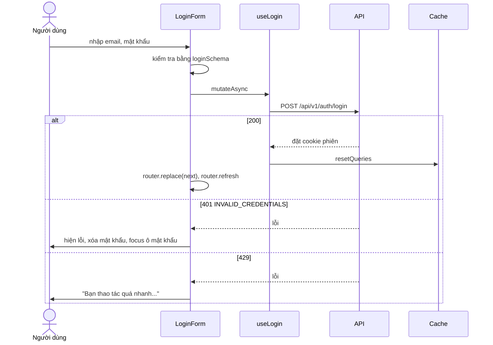
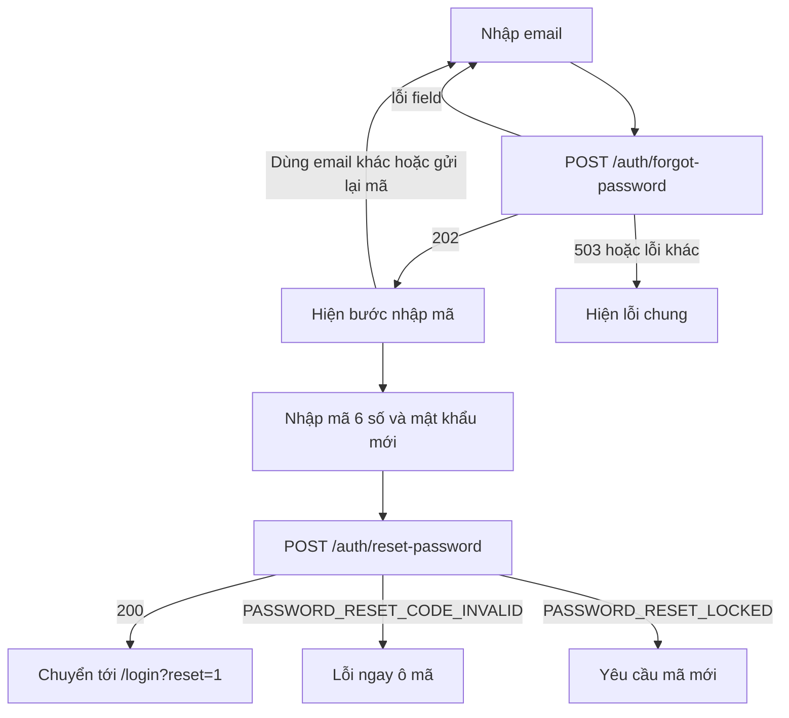

# Xác thực (Auth)

Module Auth gồm đăng ký, đăng nhập, quên và đặt lại mật khẩu, đăng xuất, và hộp thoại mời đăng nhập cho khách vãng lai. Phiên đăng nhập do backend cấp bằng cookie; frontend chỉ gọi API và phản ứng với kết quả.

## Tổng quan

| Mục | Giá trị |
| --- | --- |
| Mã nguồn | [src/features/auth](https://github.com/QuocDuy21-10/laptopshop-web/tree/main/src/features/auth) |
| Route | `/login`, `/register`, `/forgot-password` (route group `(auth)`) |
| Hook | `useLogin`, `useRegister`, `useForgotPassword`, `useResetPassword`, `useLogout` |
| Liên quan | Cookie và refresh: [Phiên đăng nhập](../02-architecture/auth-session.md). Người dùng hiện tại (`useMe`): module `account` |

Route group `(auth)` dùng khung riêng không có header storefront, chỉ có logo và liên kết "Về trang chủ" ([layout.tsx](https://github.com/QuocDuy21-10/laptopshop-web/blob/main/src/app/%28auth%29/layout.tsx)).

## Actors và use cases

| Actor | Use case | Route |
| --- | --- | --- |
| Khách vãng lai | Đăng ký tài khoản | `/register` |
| Khách vãng lai | Đăng nhập | `/login` |
| Khách vãng lai | Đặt lại mật khẩu bằng mã gửi qua email | `/forgot-password` |
| Khách vãng lai | Được mời đăng nhập khi thêm giỏ hàng, lưu yêu thích, viết đánh giá, bình chọn hữu ích | hộp thoại `AuthPrompt` |
| Thành viên, Admin | Đăng xuất | menu tài khoản, `AdminShell` |

## Hành trình người dùng

### Đăng ký

1. Người dùng nhập họ tên, email, mật khẩu và xác nhận mật khẩu.
2. Form kiểm tra phía client; nếu hợp lệ thì gửi `POST /api/v1/auth/register`.
3. Thành công: backend đặt cookie phiên, cache được làm mới, người dùng được đưa tới trang `next` (mặc định `/`).
4. Email đã tồn tại: lỗi hiện ngay dưới ô email.

### Đăng nhập

1. Người dùng nhập email và mật khẩu.
2. Thành công: người dùng được chuyển tới `next`. Nếu có thao tác thêm giỏ hàng đang chờ, form hiển thị thông báo "Đăng nhập để thêm sản phẩm vào giỏ hàng" và thao tác được thực hiện sau khi đăng nhập ([Giỏ hàng](cart.md)).
3. Sai thông tin: hiện lỗi chung, xóa ô mật khẩu và đưa con trỏ về ô đó.

### Quên mật khẩu (2 bước)

1. Nhập email, bấm "Gửi mã". Backend luôn chấp nhận email hợp lệ để không lộ email nào đã đăng ký.
2. Nhập mã 6 chữ số, mật khẩu mới và xác nhận. Mã có hiệu lực 15 phút.
3. Thành công: chuyển tới `/login?reset=1`, trang đăng nhập hiện thông báo "Đã đặt lại mật khẩu".

Email được giữ trong state của component giữa hai bước, không đưa lên URL ([ForgotPasswordFlow.tsx](https://github.com/QuocDuy21-10/laptopshop-web/blob/main/src/features/auth/ForgotPasswordFlow.tsx#L21-L25)). Nút "Dùng email khác hoặc gửi lại mã" quay về bước 1.

### Đăng xuất

Menu tài khoản và `AdminShell` gọi `useLogout`. Dù API thành công hay lỗi (`onSettled`), toàn bộ cache được xóa và dữ liệu `me` đặt về `null`.

## Luồng nghiệp vụ

| Việc | Frontend | Backend |
| --- | --- | --- |
| Kiểm tra form | Zod, để người dùng sửa sớm | Zod, là bản quyết định |
| Tạo phiên | Gọi API, không giữ token | Đặt ba cookie ([chi tiết](../02-architecture/auth-session.md)) |
| Làm mới phiên | `authFetch` tự làm khi `401` | Xoay refresh token |
| Đặt lại mật khẩu | Gửi mã và mật khẩu mới | Tạo mã, gửi email, kiểm tra mã, đăng xuất mọi phiên |
| Giới hạn tần suất | Hiển thị thông báo khi `429` | Giới hạn 10 request mỗi 15 phút cho đăng nhập, đăng ký, quên và đặt lại mật khẩu |

## Business rules

| Quy tắc | Thực thi bởi | Nguồn |
| --- | --- | --- |
| Email đúng định dạng, tối đa 255 ký tự (đăng ký, quên mật khẩu) | Web và API | [schemas.ts](https://github.com/QuocDuy21-10/laptopshop-web/blob/main/src/features/auth/schemas.ts#L9-L22), [auth.schema.ts](https://github.com/QuocDuy21-10/laptopshop-api/blob/main/src/modules/auth/auth.schema.ts) |
| Mật khẩu 8 đến 72 ký tự khi đăng ký và đặt lại; đăng nhập chỉ cần 1 đến 72 | Web và API | cùng hai file |
| Xác nhận mật khẩu phải trùng | Web và API | cùng hai file |
| Mã đặt lại là đúng 6 chữ số | Web và API | cùng hai file |
| Mã đặt lại có hiệu lực 15 phút | API | [password-reset.constants.ts](https://github.com/QuocDuy21-10/laptopshop-api/blob/main/src/modules/auth/password-reset.constants.ts) |
| Đặt lại mật khẩu đăng xuất mọi phiên | API | mô tả endpoint trong [schema.d.ts](https://github.com/QuocDuy21-10/laptopshop-web/blob/main/src/lib/api/schema.d.ts#L363) |
| Tối đa 10 lần thử mỗi 15 phút cho các endpoint auth | API | [rate-limit.ts](https://github.com/QuocDuy21-10/laptopshop-api/blob/main/src/middlewares/rate-limit.ts#L34-L41) |
| `next` chỉ nhận đường dẫn cùng site | Web | [safe-next.ts](https://github.com/QuocDuy21-10/laptopshop-web/blob/main/src/lib/safe-next.ts) |

Điểm khác biệt đáng biết: ở đăng nhập, backend chỉ yêu cầu `username` không rỗng (tối đa 255), còn frontend yêu cầu đúng định dạng email.

## Sơ đồ

### Đăng nhập

Diễn giải: `authFetch` không làm mới phiên cho đường dẫn `/api/v1/auth/*`, nên `401` khi đăng nhập hiện thẳng cho người dùng thay vì gây vòng lặp. Sau khi đăng nhập, `resetQueries` làm mọi dữ liệu cũ (của khách) được tải lại theo phiên mới. Cơ chế làm mới phiên ở [Phiên đăng nhập](../02-architecture/auth-session.md#refresh-single-flight).

### Đặt lại mật khẩu

Diễn giải: lỗi mã sai gắn vào ô mã (`PASSWORD_RESET_CODE_INVALID`: "Mã không đúng hoặc đã hết hạn"). `PASSWORD_RESET_LOCKED` có trong bảng thông báo ("Bạn đã nhập sai quá nhiều lần. Hãy yêu cầu mã mới") và hiện ở lỗi chung vì không có nhánh riêng trong form.

## API requests/responses

| Method | Path | Auth | Request | Response | Lỗi thường gặp |
| --- | --- | --- | --- | --- | --- |
| POST | `/api/v1/auth/register` | Không | `fullName`, `username`, `password`, `confirmPassword` | `201` `{ data: { user } }`, đặt cookie | `400` dữ liệu sai, `409` `EMAIL_TAKEN` |
| POST | `/api/v1/auth/login` | Không | `username`, `password` | `200`, đặt cookie | `401` `INVALID_CREDENTIALS`, `429` |
| POST | `/api/v1/auth/forgot-password` | Không | `username` | `202` | `400`, `429`, `503` `EMAIL_DELIVERY_UNAVAILABLE` |
| POST | `/api/v1/auth/reset-password` | Không | `username`, `code`, `password`, `confirmPassword` | `200`, xóa cookie | `400` mã sai hoặc hết hạn, `429` |
| POST | `/api/v1/auth/refresh` | Cookie refresh | không có | `200`, cookie mới | `401` |
| POST | `/api/v1/auth/logout` | Cookie | không có | `204`, xóa cookie | không |

Nguồn: [schema.d.ts](https://github.com/QuocDuy21-10/laptopshop-web/blob/main/src/lib/api/schema.d.ts#L7) (khối `/api/v1/auth/*`). Endpoint `refresh` chỉ được gọi từ `refreshSession()`, không từ hook của module này.

## Data contracts

Bảng field đầy đủ ở [Data dictionary: Auth](../06-api-and-data/data-dictionary/auth.md): `LoginInput`, `RegisterInput`, `ForgotPasswordInput`, `ResetPasswordInput`, `User`, `Me`.

## UI states và xử lý lỗi

| Tình huống | Hiển thị |
| --- | --- |
| Đang gửi | Nút ở trạng thái `loading` |
| Sai thông tin đăng nhập | Alert lỗi, xóa mật khẩu, focus ô mật khẩu; lỗi tự mất khi người dùng gõ lại |
| Email đã đăng ký | Lỗi dưới ô email |
| Lỗi từng field từ API | Dưới ô tương ứng, nội dung cố định "Giá trị không hợp lệ" |
| Lỗi khác | Alert lỗi ở đầu form qua `errorMessage` |
| Vừa đặt lại mật khẩu | Alert thành công trên trang đăng nhập |
| Có thao tác thêm giỏ hàng đang chờ | Alert thông tin trên trang đăng nhập |

Chi tiết cơ chế lỗi ở [Xử lý lỗi API](../06-api-and-data/errors.md).

## Edge cases

- `next` không an toàn (URL ngoài, `//host`, `/\host`) bị thay bằng `/`.
- Người dùng có cả `next` lẫn thao tác giỏ hàng đang chờ: thao tác giỏ hàng chỉ được thực hiện sau khi đăng nhập thành công, và chỉ một lần.
- Hộp thoại mời đăng nhập có bốn lý do (`cart`, `wishlist`, `review`, `helpful`); hai lý do đầu lưu thao tác để tiếp tục sau khi đăng nhập, hai lý do sau thì không ([AuthPromptProvider.tsx](https://github.com/QuocDuy21-10/laptopshop-web/blob/main/src/features/auth/AuthPrompt/AuthPromptProvider.tsx#L15-L20)).
- Khi `sessionStorage` bị chặn, thao tác giỏ hàng đang chờ không được lưu (code bắt lỗi và bỏ qua).
- Đăng xuất xóa cache dù API lỗi, nên giao diện không giữ lại dữ liệu của phiên cũ.

> [!WARNING]
> **Chưa xác minh:** phản ứng giao diện khi `PASSWORD_RESET_LOCKED` xảy ra (chỉ biết đi vào nhánh lỗi chung). Cũng chưa kiểm tra liệu backend khóa theo email hay theo IP. Cần đọc `password-reset.service.ts` trong backend.

## Bảo mật

- Token nằm trong cookie HttpOnly; JavaScript không đọc được ([Phiên đăng nhập](../02-architecture/auth-session.md)).
- Mã đặt lại mật khẩu không bao giờ nằm trên URL.
- Phản hồi quên mật khẩu không tiết lộ email có tồn tại hay không.
- Thông báo lỗi đăng nhập không phân biệt sai email hay sai mật khẩu ("Email hoặc mật khẩu không đúng").
- Giới hạn tần suất dựa trên IP nên cần nginx chuyển tiếp `X-Forwarded-For` ([nginx](../10-operations/nginx-and-proxy.md)). Cách khóa của limiter (theo IP hay khóa khác) suy ra từ cấu hình mặc định, chưa kiểm tra riêng.
- Ràng buộc kiểm tra form ở web chỉ phục vụ trải nghiệm; backend luôn kiểm tra lại.

## Tham chiếu mã nguồn

| Nội dung | File |
| --- | --- |
| Schema form | [schemas.ts](https://github.com/QuocDuy21-10/laptopshop-web/blob/main/src/features/auth/schemas.ts) |
| Hook gọi API | [hooks.ts](https://github.com/QuocDuy21-10/laptopshop-web/blob/main/src/features/auth/hooks.ts#L9-L47) |
| Form | [LoginForm.tsx](https://github.com/QuocDuy21-10/laptopshop-web/blob/main/src/features/auth/LoginForm.tsx#L33-L47), [RegisterForm.tsx](https://github.com/QuocDuy21-10/laptopshop-web/blob/main/src/features/auth/RegisterForm.tsx#L25-L35), [ForgotPasswordFlow.tsx](https://github.com/QuocDuy21-10/laptopshop-web/blob/main/src/features/auth/ForgotPasswordFlow.tsx#L55-L89) |
| Trang | [login/page.tsx](https://github.com/QuocDuy21-10/laptopshop-web/blob/main/src/app/%28auth%29/login/page.tsx) |
| Hộp thoại mời đăng nhập | [AuthPromptProvider.tsx](https://github.com/QuocDuy21-10/laptopshop-web/blob/main/src/features/auth/AuthPrompt/AuthPromptProvider.tsx) |
| Test | [LoginForm.test.tsx](https://github.com/QuocDuy21-10/laptopshop-web/blob/main/tests/features/LoginForm.test.tsx), [ForgotPasswordFlow.test.tsx](https://github.com/QuocDuy21-10/laptopshop-web/blob/main/tests/features/ForgotPasswordFlow.test.tsx), [auth-schemas.test.ts](https://github.com/QuocDuy21-10/laptopshop-web/blob/main/tests/features/auth-schemas.test.ts), [AuthPromptProvider.test.tsx](https://github.com/QuocDuy21-10/laptopshop-web/blob/main/tests/features/AuthPromptProvider.test.tsx) |
| Backend | [src/modules/auth](https://github.com/QuocDuy21-10/laptopshop-api/tree/main/src/modules/auth) |

## Tài liệu liên quan

- [Phiên đăng nhập](../02-architecture/auth-session.md)
- [Routing và bảo vệ route](../02-architecture/routing-and-guards.md)
- [Giỏ hàng](cart.md)
- [Data dictionary: Auth](../06-api-and-data/data-dictionary/auth.md)
