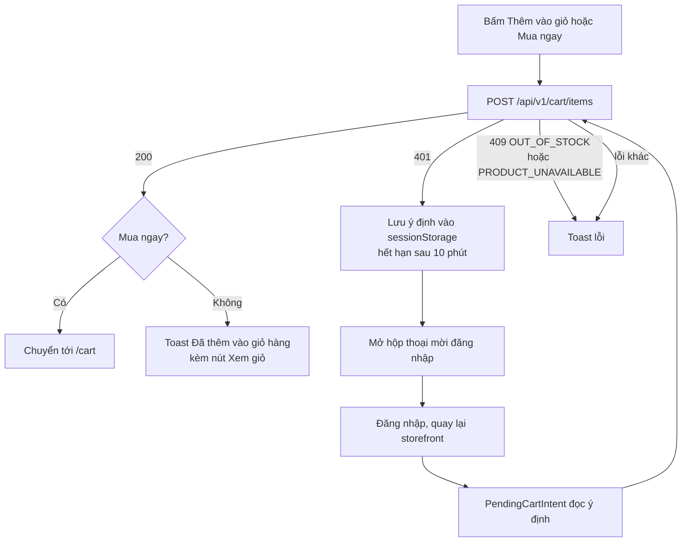
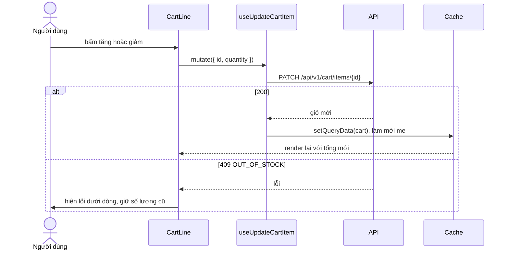

# Giỏ hàng (Cart)

Giỏ hàng lưu theo tài khoản trên backend, không có giỏ hàng cho khách vãng lai. Frontend cho phép khách bấm "Thêm vào giỏ", nhận `401` từ API, rồi lưu ý định để thực hiện lại sau khi đăng nhập.

## Tổng quan

| Mục | Giá trị |
| --- | --- |
| Mã nguồn | [src/features/cart](https://github.com/QuocDuy21-10/laptopshop-web/tree/main/src/features/cart) |
| Route | `/cart` (cần đăng nhập) |
| Thành phần liên quan | Nút thêm vào giỏ ở [AddToCart](https://github.com/QuocDuy21-10/laptopshop-web/tree/main/src/features/products/AddToCart); giỏ mini ở [MiniCart](https://github.com/QuocDuy21-10/laptopshop-web/tree/main/src/components/layout/MiniCart) và [CartLink](https://github.com/QuocDuy21-10/laptopshop-web/tree/main/src/components/layout/CartLink) |
| Hook | `useCart`, `useAddToCart`, `useUpdateCartItem`, `useRemoveCartItem`, `useAddToCartAction` |

## Actors và use cases

| Actor | Use case | Route hoặc nơi thao tác |
| --- | --- | --- |
| Khách vãng lai | Bấm "Thêm vào giỏ" hoặc "Mua ngay", được mời đăng nhập | trang chi tiết sản phẩm (`AddToCart`); thẻ sản phẩm, bảng so sánh, thẻ yêu thích (`AddToCartButton`) |
| Thành viên | Thêm sản phẩm với số lượng chọn trước | trang chi tiết |
| Thành viên | Đổi số lượng, xóa dòng | `/cart` |
| Thành viên | Xem nhanh giỏ (tối đa 4 dòng) | popover giỏ trên header |
| Thành viên | Tiến hành đặt hàng | nút trong `/cart` dẫn tới `/checkout` |

## Hành trình người dùng

1. Ở trang chi tiết, người dùng chọn số lượng (tối đa bằng tồn kho, không quá 100) rồi bấm "Thêm vào giỏ" hoặc "Mua ngay".
2. Thành công: "Thêm vào giỏ" hiện toast "Đã thêm vào giỏ hàng" kèm nút "Xem giỏ"; "Mua ngay" chuyển thẳng tới `/cart`.
3. Ở `/cart`, người dùng đổi số lượng hoặc xóa dòng; tóm tắt bên cạnh cập nhật theo kết quả server trả về.
4. Bấm "Tiến hành đặt hàng" để sang [Checkout](checkout.md).

### Khi chưa đăng nhập

1. Khách bấm "Thêm vào giỏ"; API trả `401`.
2. Hook lưu ý định (mã sản phẩm, số lượng, có chuyển tới giỏ hay không) vào `sessionStorage` và mở hộp thoại mời đăng nhập, `returnTo` là trang hiện tại kèm query.
3. Sau khi đăng nhập và quay lại trang storefront, `PendingCartIntent` đọc ý định, thêm sản phẩm rồi hiện toast hoặc chuyển tới `/cart`.

## Luồng nghiệp vụ

| Việc | Frontend | Backend |
| --- | --- | --- |
| Lưu giỏ | Chỉ gửi `productId`, `quantity` | Lưu theo tài khoản; thêm sản phẩm đã có thì cộng dồn số lượng |
| Kiểm tra tồn kho | Giới hạn bộ chọn số lượng theo `quantity` của sản phẩm | Từ chối `OUT_OF_STOCK` nếu vượt tồn kho |
| Tính giá, giảm giá | Hiển thị `lineTotal`, `subtotal`, `productDiscount`, `totalAfterProductDiscount` | Tính toàn bộ, kể cả khuyến mãi và flash sale |
| Sản phẩm ngừng bán | Hiện badge, vô hiệu hóa đổi số lượng, chặn đặt hàng | Từ chối `PRODUCT_UNAVAILABLE` |

## Business rules

| Quy tắc | Thực thi bởi | Nguồn |
| --- | --- | --- |
| Mỗi lần thêm hoặc cập nhật: số lượng nguyên từ 1 đến 100 | API (và web qua bộ chọn số lượng) | [cart.schema.ts](https://github.com/QuocDuy21-10/laptopshop-api/blob/main/src/modules/cart/cart.schema.ts) |
| Thêm sản phẩm đã có trong giỏ sẽ cộng dồn; vượt tồn kho thì cả thao tác bị hủy với `OUT_OF_STOCK` | API | [cart.service.ts](https://github.com/QuocDuy21-10/laptopshop-api/blob/main/src/modules/cart/cart.service.ts#L60-L83) |
| Cập nhật số lượng vượt tồn kho bị từ chối `OUT_OF_STOCK` | API | cùng file, dòng 85 đến 95 |
| Sản phẩm không còn bán (`isActive` là sai) không thêm, không sửa số lượng được | API, và web ẩn thao tác | cùng file; [CartLine.tsx](https://github.com/QuocDuy21-10/laptopshop-web/blob/main/src/features/cart/CartLine/CartLine.tsx#L33-L63) |
| Còn dòng sản phẩm ngừng kinh doanh thì nút đặt hàng bị vô hiệu | Web | [CartView.tsx](https://github.com/QuocDuy21-10/laptopshop-web/blob/main/src/features/cart/CartView/CartView.tsx#L44-L70) |
| Bộ chọn số lượng ở giỏ có giới hạn trên là nhỏ hơn giữa tồn kho và 100 (tối thiểu 1) | Web | [CartLine.tsx](https://github.com/QuocDuy21-10/laptopshop-web/blob/main/src/features/cart/CartLine/CartLine.tsx#L60) |
| Ý định thêm giỏ hết hạn sau 10 phút | Web | [intent.ts](https://github.com/QuocDuy21-10/laptopshop-web/blob/main/src/features/cart/intent.ts#L1-L2) |
| Khi suất flash sale không đủ, giỏ hiển thị ghi chú và tính theo giá khuyến mãi hoặc giá niêm yết | API quyết định, web hiển thị | [CartLine.tsx](https://github.com/QuocDuy21-10/laptopshop-web/blob/main/src/features/cart/CartLine/CartLine.tsx#L14-L26) |
| Giỏ hàng không giữ chỗ: trong `cart.service.ts`, tồn kho chỉ được so sánh khi thêm hoặc sửa số lượng, không có bước giữ hàng | API | [cart.service.ts](https://github.com/QuocDuy21-10/laptopshop-api/blob/main/src/modules/cart/cart.service.ts#L60-L95) |

## Sơ đồ

### Thêm vào giỏ (activity)

Diễn giải:

- `401` là tín hiệu duy nhất cho "chưa đăng nhập"; không có giỏ hàng tạm cho khách.
- Sau khi thêm thành công, hook lưu giỏ mới trả về vào cache (`setQueryData`) và làm mới `me` để cập nhật `cartItemCount` trên biểu tượng giỏ.
- `PendingCartIntent` chỉ xử lý đúng một lần (cờ `processed`), xóa ý định trước khi gọi API, nên không lặp thao tác nếu người dùng tải lại trang.
- Ý định không hợp lệ hoặc hết hạn bị xóa và bỏ qua.

### Đổi số lượng

Diễn giải: không dùng cập nhật lạc quan; giao diện chỉ đổi sau khi server trả giỏ mới. Trong lúc chờ, dòng đặt `aria-busy` và các nút bị vô hiệu.

## API requests/responses

| Method | Path | Auth | Request | Response | Lỗi thường gặp |
| --- | --- | --- | --- | --- | --- |
| GET | `/api/v1/cart` | Có | không | `200` `{ data: Cart }` | `401` |
| POST | `/api/v1/cart/items` | Có | `{ productId, quantity }` | `200` giỏ mới | `401`, `404` sản phẩm không có, `409` hết hàng hoặc ngừng bán |
| PATCH | `/api/v1/cart/items/{id}` | Có | `{ quantity }` | `200` giỏ mới | `401`, `404`, `409` |
| DELETE | `/api/v1/cart/items/{id}` | Có | không | `204` | `401`, `404` |

Nguồn: [schema.d.ts](https://github.com/QuocDuy21-10/laptopshop-web/blob/main/src/lib/api/schema.d.ts#L4070) (khối `/api/v1/cart*`). `{id}` là mã dòng giỏ hàng, không phải mã sản phẩm. Sau khi xóa, hook làm mới `cart` và `me` thay vì dùng kết quả trả về (vì `204` không có thân).

## Data contracts

Chi tiết ở [Data dictionary: Cart](../06-api-and-data/data-dictionary/cart.md): `Cart`, `CartItem`, `promotionFallback`, `PricedProduct`, ý định thêm giỏ.

## UI states và xử lý lỗi

| Tình huống | Hiển thị |
| --- | --- |
| Đang tải giỏ | `Skeleton` |
| Lỗi tải giỏ | Alert "Không tải được giỏ hàng", thông điệp lỗi và nút "Thử lại" |
| Giỏ trống | "Giỏ hàng đang trống" kèm nút "Xem laptop" |
| Lỗi đổi số lượng hoặc xóa | Dòng chữ lỗi ngay dưới sản phẩm (`role="alert"`) |
| Sản phẩm ngừng kinh doanh | Badge "Ngừng kinh doanh"; ghi chú "Xoá sản phẩm ngừng kinh doanh khỏi giỏ để tiếp tục đặt hàng"; nút đặt hàng bị vô hiệu |
| Hết hàng khi chưa thêm | Trang chi tiết hiện "Sản phẩm tạm hết hàng." thay cho nút thêm |
| Chưa đăng nhập mở giỏ mini | "Đăng nhập để xem giỏ hàng và thanh toán." kèm nút đăng nhập, đăng ký; không gọi API giỏ |
| Giỏ mini có hơn 4 dòng | Hiện 4 dòng đầu và "và N sản phẩm khác" |

## Edge cases

- Cộng dồn vượt tồn kho khi thêm lại cùng sản phẩm: cả thao tác thất bại, giỏ giữ nguyên.
- Suất flash sale hết hoặc người dùng hết lượt mua: dòng giỏ vẫn giữ, được tính giá khác và hiện ghi chú giải thích; người dùng có thể giảm số lượng xuống số suất còn lại.
- Tồn kho giảm sau khi đã thêm vào giỏ: bộ chọn số lượng ở giỏ bị chặn theo tồn kho hiện tại (`product.quantity`), và backend kiểm tra lại khi sửa số lượng. Chưa thấy cảnh báo riêng cho dòng đang vượt tồn kho.
- `sessionStorage` bị chặn: ý định thêm giỏ không được lưu, người dùng phải thêm lại sau khi đăng nhập.
- Nút thêm vào giỏ ở thẻ sản phẩm, bảng so sánh và thẻ yêu thích đều đi qua `useAddToCartAction`; hook giữ lại cả query của trang hiện tại (ví dụ `/compare?ids=...`) làm địa chỉ quay lại sau đăng nhập.

> [!WARNING]
> **Chưa xác minh:** giới hạn tổng số lượng của một dòng sau nhiều lần cộng dồn. Backend giới hạn 100 cho mỗi request, nhưng `cart.service.ts` chỉ kiểm tra tổng so với tồn kho, không thấy chặn trần 100 cho tổng. Cần xác nhận ý định thiết kế.

## Bảo mật

- Mọi thao tác giỏ hàng đều yêu cầu phiên; backend lọc theo `userId` của người gọi (`cart: { userId }`), nên không thao tác được giỏ của người khác.
- Frontend không gửi giá hay tổng tiền; mọi số tiền do server tính.
- Ý định thêm giỏ chỉ chứa mã sản phẩm, số lượng, một cờ và thời hạn; không chứa thông tin nhạy cảm, và được kiểm tra kiểu trước khi dùng.

## Tham chiếu mã nguồn

| Nội dung | File |
| --- | --- |
| Hook | [hooks.ts](https://github.com/QuocDuy21-10/laptopshop-web/blob/main/src/features/cart/hooks.ts) |
| Thêm vào giỏ từ giao diện | [useAddToCartAction.ts](https://github.com/QuocDuy21-10/laptopshop-web/blob/main/src/features/cart/useAddToCartAction.ts#L10-L37), [AddToCart.tsx](https://github.com/QuocDuy21-10/laptopshop-web/blob/main/src/features/products/AddToCart/AddToCart.tsx) |
| Ý định chờ | [intent.ts](https://github.com/QuocDuy21-10/laptopshop-web/blob/main/src/features/cart/intent.ts), [PendingCartIntent.tsx](https://github.com/QuocDuy21-10/laptopshop-web/blob/main/src/features/cart/PendingCartIntent/PendingCartIntent.tsx) |
| Trang giỏ | [CartView.tsx](https://github.com/QuocDuy21-10/laptopshop-web/blob/main/src/features/cart/CartView/CartView.tsx), [CartLine.tsx](https://github.com/QuocDuy21-10/laptopshop-web/blob/main/src/features/cart/CartLine/CartLine.tsx), [CartSummary.tsx](https://github.com/QuocDuy21-10/laptopshop-web/blob/main/src/features/cart/CartSummary/CartSummary.tsx) |
| Giỏ mini | [MiniCart.tsx](https://github.com/QuocDuy21-10/laptopshop-web/blob/main/src/components/layout/MiniCart/MiniCart.tsx) |
| Test | [CartLine.test.tsx](https://github.com/QuocDuy21-10/laptopshop-web/blob/main/tests/features/CartLine.test.tsx), [CartSummary.test.tsx](https://github.com/QuocDuy21-10/laptopshop-web/blob/main/tests/features/CartSummary.test.tsx), [useAddToCartAction.test.tsx](https://github.com/QuocDuy21-10/laptopshop-web/blob/main/tests/features/useAddToCartAction.test.tsx), [MiniCart.test.tsx](https://github.com/QuocDuy21-10/laptopshop-web/blob/main/tests/components/MiniCart.test.tsx), [PendingCartIntent.test.tsx](https://github.com/QuocDuy21-10/laptopshop-web/blob/main/tests/features/cart/PendingCartIntent.test.tsx) |
| Backend | [src/modules/cart](https://github.com/QuocDuy21-10/laptopshop-api/tree/main/src/modules/cart) |

## Tài liệu liên quan

- [Checkout](checkout.md)
- [Auth](auth.md)
- [Sản phẩm](products.md)
- [Data dictionary: Cart](../06-api-and-data/data-dictionary/cart.md)
