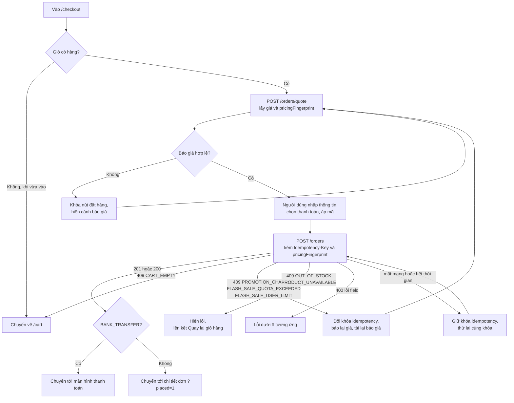
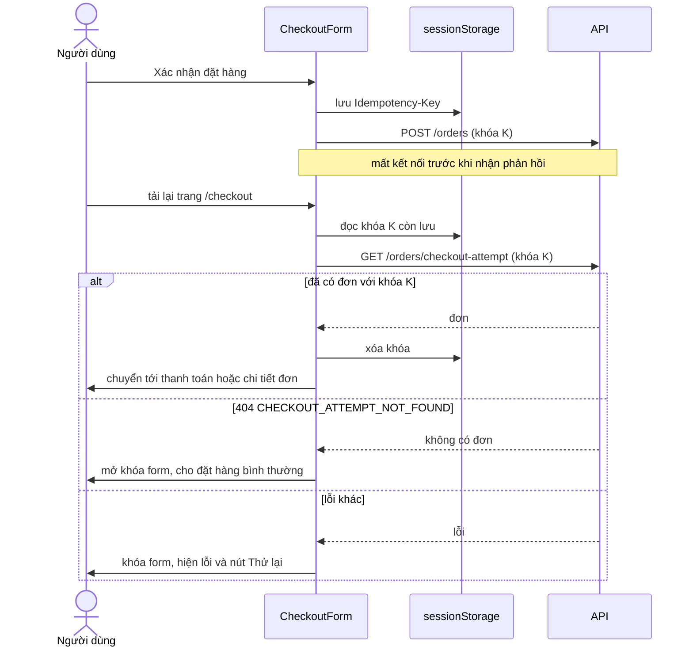

# Đặt hàng (Checkout)

Checkout biến giỏ hàng thành đơn hàng. Giao diện chỉ thu thập thông tin nhận hàng và phương thức thanh toán; giá, giảm giá, tồn kho và việc tạo đơn đều do backend quyết định. Hai cơ chế an toàn quan trọng nhất là **báo giá có dấu vân tay** (`pricingFingerprint`) và **khóa idempotency**.

## Tổng quan

| Mục | Giá trị |
| --- | --- |
| Mã nguồn | [src/features/checkout](https://github.com/QuocDuy21-10/laptopshop-web/tree/main/src/features/checkout) |
| Route | `/checkout` (cần đăng nhập) |
| Hook | `useCheckoutQuote`, `usePlaceOrder`, `usePaymentMethods` (module payments) |
| Điểm đến sau khi đặt | `/account/orders/{id}/payment` (chuyển khoản) hoặc `/account/orders/{id}?placed=1` (các trường hợp còn lại) |

## Actors và use cases

| Actor | Use case | Nơi thao tác |
| --- | --- | --- |
| Thành viên | Xem tóm tắt đơn và giá do server tính | `/checkout` |
| Thành viên | Nhập hoặc sửa tên, số điện thoại, địa chỉ nhận hàng (điền sẵn từ hồ sơ) | `CheckoutForm` |
| Thành viên | Áp mã giảm giá | `CouponInput` |
| Thành viên | Chọn COD hoặc chuyển khoản (nếu được bật) | `CheckoutForm` |
| Thành viên | Xác nhận đặt hàng | nút "Xác nhận đặt hàng" |

## Hành trình người dùng

1. Từ `/cart`, người dùng bấm "Tiến hành đặt hàng". Giỏ trống thì bị đưa về `/cart`.
2. Form được điền sẵn tên, số điện thoại, địa chỉ từ hồ sơ (`useMe`).
3. Trang gọi báo giá và hiển thị tóm tắt: ưu đãi sản phẩm, giảm giá mã, tổng cộng và tiền từng dòng. Trong lúc chưa có báo giá hợp lệ, nút đặt hàng bị khóa và hiện "Đang xác nhận giá và ưu đãi."
4. Tùy chọn: nhập mã giảm giá rồi bấm "Áp dụng"; báo giá được tính lại.
5. Chọn phương thức thanh toán và bấm "Xác nhận đặt hàng".
6. Chuyển khoản dẫn tới màn hình thanh toán ([Payments](payments.md)); COD dẫn tới chi tiết đơn ([Orders](orders.md)).

## Luồng nghiệp vụ

| Việc | Frontend | Backend |
| --- | --- | --- |
| Tính giá | Gửi mã giảm giá (nếu có), hiển thị kết quả | Tính giá, khuyến mãi, mã giảm giá; trả `pricingFingerprint` |
| Chặn giá thay đổi | Gửi lại đúng `pricingFingerprint` đã nhận | So khớp với giá tính lại; lệch thì từ chối `PROMOTION_CHANGED` |
| Chống đặt trùng | Sinh `Idempotency-Key`, giữ qua các lần thử | Trả lại đơn cũ nếu khóa đã dùng với cùng nội dung |
| Tạo đơn | Chỉ gửi thông tin nhận hàng | Khóa sản phẩm, kiểm tra tồn kho, trừ kho, đóng băng giá, tạo thanh toán, xóa giỏ |

## Business rules

| Quy tắc | Thực thi bởi | Nguồn |
| --- | --- | --- |
| Tên người nhận 1 đến 255 ký tự; địa chỉ 1 đến 255 ký tự | Web và API | [schema.ts](https://github.com/QuocDuy21-10/laptopshop-web/blob/main/src/features/checkout/schema.ts), [orders.schema.ts](https://github.com/QuocDuy21-10/laptopshop-api/blob/main/src/modules/orders/orders.schema.ts#L5-L12) |
| Số điện thoại: web chấp nhận 8 đến 20 ký tự gồm chữ số và `+ ( ) . -` khoảng trắng; API chỉ yêu cầu 8 đến 20 ký tự | Web, API | cùng hai file |
| Phương thức thanh toán là `COD` hoặc `BANK_TRANSFER`, mặc định `COD` | Web và API | cùng hai file |
| Chuyển khoản chỉ dùng được khi backend bật; nếu không, từ chối `PAYMENT_METHOD_UNAVAILABLE` | API | [orders.service.ts](https://github.com/QuocDuy21-10/laptopshop-api/blob/main/src/modules/orders/orders.service.ts#L84-L86) |
| Mã giảm giá 1 đến 50 ký tự | API | [orders.schema.ts](https://github.com/QuocDuy21-10/laptopshop-api/blob/main/src/modules/orders/orders.schema.ts#L10-L15) |
| `pricingFingerprint` là chuỗi đúng 64 ký tự, bắt buộc | API | cùng file |
| Nếu có mã giảm giá hoặc khuyến mãi mà dấu vân tay không khớp giá tính lại, đơn bị từ chối `PROMOTION_CHANGED` | API | [orders.service.ts](https://github.com/QuocDuy21-10/laptopshop-api/blob/main/src/modules/orders/orders.service.ts#L158-L160) |
| Khóa idempotency dài 1 đến 64 ký tự; dùng lại khóa với nội dung khác bị từ chối `IDEMPOTENCY_KEY_REUSED` | API | [idempotency.ts](https://github.com/QuocDuy21-10/laptopshop-api/blob/main/src/lib/idempotency.ts), [orders.service.ts](https://github.com/QuocDuy21-10/laptopshop-api/blob/main/src/modules/orders/orders.service.ts#L56-L66) |
| Tồn kho bị trừ ngay khi đặt hàng (ghi sổ kho với lý do `ORDER`) | API | [orders.service.ts](https://github.com/QuocDuy21-10/laptopshop-api/blob/main/src/modules/orders/orders.service.ts#L177-L188) |
| Giá được đóng băng vào từng dòng đơn (giá niêm yết, giảm giá, bảo hành tại thời điểm đặt) | API | cùng file, dòng 233 đến 245 |
| Đơn chuyển khoản có tổng lớn hơn 0 sinh bản ghi thanh toán trạng thái `PENDING` | API | cùng file, dòng 191 đến 213 |
| Đơn có tổng bằng 0 được tạo với phương thức `FREE` và trạng thái thanh toán thành công | API | cùng file, dòng 230 đến 231 |
| Giỏ hàng bị xóa trong cùng giao dịch tạo đơn | API | cùng file, dòng 296 đến 299 |
| Báo giá làm mới mỗi 12 giây khi tab hiển thị, và khi tab được focus lại | Web | [useCheckoutQuote.ts](https://github.com/QuocDuy21-10/laptopshop-web/blob/main/src/features/checkout/useCheckoutQuote.ts#L12-L21) |
| Chỉ cho đặt hàng khi báo giá hợp lệ và phủ mọi sản phẩm trong giỏ | Web | [CheckoutView.tsx](https://github.com/QuocDuy21-10/laptopshop-web/blob/main/src/features/checkout/CheckoutView/CheckoutView.tsx#L41-L44) |

## Sơ đồ

### Quy trình đặt hàng (activity)

Diễn giải:

- Báo giá là nguồn duy nhất của mọi con số; frontend không tự cộng trừ.
- Khi giá hoặc suất ưu đãi đổi giữa lúc báo giá và lúc đặt, backend từ chối thay vì tính một giá người dùng chưa thấy. Frontend đổi sang khóa idempotency mới (vì nội dung yêu cầu sẽ khác), báo "Giá hoặc suất ưu đãi đã thay đổi. Vui lòng xác nhận lại đơn hàng." và tải lại báo giá để người dùng xem giá mới trước khi đặt lại.
- Hết hàng hoặc ngừng bán không tự sửa được, nên người dùng được đưa về giỏ.

### Khôi phục sau khi mạng hoặc trình duyệt gặp sự cố

Diễn giải: khóa idempotency được lưu trong `sessionStorage` và dùng lại cho mọi lần gửi lại của cùng một lần đặt hàng, nên yêu cầu bị timeout không bao giờ tạo hai đơn. Trước khi cho đặt đơn mới, nếu còn khóa cũ, trang hỏi backend xem lần trước đã thành đơn chưa; trong lúc chưa biết, form bị khóa. Khi gửi lại cùng khóa, backend trả đơn đã tạo (HTTP 200) thay vì tạo mới (201).

## API requests/responses

| Method | Path | Auth | Request | Response | Lỗi thường gặp |
| --- | --- | --- | --- | --- | --- |
| POST | `/api/v1/orders/quote` | Có | `{ couponCode? }` | `200` `{ data: PricingQuote }` | `401`; `409` mã không hợp lệ, chưa đạt đơn tối thiểu hoặc giỏ trống |
| POST | `/api/v1/orders` | Có, kèm header `Idempotency-Key` | `receiverName`, `receiverAddress`, `receiverPhone`, `paymentMethod?`, `couponCode?`, `pricingFingerprint` | `201` tạo mới, `200` khóa đã dùng; `{ data: Order }` | `400`; `409` `CART_EMPTY`, `OUT_OF_STOCK`, `PRODUCT_UNAVAILABLE`, `PROMOTION_CHANGED`, `IDEMPOTENCY_KEY_REUSED`, `PAYMENT_METHOD_UNAVAILABLE` |
| GET | `/api/v1/orders/checkout-attempt` | Có, kèm header `Idempotency-Key` | không | `200` đơn đã tạo | `404` `CHECKOUT_ATTEMPT_NOT_FOUND` |
| GET | `/api/v1/payments/methods` | Có | không | `{ data: [{ code, enabled }] }` | `401` |

Nguồn kiểu: [schema.d.ts](https://github.com/QuocDuy21-10/laptopshop-web/blob/main/src/lib/api/schema.d.ts) (các khối `/api/v1/orders*` và `/api/v1/payments/methods`).

## Data contracts

Chi tiết ở [Data dictionary: Checkout](../06-api-and-data/data-dictionary/checkout.md): `ReceiverInput`, `PricingQuote`, body đặt hàng, `PaymentMethodOption`, khóa idempotency cục bộ.

## UI states và xử lý lỗi

| Tình huống | Hiển thị |
| --- | --- |
| Đang tải giỏ hoặc hồ sơ | `Skeleton` |
| Lỗi tải giỏ hoặc hồ sơ | Alert lỗi theo `errorMessage` |
| Đang lấy hoặc làm mới báo giá | Cảnh báo "Đang xác nhận giá và ưu đãi." (ở tóm tắt) và "Đang cập nhật giá và ưu đãi. Vui lòng chờ trước khi đặt hàng." (ở form); nút đặt hàng bị khóa |
| Báo giá lỗi | "Không thể cập nhật giá và ưu đãi. Vui lòng thử lại trước khi đặt hàng."; lỗi cụ thể hiện ở ô mã giảm giá |
| Mã giảm giá không hợp lệ | Lỗi dưới ô mã giảm giá; vì báo giá lỗi nên nút đặt hàng cũng khóa cho tới khi áp mã hợp lệ hoặc bỏ mã |
| Giá hoặc suất ưu đãi đổi | Alert lỗi "Giá hoặc suất ưu đãi đã thay đổi...", form khóa tới khi báo giá mới về |
| Hết hàng hoặc ngừng bán | Alert lỗi kèm liên kết "Quay lại giỏ hàng"; dữ liệu đã nhập được giữ |
| Mất mạng khi đang gửi | Cảnh báo "Mất kết nối mạng. Đơn hàng sẽ được gửi khi có mạng trở lại."; TanStack Query tạm dừng mutation và gửi lại với cùng khóa |
| Đang kiểm tra lần đặt trước | Form bị khóa; lỗi kiểm tra kèm nút "Thử lại" |
| Lỗi field từ API | Dưới ô tương ứng ("Giá trị không hợp lệ") |

## Edge cases

- Giỏ trống khi vừa vào trang bị chuyển về `/cart`; giỏ trống do vừa đặt thành công thì không bị chuyển (cờ `hadItems`), vì form đang điều hướng tới đơn.
- Đổi mã giảm giá tạo báo giá mới với `pricingFingerprint` mới; form luôn gửi dấu vân tay của báo giá đang hiển thị.
- Nút đặt hàng không thao tác được nếu thiếu `pricingFingerprint`, đang khôi phục lần trước, hoặc đang tính lại giá.
- Sau khi đặt thành công, khóa cũ bị xóa và khóa mới được tạo sẵn cho lần đặt kế tiếp.
- Nếu `GET /payments/methods` chưa trả về, form chỉ cho chọn COD.
- Tab chạy nền không làm mới báo giá (`refetchIntervalInBackground: false`).

> [!WARNING]
> **Chưa xác minh:** `schema.d.ts` khai báo `PricingQuote.lines[]` chỉ có `promotionFallback`, trong khi `CheckoutView` đọc `productId` và `netLineTotal` của từng dòng bằng cách ép kiểu `unknown` ([CheckoutView.tsx](https://github.com/QuocDuy21-10/laptopshop-web/blob/main/src/features/checkout/CheckoutView/CheckoutView.tsx#L18-L24)). Tài liệu OpenAPI ở backend có `netLineTotal` (xem [openapi.ts](https://github.com/QuocDuy21-10/laptopshop-api/blob/main/src/docs/openapi.ts#L479)), nên `schema.d.ts` trong repo này có thể đã cũ; cần chạy `pnpm gen:api` để xác nhận.

> `pricingFingerprint` là mã băm SHA-256 của các dòng, mã giảm giá và tổng tiền, không có thời hạn ([promotion-fingerprint.ts](https://github.com/QuocDuy21-10/laptopshop-api/blob/main/src/modules/promotions/promotion-fingerprint.ts#L9-L40)). Khi đặt hàng, nếu có mã giảm giá hoặc khuyến mãi mà mã băm tính lại khác thì trả `PROMOTION_CHANGED` ([orders.service.ts](https://github.com/QuocDuy21-10/laptopshop-api/blob/main/src/modules/orders/orders.service.ts#L158-L160)). Đơn tối thiểu của mã so với tạm tính sau ưu đãi sản phẩm (hoặc phần đủ điều kiện với mã theo sản phẩm); thiếu thì `MIN_ORDER_NOT_MET` ([promotions.service.ts](https://github.com/QuocDuy21-10/laptopshop-api/blob/main/src/modules/promotions/promotions.service.ts#L722-L736)).

## Bảo mật

- Frontend không bao giờ gửi giá hay tổng tiền; chỉ gửi dấu vân tay do server cấp để chứng minh người dùng đã thấy đúng giá.
- Khóa idempotency sinh bằng `crypto.randomUUID()` và chỉ lưu trong `sessionStorage` của tab; không chứa thông tin nhạy cảm.
- Backend lọc giỏ và đơn theo `userId` của phiên, nên không đặt hoặc khôi phục được đơn của người khác.
- Các dòng sản phẩm trong giỏ được khóa trong giao dịch cơ sở dữ liệu (`lockProductRows`) trước khi trừ kho, để hai lần đặt đồng thời không cùng trừ một tồn kho.
- Trong [app.ts](https://github.com/QuocDuy21-10/laptopshop-api/blob/main/src/app.ts#L76-L86), bộ giới hạn riêng chỉ gắn cho các endpoint auth và newsletter; endpoint đặt hàng chịu giới hạn chung (`globalLimiter`). Chưa kiểm tra giới hạn gắn ở nơi khác.

## Tham chiếu mã nguồn

| Nội dung | File |
| --- | --- |
| Schema form | [schema.ts](https://github.com/QuocDuy21-10/laptopshop-web/blob/main/src/features/checkout/schema.ts) |
| Báo giá | [useCheckoutQuote.ts](https://github.com/QuocDuy21-10/laptopshop-web/blob/main/src/features/checkout/useCheckoutQuote.ts) |
| Đặt hàng | [usePlaceOrder.ts](https://github.com/QuocDuy21-10/laptopshop-web/blob/main/src/features/checkout/usePlaceOrder.ts) |
| Form, khôi phục, xử lý lỗi | [CheckoutForm.tsx](https://github.com/QuocDuy21-10/laptopshop-web/blob/main/src/features/checkout/CheckoutForm/CheckoutForm.tsx#L28-L122) |
| Trang và tóm tắt | [CheckoutView.tsx](https://github.com/QuocDuy21-10/laptopshop-web/blob/main/src/features/checkout/CheckoutView/CheckoutView.tsx) |
| Mã giảm giá | [CouponInput.tsx](https://github.com/QuocDuy21-10/laptopshop-web/blob/main/src/features/checkout/CouponInput/CouponInput.tsx) |
| Test | [CheckoutForm.test.tsx](https://github.com/QuocDuy21-10/laptopshop-web/blob/main/tests/features/CheckoutForm.test.tsx), [CheckoutView.test.tsx](https://github.com/QuocDuy21-10/laptopshop-web/blob/main/tests/features/CheckoutView.test.tsx), [useCheckoutQuote.test.tsx](https://github.com/QuocDuy21-10/laptopshop-web/blob/main/tests/features/useCheckoutQuote.test.tsx) |
| Backend | [orders.service.ts](https://github.com/QuocDuy21-10/laptopshop-api/blob/main/src/modules/orders/orders.service.ts#L69-L312) |

## Tài liệu liên quan

- [Giỏ hàng](cart.md)
- [Thanh toán (Payments)](payments.md)
- [Đơn hàng (Orders)](orders.md)
- [Data dictionary: Checkout](../06-api-and-data/data-dictionary/checkout.md)
