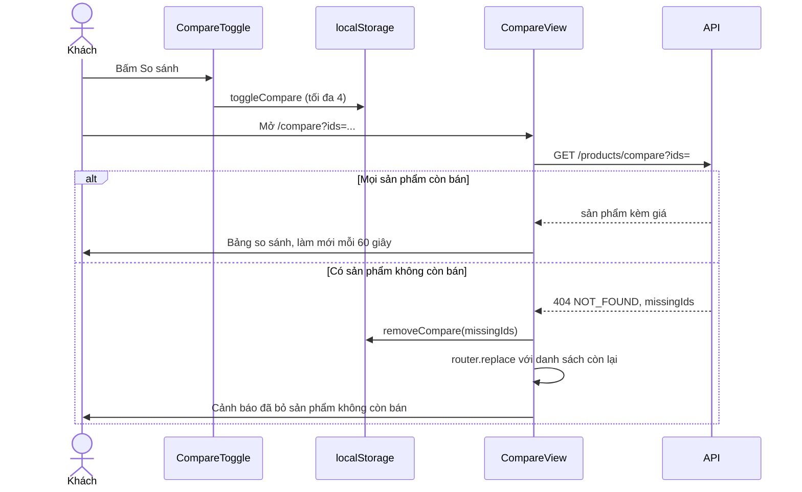

# So sánh sản phẩm (Compare)

Khách chọn tối đa 4 laptop để xem thông số và giá cạnh nhau. Danh sách đã chọn lưu trong `localStorage` của trình duyệt (không cần đăng nhập, không gửi lên backend). Trang `/compare` lấy dữ liệu mới nhất của các sản phẩm từ API; frontend tô sáng giá trị tốt nhất của từng dòng.

## Tổng quan

| Mục | Giá trị |
| --- | --- |
| Mã nguồn | [src/features/compare](https://github.com/QuocDuy21-10/laptopshop-web/tree/main/src/features/compare) |
| Route | `/compare?ids=1,2,3` (công khai, `robots: noindex`) |
| Nơi chọn sản phẩm | `CompareToggle` ở [ProductCard](https://github.com/QuocDuy21-10/laptopshop-web/blob/main/src/features/products/ProductCard/ProductCard.tsx) và trang chi tiết; thanh `CompareBar` gắn trong [SiteShell](https://github.com/QuocDuy21-10/laptopshop-web/blob/main/src/components/layout/SiteShell/SiteShell.tsx) |
| Lưu trữ | `localStorage`, khóa `laptopshop.compare` ([store.ts](https://github.com/QuocDuy21-10/laptopshop-web/blob/main/src/features/compare/store.ts#L8)) |
| Backend | `GET /api/v1/products/compare` ([products.routes.ts](https://github.com/QuocDuy21-10/laptopshop-api/blob/main/src/modules/products/products.routes.ts#L33-L34)) |
| Test | [tests/features/compare](https://github.com/QuocDuy21-10/laptopshop-web/tree/main/tests/features/compare) |

## Actors và use cases

| Actor | Use case | Nơi thao tác |
| --- | --- | --- |
| Khách vãng lai, thành viên | Bấm "So sánh" ở thẻ sản phẩm để thêm hoặc bỏ | thẻ sản phẩm |
| Khách vãng lai, thành viên | Xem, xóa từng sản phẩm hoặc xóa tất cả ở thanh so sánh | `CompareBar` |
| Khách vãng lai, thành viên | Xem bảng so sánh, bỏ một sản phẩm khỏi bảng | `/compare` |

## Hành trình người dùng

1. Khách bấm "So sánh" trên 2 đến 4 sản phẩm; thanh nổi liệt kê ảnh và tên, nhắc "Chọn thêm ít nhất 1 sản phẩm" khi mới có một.
2. Từ 2 sản phẩm, nút "So sánh (N)" dẫn tới `/compare?ids=...`.
3. Trang tải thông số và giá mới nhất, hiện bảng; ô tốt nhất có huy hiệu "Tốt nhất".
4. Khách có thể bỏ sản phẩm khỏi bảng; URL và danh sách lưu cùng cập nhật.
5. Vào `/compare` không kèm `ids` mà đã lưu từ 2 sản phẩm: tự chuyển tới URL có `ids`.

## Luồng nghiệp vụ

| Việc | Frontend | Backend |
| --- | --- | --- |
| Chọn sản phẩm | Ghi vào `localStorage` | Không tham gia |
| Lấy dữ liệu | `GET /products/compare?ids=` khi có ít nhất 2 mã | Chỉ sản phẩm đang bán; trả giá và khuyến mãi hiện tại |
| Sản phẩm không còn bán | Bỏ khỏi danh sách và URL, hiện cảnh báo | Trả 404 `NOT_FOUND` kèm `missingIds` |
| Làm mới | Hỏi lại mỗi 60 giây và khi tab lấy lại focus | |

## Business rules

| Quy tắc | Thực thi bởi | Nguồn |
| --- | --- | --- |
| Tối đa 4 sản phẩm; thêm sản phẩm thứ 5 báo lỗi "Chỉ so sánh tối đa 4 sản phẩm" | Web | [store.ts](https://github.com/QuocDuy21-10/laptopshop-web/blob/main/src/features/compare/store.ts#L3), [store.ts](https://github.com/QuocDuy21-10/laptopshop-web/blob/main/src/features/compare/store.ts#L68), [CompareToggle.tsx](https://github.com/QuocDuy21-10/laptopshop-web/blob/main/src/features/compare/CompareToggle/CompareToggle.tsx#L16) |
| API nhận 2 đến 4 mã, mỗi mã tối đa 9 chữ số, không trùng | API | [products.schema.ts](https://github.com/QuocDuy21-10/laptopshop-api/blob/main/src/modules/products/products.schema.ts#L166-L178) |
| Mục lưu không hợp lệ (mã sai, trùng, hỏng JSON) bị bỏ; chỉ giữ 4 mục đầu | Web | [store.ts](https://github.com/QuocDuy21-10/laptopshop-web/blob/main/src/features/compare/store.ts#L36-L50) |
| Chỉ sản phẩm `isActive` được so sánh; thiếu bất kỳ mã nào thì cả yêu cầu 404 | API | [products.service.ts](https://github.com/QuocDuy21-10/laptopshop-api/blob/main/src/modules/products/products.service.ts#L138-L144) |
| Giá hiển thị là giá khuyến mãi hiện hành khi cờ `CATALOG_PROMOTION_PRICING_ENABLED` bật, ngược lại là giá niêm yết | API | [products.service.ts](https://github.com/QuocDuy21-10/laptopshop-api/blob/main/src/modules/products/products.service.ts#L145-L148) |
| Dòng nào có "tốt hơn" (cao hơn hoặc thấp hơn) mới được tô; cần ít nhất hai giá trị đã biết và không hòa | Web | [specs.ts](https://github.com/QuocDuy21-10/laptopshop-web/blob/main/src/features/compare/specs.ts#L54-L61) |
| Hướng "tốt hơn": RAM, ổ cứng, tần số quét, pin, bảo hành là cao hơn; trọng lượng là thấp hơn; CPU, GPU, màn hình, độ phân giải không xếp hạng | Web | [specs.ts](https://github.com/QuocDuy21-10/laptopshop-web/blob/main/src/features/compare/specs.ts#L28-L49) |
| Giá "tốt nhất" so theo giá khách thấy (`salePrice` hoặc `price`) | Web | [CompareTable.tsx](https://github.com/QuocDuy21-10/laptopshop-web/blob/main/src/features/compare/CompareTable/CompareTable.tsx#L71-L80) |

## Sơ đồ

`CompareView` đọc `ids` từ URL, nên liên kết chia sẻ được; danh sách trong `localStorage` chỉ là nguồn khi vào `/compare` trống ([CompareView.tsx](https://github.com/QuocDuy21-10/laptopshop-web/blob/main/src/features/compare/CompareView/CompareView.tsx#L40-L49)).

## API requests/responses

| Method | Path | Auth | Request | Response | Lỗi thường gặp |
| --- | --- | --- | --- | --- | --- |
| GET | `/api/v1/products/compare` | Không | `ids` chuỗi mã phân cách bằng dấu phẩy | `{ data: PricedProduct[] }` theo thứ tự `ids` | `400` (định dạng, ngoài 2 đến 4, trùng); `404 NOT_FOUND` kèm `details.missingIds` |

Mã sai định dạng (NaN, 0) được gửi nguyên để API trả 400 ([hooks.ts](https://github.com/QuocDuy21-10/laptopshop-web/blob/main/src/features/compare/hooks.ts#L8)).

## Data contracts

Danh sách lưu (`CompareItem`) và `PricedProduct` ở [Data dictionary: Compare](../06-api-and-data/data-dictionary/compare.md).

## UI states và xử lý lỗi

- Dưới 2 mã: `EmptyState` "Chọn ít nhất 2 sản phẩm để so sánh" kèm nút "Xem laptop" ([CompareView.tsx](https://github.com/QuocDuy21-10/laptopshop-web/blob/main/src/features/compare/CompareView/CompareView.tsx#L57-L68)).
- Đang tải: `Skeleton`. Lỗi khác (không phải thiếu sản phẩm): `Alert` kèm liên kết về danh sách ([CompareView.tsx](https://github.com/QuocDuy21-10/laptopshop-web/blob/main/src/features/compare/CompareView/CompareView.tsx#L69-L77)). Truy vấn không tự thử lại (`retry: false`).
- Cảnh báo "Một số sản phẩm không còn bán đã được bỏ khỏi danh sách so sánh." khi tự bỏ sản phẩm.
- Bảng cuộn ngang trên màn hẹp, kèm gợi ý "Vuốt ngang để xem các sản phẩm còn lại."
- Giá trị thiếu hiện dấu "—" ([SpecTable.tsx](https://github.com/QuocDuy21-10/laptopshop-web/blob/main/src/features/compare/SpecTable/SpecTable.tsx#L9)).
- `CompareBar` ẩn khi danh sách rỗng hoặc đang ở `/compare`.

## Edge cases

- `localStorage` bị chặn hoặc đầy: `toggleCompare` trả `error` và hiện toast "Không thể lưu danh sách so sánh trên trình duyệt này"; tính năng coi như rỗng ([store.ts](https://github.com/QuocDuy21-10/laptopshop-web/blob/main/src/features/compare/store.ts#L26-L33), [store.ts](https://github.com/QuocDuy21-10/laptopshop-web/blob/main/src/features/compare/store.ts#L52-L61)).
- Mở nhiều tab: sự kiện `storage` đồng bộ danh sách giữa các tab ([store.ts](https://github.com/QuocDuy21-10/laptopshop-web/blob/main/src/features/compare/store.ts#L77-L87)).
- Render server luôn rỗng để khớp hydration ([useCompare.ts](https://github.com/QuocDuy21-10/laptopshop-web/blob/main/src/features/compare/useCompare.ts#L6-L8)).
- Ảnh và tên trong danh sách lưu có thể cũ so với dữ liệu thật; bảng `/compare` luôn dùng dữ liệu từ API.

## Bảo mật

- Không dữ liệu cá nhân, không token; `localStorage` chỉ chứa mã, tên, ảnh sản phẩm.
- Endpoint công khai; mã được kiểm tra chặt ở backend trước khi truy vấn.

## Tham chiếu mã nguồn

- Web: [store.ts](https://github.com/QuocDuy21-10/laptopshop-web/blob/main/src/features/compare/store.ts), [hooks.ts](https://github.com/QuocDuy21-10/laptopshop-web/blob/main/src/features/compare/hooks.ts), [specs.ts](https://github.com/QuocDuy21-10/laptopshop-web/blob/main/src/features/compare/specs.ts), [CompareView.tsx](https://github.com/QuocDuy21-10/laptopshop-web/blob/main/src/features/compare/CompareView/CompareView.tsx), [CompareTable.tsx](https://github.com/QuocDuy21-10/laptopshop-web/blob/main/src/features/compare/CompareTable/CompareTable.tsx).
- Backend: [products.schema.ts](https://github.com/QuocDuy21-10/laptopshop-api/blob/main/src/modules/products/products.schema.ts), [products.service.ts](https://github.com/QuocDuy21-10/laptopshop-api/blob/main/src/modules/products/products.service.ts).

> [!WARNING]
> **Chưa xác minh:** (1) bố cục thanh `CompareBar` trên màn hẹp (chỉ đọc mã, chưa xem giao diện); (2) `SpecTable` ở trang sản phẩm và quan hệ với bảng so sánh.

## Tài liệu liên quan

- [Products](products.md): thẻ sản phẩm chứa nút so sánh.
- [Promotions](promotions.md): giá khuyến mãi trong bảng.
- [Wishlist](wishlist.md)
