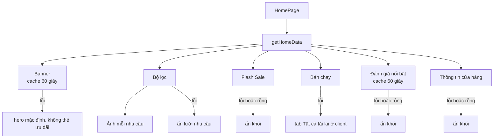

# Trang chủ (Home)

Trang chủ `/` gom nhiều khối: banner hero và thẻ ưu đãi do admin cấu hình, dải thương hiệu, lưới nhu cầu, Flash Sale, bán chạy, lời mời tư vấn, thông tin cửa hàng, đánh giá nổi bật và đăng ký bản tin. Trang là Server Component; mỗi khối lấy dữ liệu độc lập, khối nào lỗi thì tự ẩn mà không làm hỏng cả trang.

## Tổng quan

| Mục | Giá trị |
| --- | --- |
| Mã nguồn | [src/features/home](https://github.com/QuocDuy21-10/laptopshop-web/tree/main/src/features/home) (khách), [src/features/admin/home-banners](https://github.com/QuocDuy21-10/laptopshop-web/tree/main/src/features/admin/home-banners) (admin) |
| Route | `/` ([page.tsx](https://github.com/QuocDuy21-10/laptopshop-web/blob/main/src/app/%28storefront%29/page.tsx)) |
| Route admin | `/admin/home-banners`, `/admin/home-banners/new`, `/admin/home-banners/[id]` |
| Lấy dữ liệu | `getHomeData` ở [server.ts](https://github.com/QuocDuy21-10/laptopshop-web/blob/main/src/features/home/server.ts) |
| Backend | [src/modules/home-banners](https://github.com/QuocDuy21-10/laptopshop-api/tree/main/src/modules/home-banners) và các endpoint sản phẩm, đánh giá, thông tin cửa hàng |
| Test | [tests/features/home](https://github.com/QuocDuy21-10/laptopshop-web/tree/main/tests/features/home) |

## Actors và use cases

| Actor | Use case | Nơi thao tác |
| --- | --- | --- |
| Khách vãng lai | Xem banner, vào danh mục theo nhu cầu, xem Flash Sale và bán chạy | `/` |
| Khách vãng lai | Chuyển tab bán chạy theo nhu cầu | khối bán chạy |
| Khách vãng lai | Vào trang tư vấn, đăng ký bản tin | khối tư vấn, khối bản tin |
| Admin | Tạo, sửa, bật tắt, xóa banner; thêm hoặc xóa ảnh | `/admin/home-banners` |

## Hành trình người dùng

1. Khách mở `/`; thấy hero (hoặc hero mặc định nếu chưa có banner) và các thẻ ưu đãi bên cạnh.
2. Cuộn qua dải thương hiệu, lưới "theo nhu cầu" (mỗi nhu cầu kèm ảnh sản phẩm bán chạy nhất), Flash Sale, bán chạy.
3. Ở khối bán chạy, bấm tab để xem theo nhu cầu; bấm "Xem tất cả" để sang danh sách sản phẩm đã sắp xếp theo đã bán.
4. Cuối trang: thông tin liên hệ cửa hàng, đánh giá nổi bật, ô đăng ký bản tin.

## Luồng nghiệp vụ

| Khối | Dữ liệu | Hiển thị khi |
| --- | --- | --- |
| Hero, thẻ ưu đãi | `GET /home-banners` (cache 60 giây) | Có banner; không có hero thì hiện hero mặc định ([HomeHero.tsx](https://github.com/QuocDuy21-10/laptopshop-web/blob/main/src/features/home/HomeHero/HomeHero.tsx#L35-L53)) |
| Dải thương hiệu | Danh sách cố định trong mã ([BrandMarquee.tsx](https://github.com/QuocDuy21-10/laptopshop-web/blob/main/src/features/home/BrandMarquee/BrandMarquee.tsx#L15)) | Luôn hiện |
| Lưới nhu cầu | `targetOptions` của bộ lọc và ảnh sản phẩm bán chạy nhất mỗi nhu cầu | Có ít nhất một nhu cầu |
| Flash Sale | `GET /products?flashSale=true&sort=sold_desc` | Có sản phẩm; không thì ẩn ([FlashSaleSection.tsx](https://github.com/QuocDuy21-10/laptopshop-web/blob/main/src/features/home/FlashSaleSection/FlashSaleSection.tsx#L15)) |
| Bán chạy | `GET /products?sort=sold_desc`, đổi tab thì gọi lại theo `target` | Luôn hiện; lỗi tải tab hiện `Alert` |
| Tư vấn | Nội dung tĩnh | Luôn hiện |
| Cam kết cửa hàng | `getStoreInfo` | Có ít nhất một thông tin cấu hình |
| Đánh giá nổi bật | `GET /reviews/highlights?limit=6` | Có ít nhất một đánh giá |
| Bản tin | Form đăng ký bản tin (xem [Newsletter](newsletter.md)) | Luôn hiện |

## Business rules

| Quy tắc | Thực thi bởi | Nguồn |
| --- | --- | --- |
| Mỗi khối được bọc `settle`: lỗi thì ghi log `[home] <khối> failed` và dùng giá trị dự phòng | Web | [server.ts](https://github.com/QuocDuy21-10/laptopshop-web/blob/main/src/features/home/server.ts#L28-L36) |
| Một lỗi 404 của API không biến trang chủ thành trang not-found | Web | [server.ts](https://github.com/QuocDuy21-10/laptopshop-web/blob/main/src/features/home/server.ts#L21-L26) |
| Mỗi dải sản phẩm 8 mục; đánh giá nổi bật 6 | Web | [constants.ts](https://github.com/QuocDuy21-10/laptopshop-web/blob/main/src/features/home/constants.ts#L1-L2) |
| Banner công khai: đang bật, trong khoảng `startsAt` và `endsAt`, sắp theo `position` rồi `id`; tối đa 5 hero và 3 thẻ ưu đãi | API | [home-banners.service.ts](https://github.com/QuocDuy21-10/laptopshop-api/blob/main/src/modules/home-banners/home-banners.service.ts#L19-L32) |
| Loại banner: `HERO`, `SIDE` | API | [home-banners.schema.ts](https://github.com/QuocDuy21-10/laptopshop-api/blob/main/src/modules/home-banners/home-banners.schema.ts#L3) |
| Liên kết banner chỉ là đường dẫn nội bộ `/...` (không `//`) hoặc `https://` | API | [home-banners.schema.ts](https://github.com/QuocDuy21-10/laptopshop-api/blob/main/src/modules/home-banners/home-banners.schema.ts#L9-L19) |
| `HERO`: nút chính và liên kết phải đi cùng nhau, nút phụ cũng vậy; `SIDE` không có nút và huy hiệu | API | [home-banners.schema.ts](https://github.com/QuocDuy21-10/laptopshop-api/blob/main/src/modules/home-banners/home-banners.schema.ts#L75-L87) |
| Banner có ảnh phải có mô tả ảnh (`imageAlt`); `endsAt` phải sau `startsAt` | API | [home-banners.schema.ts](https://github.com/QuocDuy21-10/laptopshop-api/blob/main/src/modules/home-banners/home-banners.schema.ts#L88-L91) |
| Giới hạn chữ: tiêu đề 80, mô tả 200, nút 30, nhãn nhỏ 60, tối đa 2 huy hiệu (40 ký tự) | API | [home-banners.schema.ts](https://github.com/QuocDuy21-10/laptopshop-api/blob/main/src/modules/home-banners/home-banners.schema.ts#L43-L58) |
| Banner tạo mới mặc định tắt (`isActive` false) và `position` 0 | API | [home-banners.service.ts](https://github.com/QuocDuy21-10/laptopshop-api/blob/main/src/modules/home-banners/home-banners.service.ts#L70-L71) |
| Hero không tự chạy: người dùng tự chuyển slide (nút, bàn phím mũi tên, vuốt 40 px) | Web | [HeroSlider.tsx](https://github.com/QuocDuy21-10/laptopshop-web/blob/main/src/features/home/HeroSlider/HeroSlider.tsx#L12-L38) |
| Hạn Flash Sale ở trang chủ là hạn sớm nhất trong các sản phẩm hiển thị; hết giờ thì `router.refresh()` | Web | [FlashSaleSection.tsx](https://github.com/QuocDuy21-10/laptopshop-web/blob/main/src/features/home/FlashSaleSection/FlashSaleSection.tsx#L16-L18), [FlashSaleTimer.tsx](https://github.com/QuocDuy21-10/laptopshop-web/blob/main/src/features/home/FlashSaleSection/FlashSaleTimer.tsx#L8-L19) |

## Sơ đồ

Các lệnh gọi chạy song song bằng `Promise.all`; ảnh từng nhu cầu chạy sau khi có danh sách nhu cầu ([server.ts](https://github.com/QuocDuy21-10/laptopshop-web/blob/main/src/features/home/server.ts#L38-L92)). Nhánh "lỗi" khớp với giá trị dự phòng trong từng lệnh `settle`: banner rỗng, bộ lọc null, Flash Sale mảng rỗng, bán chạy null, đánh giá null.

## API requests/responses

| Method | Path | Auth | Request | Response | Ghi chú |
| --- | --- | --- | --- | --- | --- |
| GET | `/api/v1/home-banners` | Không | | `{ hero, side }` | cache 60 giây |
| GET | `/api/v1/products` | Không | `sort=sold_desc`, `pageSize`, `flashSale?`, `target?` | danh sách sản phẩm | Flash Sale và bán chạy không cache; ảnh nhu cầu cache 60 giây |
| GET | `/api/v1/products/filters` | Không | | `FilterOptions` | qua `getFilterOptions` |
| GET | `/api/v1/reviews/highlights` | Không | `limit` | `ReviewHighlights` | cache 60 giây |
| GET | thông tin cửa hàng | Không | | `StoreInfo` | qua `getStoreInfo` |

Phía admin ([hooks.ts](https://github.com/QuocDuy21-10/laptopshop-web/blob/main/src/features/admin/home-banners/hooks.ts)): `GET` và `POST /admin/home-banners`; `GET`, `PATCH`, `DELETE /admin/home-banners/{id}`; `DELETE /admin/home-banners/{id}/image`; tải ảnh lên bằng `POST /{id}/image` ([home-banners.routes.ts](https://github.com/QuocDuy21-10/laptopshop-api/blob/main/src/modules/home-banners/home-banners.routes.ts#L23-L50)).

## Data contracts

`PublicHomeBanner`, `AdminHomeBanner`, `ReviewHighlights` ở [types.ts](https://github.com/QuocDuy21-10/laptopshop-web/blob/main/src/lib/api/types.ts). Chi tiết ở [Data dictionary: Home](../06-api-and-data/data-dictionary/home.md).

## UI states và xử lý lỗi

- Không có hero: hiện tiêu đề mặc định và hai nút "Xem tất cả laptop", "Tư vấn chọn laptop" ([HomeHero.tsx](https://github.com/QuocDuy21-10/laptopshop-web/blob/main/src/features/home/HomeHero/HomeHero.tsx#L35-L50)).
- Thẻ ưu đãi chỉ hiện khi có banner `SIDE`; bố cục chuyển giữa "with-side" và "full" ([HomeHero.tsx](https://github.com/QuocDuy21-10/laptopshop-web/blob/main/src/features/home/HomeHero/HomeHero.tsx#L53-L57)).
- Bán chạy: giữ dữ liệu tab cũ khi đổi tab (`keepPreviousData`), `staleTime` 60 giây; lỗi hiện `Alert`, rỗng hiện `EmptyState`; mũi tên trái phải đổi tab ([BestsellerTabs.tsx](https://github.com/QuocDuy21-10/laptopshop-web/blob/main/src/features/home/BestsellerTabs/BestsellerTabs.tsx#L33-L71)).
- Khóa truy vấn bán chạy gồm `renderedAt`, nên sau `router.refresh()` (hết giờ Flash Sale) mọi tab lấy lại giá mới.
- Hero có vùng `carousel` với nhãn truy cập, nút trước, sau và chấm chọn slide ([HeroSlider.tsx](https://github.com/QuocDuy21-10/laptopshop-web/blob/main/src/features/home/HeroSlider/HeroSlider.tsx#L50-L63)).

## Edge cases

- Bộ lọc lỗi: không có tab nhu cầu, lưới nhu cầu ẩn, bán chạy chỉ còn tab "Tất cả".
- Dải thương hiệu dùng danh sách cứng trong mã, không từ API; đổi thương hiệu phải sửa mã.
- Khối "Cam kết cửa hàng" chỉ hiện những gì cửa hàng đã cấu hình (điện thoại, email, hóa đơn VAT, phương thức thanh toán); không có thì ẩn ([StoreCommitments.tsx](https://github.com/QuocDuy21-10/laptopshop-web/blob/main/src/features/home/StoreCommitments/StoreCommitments.tsx#L8-L19)).

## Bảo mật

- Trang công khai, không đọc phiên.
- Liên kết banner do backend kiểm tra (chặn `javascript:`, `data:` và chuyển hướng `//`); admin mới được sửa.
- Router admin yêu cầu vai trò `ADMIN` ([Admin](admin.md)).

## Tham chiếu mã nguồn

- Web: [server.ts](https://github.com/QuocDuy21-10/laptopshop-web/blob/main/src/features/home/server.ts), [HomeHero.tsx](https://github.com/QuocDuy21-10/laptopshop-web/blob/main/src/features/home/HomeHero/HomeHero.tsx), [BestsellerTabs.tsx](https://github.com/QuocDuy21-10/laptopshop-web/blob/main/src/features/home/BestsellerTabs/BestsellerTabs.tsx), [FlashSaleSection.tsx](https://github.com/QuocDuy21-10/laptopshop-web/blob/main/src/features/home/FlashSaleSection/FlashSaleSection.tsx), [admin hooks.ts](https://github.com/QuocDuy21-10/laptopshop-web/blob/main/src/features/admin/home-banners/hooks.ts).
- Backend: [home-banners.schema.ts](https://github.com/QuocDuy21-10/laptopshop-api/blob/main/src/modules/home-banners/home-banners.schema.ts), [home-banners.service.ts](https://github.com/QuocDuy21-10/laptopshop-api/blob/main/src/modules/home-banners/home-banners.service.ts).
- Cấu trúc bảng thuộc backend: [schema.prisma](https://github.com/QuocDuy21-10/laptopshop-api/blob/main/prisma/schema.prisma).

> [!WARNING]
> **Chưa xác minh:** (1) giá trị `revalidate: 60` có thực sự cache hay không do layout gốc `force-dynamic` ([Rendering và cache](../02-architecture/rendering-and-caching.md)); (2) giới hạn kích thước và định dạng ảnh banner, và các form admin (`HomeBannerForm`, `HomeBannerEditor`); (3) `TargetGrid`, `ScrollRow`, `ReviewHighlights` và `NewsletterSection` ngoài các điều kiện hiển thị đã nêu.

## Tài liệu liên quan

- [Products](products.md): thẻ sản phẩm, bộ lọc.
- [Wishlist](wishlist.md): nút tim trong khối Flash Sale.
- [Promotions](promotions.md): Flash Sale, bộ đếm.
- [Rendering và cache](../02-architecture/rendering-and-caching.md)
- [Admin](admin.md)
