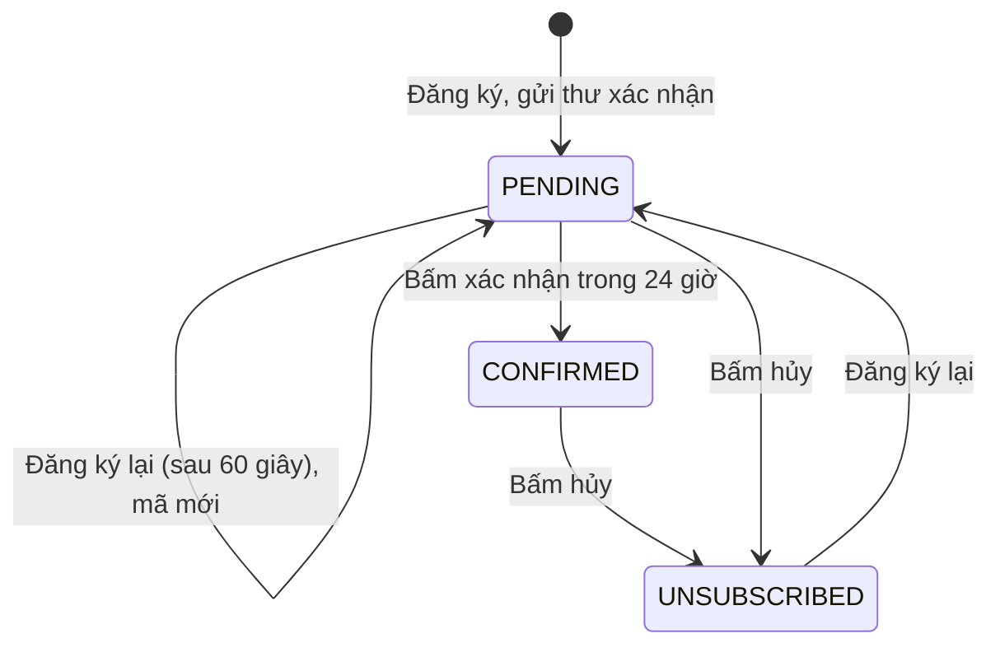

# Bản tin ưu đãi (Newsletter)

Khách đăng ký email để nhận ưu đãi qua thư. Đăng ký phải xác nhận hai bước (double opt-in): nhập email, rồi bấm liên kết trong thư xác nhận. Mỗi thư có liên kết hủy đăng ký. Admin xem danh sách người đăng ký và xuất CSV. Hiện chỉ có luồng đăng ký, xác nhận, hủy và quản trị danh sách; chưa có chức năng gửi chiến dịch trong mã đã đọc.

## Tổng quan

| Mục | Giá trị |
| --- | --- |
| Mã nguồn | [src/features/newsletter](https://github.com/QuocDuy21-10/laptopshop-web/tree/main/src/features/newsletter) (khách), [src/features/admin/newsletter](https://github.com/QuocDuy21-10/laptopshop-web/tree/main/src/features/admin/newsletter) (admin) |
| Route khách | `/newsletter/confirm?token=`, `/newsletter/unsubscribe?token=` (công khai) |
| Form đăng ký | Khối "Nhận ưu đãi qua email" ở trang chủ ([NewsletterSection.tsx](https://github.com/QuocDuy21-10/laptopshop-web/blob/main/src/features/home/NewsletterSection/NewsletterSection.tsx)) |
| Route admin | `/admin/newsletter` |
| Backend | [src/modules/newsletter](https://github.com/QuocDuy21-10/laptopshop-api/tree/main/src/modules/newsletter) |
| Test | [tests/features/newsletter](https://github.com/QuocDuy21-10/laptopshop-web/tree/main/tests/features/newsletter) |

## Actors và use cases

| Actor | Use case | Route |
| --- | --- | --- |
| Khách vãng lai | Nhập email để đăng ký | form ở trang chủ |
| Khách vãng lai | Bấm liên kết trong thư để xác nhận | `/newsletter/confirm` |
| Khách vãng lai | Bấm liên kết trong thư để hủy | `/newsletter/unsubscribe` |
| Admin | Xem danh sách theo trạng thái, tìm theo email, xuất CSV | `/admin/newsletter` |

## Hành trình người dùng

1. Khách nhập email ở trang chủ và bấm "Đăng ký".
2. Giao diện luôn hiện cùng một thông báo trung tính: "Nếu email hợp lệ, bạn sẽ nhận được thư xác nhận trong ít phút."
3. Khách mở thư, bấm liên kết; trang `/newsletter/confirm` hiện nút "Xác nhận đăng ký". Chỉ khi bấm nút, đăng ký mới được xác nhận.
4. Muốn hủy, khách bấm liên kết hủy trong thư; trang `/newsletter/unsubscribe` hiện nút "Hủy đăng ký".

## Luồng nghiệp vụ

| Việc | Frontend | Backend |
| --- | --- | --- |
| Đăng ký | `POST /newsletter/subscribe` với email | Tạo hoặc cập nhật `PENDING`, sinh mã xác nhận, gửi thư |
| Xác nhận | `POST /newsletter/confirm` với `token` sau khi bấm nút | Tìm theo băm mã, còn hạn, chuyển `CONFIRMED` |
| Hủy | `POST /newsletter/unsubscribe` với `token` sau khi bấm nút | Kiểm tra chữ ký, chuyển `UNSUBSCRIBED` |
| Danh sách, CSV | Bảng admin, nút xuất | Lọc theo trạng thái và email |

## Business rules

| Quy tắc | Thực thi bởi | Nguồn |
| --- | --- | --- |
| Email cắt khoảng trắng, hợp lệ, tối đa 254 ký tự; backend đưa về chữ thường | Web và API | [schemas.ts](https://github.com/QuocDuy21-10/laptopshop-web/blob/main/src/features/newsletter/schemas.ts#L3-L5), [newsletter.schema.ts](https://github.com/QuocDuy21-10/laptopshop-api/blob/main/src/modules/newsletter/newsletter.schema.ts#L7) |
| Trạng thái: `PENDING`, `CONFIRMED`, `UNSUBSCRIBED` | API | [newsletter.schema.ts](https://github.com/QuocDuy21-10/laptopshop-api/blob/main/src/modules/newsletter/newsletter.schema.ts#L5) |
| Luôn trả `accepted` kể cả khi email đã đăng ký, để không lộ email nào đã có; chỉ lỗi khi không gửi được thư | API | [newsletter.service.ts](https://github.com/QuocDuy21-10/laptopshop-api/blob/main/src/modules/newsletter/newsletter.service.ts#L37-L47) |
| Gửi lại thư xác nhận chỉ sau ít nhất 60 giây kể từ lần gửi trước | API | [newsletter.service.ts](https://github.com/QuocDuy21-10/laptopshop-api/blob/main/src/modules/newsletter/newsletter.service.ts#L27), [newsletter.service.ts](https://github.com/QuocDuy21-10/laptopshop-api/blob/main/src/modules/newsletter/newsletter.service.ts#L43-L47) |
| Mã xác nhận có hiệu lực 24 giờ; CSDL chỉ giữ giá trị băm SHA-256 | API | [newsletter.service.ts](https://github.com/QuocDuy21-10/laptopshop-api/blob/main/src/modules/newsletter/newsletter.service.ts#L26), [newsletter.tokens.ts](https://github.com/QuocDuy21-10/laptopshop-api/blob/main/src/modules/newsletter/newsletter.tokens.ts#L6-L12) |
| Người đã `CONFIRMED` không bị đưa về `PENDING` khi đăng ký lại | API | [newsletter.service.ts](https://github.com/QuocDuy21-10/laptopshop-api/blob/main/src/modules/newsletter/newsletter.service.ts#L42-L62) |
| Mã hủy không lưu: dạng `id.HMAC`, kiểm tra bằng so sánh thời gian cố định; không hết hạn | API | [newsletter.tokens.ts](https://github.com/QuocDuy21-10/laptopshop-api/blob/main/src/modules/newsletter/newsletter.tokens.ts#L14-L33) |
| Hủy đăng ký idempotent: hủy lại vẫn thành công | API | [newsletter.service.ts](https://github.com/QuocDuy21-10/laptopshop-api/blob/main/src/modules/newsletter/newsletter.service.ts#L114-L131) |
| Mã sai, hết hạn hoặc đã dùng: `NEWSLETTER_TOKEN_INVALID` (400) | API | [newsletter.service.ts](https://github.com/QuocDuy21-10/laptopshop-api/blob/main/src/modules/newsletter/newsletter.service.ts#L31-L32) |
| Thư không gửi được (tắt email hoặc lỗi nhà cung cấp): `EMAIL_DELIVERY_UNAVAILABLE` (503) | API | [newsletter.service.ts](https://github.com/QuocDuy21-10/laptopshop-api/blob/main/src/modules/newsletter/newsletter.service.ts#L29-L30), [newsletter.service.ts](https://github.com/QuocDuy21-10/laptopshop-api/blob/main/src/modules/newsletter/newsletter.service.ts#L83-L86) |
| Xuất CSV một trạng thái mỗi lần (mặc định `CONFIRMED`), có giới hạn kích thước | API | [newsletter.schema.ts](https://github.com/QuocDuy21-10/laptopshop-api/blob/main/src/modules/newsletter/newsletter.schema.ts#L22-L25), [newsletter.service.ts](https://github.com/QuocDuy21-10/laptopshop-api/blob/main/src/modules/newsletter/newsletter.service.ts#L164-L170) |
| Chỉ gọi API sau khi bấm nút, để trình quét thư mở liên kết không tự xác nhận hay hủy | Web | [NewsletterTokenAction.tsx](https://github.com/QuocDuy21-10/laptopshop-web/blob/main/src/features/newsletter/NewsletterTokenAction/NewsletterTokenAction.tsx#L22) |

## Sơ đồ

Đăng ký lại một địa chỉ `UNSUBSCRIBED` đi qua nhánh cập nhật có điều kiện `status != CONFIRMED`, nên quay về `PENDING` và gửi thư mới ([newsletter.service.ts](https://github.com/QuocDuy21-10/laptopshop-api/blob/main/src/modules/newsletter/newsletter.service.ts#L56-L63)).

## API requests/responses

| Method | Path | Auth | Request | Response | Lỗi thường gặp |
| --- | --- | --- | --- | --- | --- |
| POST | `/api/v1/newsletter/subscribe` | Không | `{ email }` | `{ accepted: true }` | `400`, `503 EMAIL_DELIVERY_UNAVAILABLE` |
| POST | `/api/v1/newsletter/confirm` | Không | `{ token }` | `{ status: "CONFIRMED" }` | `400 NEWSLETTER_TOKEN_INVALID` |
| POST | `/api/v1/newsletter/unsubscribe` | Không | `{ token }` | `{ status: "UNSUBSCRIBED" }` | `400 NEWSLETTER_TOKEN_INVALID` |
| GET | `/api/v1/admin/newsletter/subscribers` | Admin | `page`, `pageSize`, `status?`, `q?` | danh sách người đăng ký | |
| GET | `/api/v1/admin/newsletter/subscribers/export.csv` | Admin | `status` (mặc định `CONFIRMED`), `q?` | tệp CSV | |

## Data contracts

`NewsletterSubscriber` và các body ở [Data dictionary: Newsletter](../06-api-and-data/data-dictionary/newsletter.md).

## UI states và xử lý lỗi

- Form: nút "Đăng ký" có trạng thái đang gửi; lỗi trường gán vào ô email, lỗi khác hiện `Alert` ([NewsletterForm.tsx](https://github.com/QuocDuy21-10/laptopshop-web/blob/main/src/features/newsletter/NewsletterForm/NewsletterForm.tsx#L24-L32)). Thành công hiện thông báo trung tính, không phân biệt email mới hay đã có.
- Trang xác nhận và hủy: không có `token` thì `Alert` "Liên kết không hợp lệ hoặc đã hết hạn."; có token thì hiện lời nhắc và nút; lỗi API hiện `Alert`; thành công hiện lời cảm ơn ([NewsletterTokenAction.tsx](https://github.com/QuocDuy21-10/laptopshop-web/blob/main/src/features/newsletter/NewsletterTokenAction/NewsletterTokenAction.tsx#L29-L45)).
- Admin: bảng có nhãn trạng thái màu, lọc phân đoạn (Đã xác nhận, Chờ xác nhận, Đã hủy), ô tìm email, nút xuất CSV chỉ bật khi đã chọn một trạng thái ([NewsletterSubscriberList.tsx](https://github.com/QuocDuy21-10/laptopshop-web/blob/main/src/features/admin/newsletter/NewsletterSubscriberList.tsx#L14-L60)).

## Edge cases

- Trình quét thư (antivirus, xem trước liên kết) mở liên kết xác nhận: không có hiệu lực vì cần bấm nút.
- Trang xác nhận và hủy đặt `noindex` và `referrer: no-referrer` để mã trên URL không lọt vào kết quả tìm kiếm hay tiêu đề Referer ([confirm/page.tsx](https://github.com/QuocDuy21-10/laptopshop-web/blob/main/src/app/%28storefront%29/newsletter/confirm/page.tsx#L6-L10)).
- Hai lần gửi liên tiếp trong 60 giây: lần sau vẫn nhận thông báo thành công nhưng không gửi thư mới.
- Mã hủy có chữ ký đúng nhưng id không còn trong cơ sở dữ liệu: `NEWSLETTER_TOKEN_INVALID`.

## Bảo mật

- Không lộ việc một email đã đăng ký hay chưa (phản hồi giống nhau).
- Mã xác nhận ngẫu nhiên 32 byte, chỉ lưu băm; mã hủy ký HMAC bằng khóa dẫn xuất từ `JWT_SECRET`.
- Đường dẫn `/newsletter/*` công khai, không cần phiên. Router admin yêu cầu vai trò `ADMIN` ([Admin](admin.md)).
- Danh sách email là dữ liệu cá nhân; chỉ admin xem và xuất được.

## Tham chiếu mã nguồn

- Web: [hooks.ts](https://github.com/QuocDuy21-10/laptopshop-web/blob/main/src/features/newsletter/hooks.ts), [schemas.ts](https://github.com/QuocDuy21-10/laptopshop-web/blob/main/src/features/newsletter/schemas.ts), [NewsletterForm.tsx](https://github.com/QuocDuy21-10/laptopshop-web/blob/main/src/features/newsletter/NewsletterForm/NewsletterForm.tsx), [NewsletterTokenAction.tsx](https://github.com/QuocDuy21-10/laptopshop-web/blob/main/src/features/newsletter/NewsletterTokenAction/NewsletterTokenAction.tsx), [admin hooks.ts](https://github.com/QuocDuy21-10/laptopshop-web/blob/main/src/features/admin/newsletter/hooks.ts).
- Backend: [newsletter.service.ts](https://github.com/QuocDuy21-10/laptopshop-api/blob/main/src/modules/newsletter/newsletter.service.ts), [newsletter.tokens.ts](https://github.com/QuocDuy21-10/laptopshop-api/blob/main/src/modules/newsletter/newsletter.tokens.ts), [newsletter.schema.ts](https://github.com/QuocDuy21-10/laptopshop-api/blob/main/src/modules/newsletter/newsletter.schema.ts).
- Cấu trúc bảng thuộc backend: [schema.prisma](https://github.com/QuocDuy21-10/laptopshop-api/blob/main/prisma/schema.prisma).

> [!WARNING]
> **Chưa xác minh:** (1) có hay không chức năng gửi chiến dịch ưu đãi (chưa thấy trong `src/modules/newsletter`; mã hủy được thiết kế để dựng lại liên kết cho chiến dịch sau); (2) giới hạn tần suất theo route cho `/newsletter/subscribe`; (3) nội dung thư (`renderNewsletterConfirmationEmail`); (4) giới hạn kích thước xuất CSV (`assertExportSize`).

## Tài liệu liên quan

- [Home](home.md): khối đăng ký.
- [Notifications](notifications.md): cùng hạ tầng gửi email.
- [Admin](admin.md)
