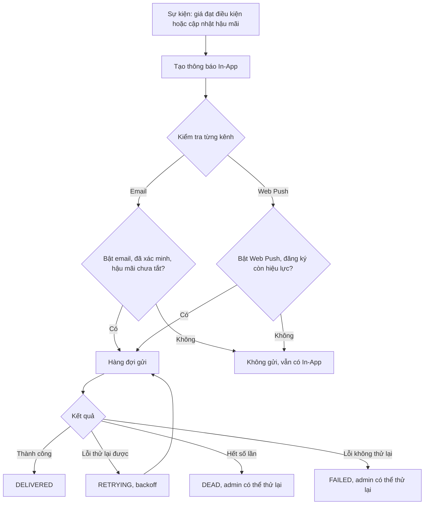
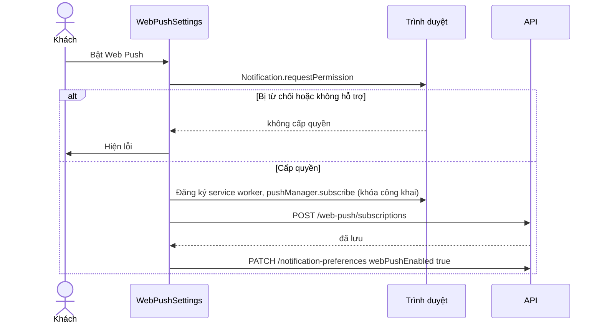

# Thông báo (Notifications)

Thành viên nhận thông báo trong ứng dụng (In-App) và, nếu bật, qua email và Web Push. Hiện có hai nhóm: cảnh báo giá (từ [Wishlist](wishlist.md)) và cập nhật hậu mãi (từ [After-sales](after-sales.md)). Admin xem tình trạng hệ thống gửi và thử lại các lần gửi thất bại. Backend tạo thông báo và gửi; frontend hiển thị, đánh dấu đã đọc và quản lý tùy chọn kênh.

## Tổng quan

| Mục | Giá trị |
| --- | --- |
| Mã nguồn | [src/features/notifications](https://github.com/QuocDuy21-10/laptopshop-web/tree/main/src/features/notifications) (khách), [src/features/admin/notifications](https://github.com/QuocDuy21-10/laptopshop-web/tree/main/src/features/admin/notifications) (admin) |
| Route khách | `/account/notifications`, `/account/notifications/settings` (cần đăng nhập) |
| Route admin | `/admin/notifications` |
| Chuông ở header | [NotificationBell](https://github.com/QuocDuy21-10/laptopshop-web/blob/main/src/features/notifications/NotificationBell/NotificationBell.tsx) hiện số chưa đọc |
| Service worker | [notification-sw.js](https://github.com/QuocDuy21-10/laptopshop-web/blob/main/public/notification-sw.js) |
| Backend | [src/modules/notifications](https://github.com/QuocDuy21-10/laptopshop-api/tree/main/src/modules/notifications) |
| Test | [tests/features/notifications](https://github.com/QuocDuy21-10/laptopshop-web/tree/main/tests/features/notifications) |

## Actors và use cases

| Actor | Use case | Route |
| --- | --- | --- |
| Thành viên | Xem danh sách, đánh dấu đã đọc từng cái hoặc tất cả, mở trang liên quan | `/account/notifications` |
| Thành viên | Bật tắt email, xác minh email bằng OTP | `/account/notifications/settings` |
| Thành viên | Bật tắt Web Push cho trình duyệt hiện tại | `/account/notifications/settings` |
| Thành viên | Bật tắt riêng email và Web Push cho cập nhật hậu mãi | `/account/notifications/settings` |
| Admin | Xem số liệu hệ thống gửi, worker, bộ quét cảnh báo giá | `/admin/notifications` |
| Admin | Thử lại một lần gửi `DEAD` hoặc `FAILED` kèm lý do | API đã có hook; xem mục chưa xác minh |

## Hành trình người dùng

1. Chuông ở header hiện số chưa đọc, làm mới mỗi 60 giây khi tab hiện.
2. Bấm chuông vào `/account/notifications`; bấm một thông báo thì nó được đánh dấu đã đọc và người dùng chuyển tới `/account/after-sales/{id}` hoặc `/products/{id}` nếu có.
3. Vào "Cài đặt thông báo" để chọn kênh. In-App luôn bật.
4. Bật email lần đầu: nếu email chưa xác minh, hộp thoại OTP mở; nhập mã 6 chữ số.
5. Bật Web Push: trình duyệt xin quyền, đăng ký service worker và gửi đăng ký lên backend.

## Luồng nghiệp vụ

| Việc | Frontend | Backend |
| --- | --- | --- |
| Tạo thông báo | | Bộ quét giá hoặc luồng hậu mãi tạo thông báo và các lần gửi (`PRICE_ALERT`, `AFTER_SALES`) |
| Danh sách, đếm chưa đọc | `GET /notifications`, `/notifications/unread-count` | Chỉ của người dùng đang đăng nhập |
| Đánh dấu đã đọc | Cập nhật lạc quan, hoàn tác khi lỗi | `updateMany` với `readAt` rỗng |
| Tùy chọn kênh | `PATCH /notification-preferences` | Lưu, yêu cầu email đã xác minh khi bật email |
| Gửi email, Web Push | | Hàng đợi, kiểm tra đồng ý, thử lại với backoff |
| Dọn dữ liệu cũ | | Job bảo trì xóa theo thời hạn |

## Business rules

| Quy tắc | Thực thi bởi | Nguồn |
| --- | --- | --- |
| Bật email khi email chưa xác minh bị từ chối `EMAIL_NOT_VERIFIED` (409); web mở hộp thoại OTP trước khi gọi | API và web | [notification-preferences.service.ts](https://github.com/QuocDuy21-10/laptopshop-api/blob/main/src/modules/notifications/notification-preferences.service.ts#L20-L28), [NotificationSettings.tsx](https://github.com/QuocDuy21-10/laptopshop-web/blob/main/src/features/notifications/NotificationSettings/NotificationSettings.tsx#L33-L44) |
| Mặc định khi chưa có bản ghi tùy chọn: mọi kênh tắt | API | [notification-preferences.service.ts](https://github.com/QuocDuy21-10/laptopshop-api/blob/main/src/modules/notifications/notification-preferences.service.ts#L29-L37) |
| Mã OTP gồm đúng 6 chữ số; web chặn gửi nếu sai định dạng | Web | [EmailVerificationDialog.tsx](https://github.com/QuocDuy21-10/laptopshop-web/blob/main/src/features/notifications/EmailVerificationDialog/EmailVerificationDialog.tsx#L38-L40) |
| Tùy chọn hậu mãi theo kênh chỉ có tác dụng khi kênh chính đang bật (ô bị khóa khi kênh chính tắt) | Web | [NotificationSettings.tsx](https://github.com/QuocDuy21-10/laptopshop-web/blob/main/src/features/notifications/NotificationSettings/NotificationSettings.tsx#L63-L70) |
| Tùy chọn hậu mãi không ảnh hưởng cảnh báo giá | API | [notification-delivery.service.ts](https://github.com/QuocDuy21-10/laptopshop-api/blob/main/src/modules/notifications/notification-delivery.service.ts#L34-L59) |
| Email chỉ gửi khi: bật email, (với hậu mãi) chưa tắt email hậu mãi, email đã xác minh và đích gửi khớp username | API | [notification-delivery.service.ts](https://github.com/QuocDuy21-10/laptopshop-api/blob/main/src/modules/notifications/notification-delivery.service.ts#L44-L53) |
| Web Push chỉ gửi khi: bật Web Push, (với hậu mãi) chưa tắt Web Push hậu mãi và đăng ký chưa bị vô hiệu | API | [notification-delivery.service.ts](https://github.com/QuocDuy21-10/laptopshop-api/blob/main/src/modules/notifications/notification-delivery.service.ts#L54-L59) |
| Đổi email vô hiệu hóa tùy chọn email, các mã OTP đang chờ, và chuyển các lần gửi email chờ tới email cũ sang `SUPPRESSED` | API | [notification-preferences.service.ts](https://github.com/QuocDuy21-10/laptopshop-api/blob/main/src/modules/notifications/notification-preferences.service.ts#L52-L77) |
| Lỗi gửi: không thể thử lại thì `FAILED`; thử lại được nhưng hết số lần thì `DEAD`; còn lại `RETRYING` với chờ 2^n giây, tối đa 1 giờ | API | [notification-delivery.service.ts](https://github.com/QuocDuy21-10/laptopshop-api/blob/main/src/modules/notifications/notification-delivery.service.ts#L243-L264) |
| Đăng ký Web Push bị báo hết hạn (`PUSH_SUBSCRIPTION_GONE`) thì bị vô hiệu | API | [notification-delivery.service.ts](https://github.com/QuocDuy21-10/laptopshop-api/blob/main/src/modules/notifications/notification-delivery.service.ts#L245-L249) |
| Admin chỉ thử lại được lần gửi `DEAD` hoặc `FAILED` (`DELIVERY_NOT_RETRYABLE`); cần `reason` 1 đến 255 ký tự | API | [admin-notifications.service.ts](https://github.com/QuocDuy21-10/laptopshop-api/blob/main/src/modules/notifications/admin-notifications.service.ts#L70-L80), [admin-notifications.schema.ts](https://github.com/QuocDuy21-10/laptopshop-api/blob/main/src/modules/notifications/admin-notifications.schema.ts#L21-L23) |
| Giữ dữ liệu: thông báo 180 ngày, lần gửi 90 ngày, sự kiện outbox đã phát 30 ngày, OTP 7 ngày, đăng ký Web Push đã vô hiệu 30 ngày | API | [notification-retention.service.ts](https://github.com/QuocDuy21-10/laptopshop-api/blob/main/src/modules/notifications/notification-retention.service.ts#L12-L23) |
| Service worker chỉ nhận liên kết dạng `/products/<số>` hoặc `/account/notifications`, còn lại về trang thông báo | Web | [notification-sw.js](https://github.com/QuocDuy21-10/laptopshop-web/blob/main/public/notification-sw.js#L5) |

## Sơ đồ

### Từ sự kiện đến thông báo và kênh gửi

In-App luôn được tạo; hai kênh còn lại phụ thuộc đồng ý. Trạng thái `SUPPRESSED` dùng khi đích gửi không còn hợp lệ ([notification-delivery.service.ts](https://github.com/QuocDuy21-10/laptopshop-api/blob/main/src/modules/notifications/notification-delivery.service.ts#L195-L226)).

### Bật Web Push

Hai bước cuối do `WebPushSettings` và `NotificationSettings` phối hợp qua `onEnabled` ([web-push.ts](https://github.com/QuocDuy21-10/laptopshop-web/blob/main/src/features/notifications/web-push.ts#L13-L27), [WebPushSettings.tsx](https://github.com/QuocDuy21-10/laptopshop-web/blob/main/src/features/notifications/WebPushSettings/WebPushSettings.tsx#L27-L36)).

## API requests/responses

Phía khách ([hooks.ts](https://github.com/QuocDuy21-10/laptopshop-web/blob/main/src/features/notifications/hooks.ts), [web-push.ts](https://github.com/QuocDuy21-10/laptopshop-web/blob/main/src/features/notifications/web-push.ts)):

| Method | Path | Auth | Request | Response | Lỗi thường gặp |
| --- | --- | --- | --- | --- | --- |
| GET | `/api/v1/notifications` | Có | `page`, `pageSize` (web dùng 10) | `NotificationPage` | `401` |
| GET | `/api/v1/notifications/unread-count` | Có | | `{ unreadCount }` | `401` |
| PATCH | `/api/v1/notifications/{id}/read` | Có | | thông báo | `404 NOTIFICATION_NOT_FOUND` |
| PATCH | `/api/v1/notifications/read-all` | Có | | `{ updatedCount }` | |
| GET, PATCH | `/api/v1/notification-preferences` | Có | các cờ `emailEnabled`, `webPushEnabled`, `afterSalesEmailEnabled`, `afterSalesWebPushEnabled` (ít nhất một) | tùy chọn | `409 EMAIL_NOT_VERIFIED` |
| POST | `/api/v1/me/email-verification/request` | Có | | `{ accepted }` | |
| POST | `/api/v1/me/email-verification/confirm` | Có | `code` | `{ verified }` | |
| GET | `/api/v1/web-push/config` | Có | | khóa công khai | |
| POST, DELETE | `/api/v1/web-push/subscriptions` | Có | đăng ký (`endpoint`, `keys`) | | |
| DELETE | `/api/v1/web-push/subscriptions/{id}` | Có | | | |

Phía admin ([hooks.ts](https://github.com/QuocDuy21-10/laptopshop-web/blob/main/src/features/admin/notifications/hooks.ts)): `GET /admin/notifications/operations` và `POST /admin/notification-deliveries/{id}/retry` (`reason`).

## Data contracts

`InAppNotification`, `NotificationPage`, `NotificationPreferences` ở [types.ts](https://github.com/QuocDuy21-10/laptopshop-web/blob/main/src/lib/api/types.ts). Chi tiết ở [Data dictionary: Notifications](../06-api-and-data/data-dictionary/notifications.md).

## UI states và xử lý lỗi

- Danh sách: skeleton khi tải; lỗi hiện `Alert` kèm liên kết tới cài đặt; rỗng hiện `NotificationEmptyState` ([NotificationsView.tsx](https://github.com/QuocDuy21-10/laptopshop-web/blob/main/src/features/notifications/NotificationsView/NotificationsView.tsx#L24-L41)).
- "Đánh dấu tất cả đã đọc" bị khóa khi không còn chưa đọc hoặc đang gửi ([NotificationList.tsx](https://github.com/QuocDuy21-10/laptopshop-web/blob/main/src/features/notifications/NotificationList/NotificationList.tsx#L17)).
- Đánh dấu đã đọc cập nhật lạc quan cả danh sách và số chưa đọc, hoàn tác khi lỗi rồi làm mới ([hooks.ts](https://github.com/QuocDuy21-10/laptopshop-web/blob/main/src/features/notifications/hooks.ts#L116-L156)). Lỗi hiện toast.
- Cài đặt: "Đang tải cài đặt thông báo…"; lỗi hiện `Alert`; lỗi cập nhật hiện `Alert` ở đầu bảng ([NotificationSettings.tsx](https://github.com/QuocDuy21-10/laptopshop-web/blob/main/src/features/notifications/NotificationSettings/NotificationSettings.tsx#L19-L56)).
- Web Push: nút bị khóa và có ghi chú khi quyền bị từ chối hoặc trình duyệt không hỗ trợ ([WebPushSettings.tsx](https://github.com/QuocDuy21-10/laptopshop-web/blob/main/src/features/notifications/WebPushSettings/WebPushSettings.tsx#L45-L62)).
- OTP: "Yêu cầu gửi mã đã được tiếp nhận. Hãy kiểm tra email." sau khi yêu cầu; lỗi hiện `Alert` ([EmailVerificationDialog.tsx](https://github.com/QuocDuy21-10/laptopshop-web/blob/main/src/features/notifications/EmailVerificationDialog/EmailVerificationDialog.tsx#L28-L46)).

## Edge cases

- Chưa xác minh email mà bật email: hộp thoại OTP mở, tùy chọn chỉ bật sau khi xác minh xong.
- Đổi email tài khoản: tùy chọn email bị tắt, người dùng phải xác minh lại.
- Tab ẩn: chuông không hỏi lại số chưa đọc.
- Thông báo hậu mãi: web đọc `serviceRequestId` bằng cách ép kiểu vì `schema.d.ts` hiện chỉ khai báo loại `PRICE_DROP` và không có field này ([NotificationList.tsx](https://github.com/QuocDuy21-10/laptopshop-web/blob/main/src/features/notifications/NotificationList/NotificationList.tsx#L17)).
- `sessionStorage` không liên quan: không có ý định chờ đăng nhập cho thông báo.

## Bảo mật

- Mọi endpoint khách cần đăng nhập; thao tác đọc chỉ trên thông báo của chính người dùng (`where: { id, userId }`) ([notifications.service.ts](https://github.com/QuocDuy21-10/laptopshop-api/blob/main/src/modules/notifications/notifications.service.ts#L43)).
- Service worker kiểm tra liên kết nhận được, chỉ chấp nhận đường dẫn nội bộ đã liệt kê.
- Khóa công khai Web Push lấy từ API; khóa riêng chỉ ở backend.
- Router admin yêu cầu vai trò `ADMIN` ([Admin](admin.md)).

## Tham chiếu mã nguồn

- Web: [hooks.ts](https://github.com/QuocDuy21-10/laptopshop-web/blob/main/src/features/notifications/hooks.ts), [web-push.ts](https://github.com/QuocDuy21-10/laptopshop-web/blob/main/src/features/notifications/web-push.ts), [NotificationSettings.tsx](https://github.com/QuocDuy21-10/laptopshop-web/blob/main/src/features/notifications/NotificationSettings/NotificationSettings.tsx), [admin hooks.ts](https://github.com/QuocDuy21-10/laptopshop-web/blob/main/src/features/admin/notifications/hooks.ts).
- Backend: [notification-preferences.service.ts](https://github.com/QuocDuy21-10/laptopshop-api/blob/main/src/modules/notifications/notification-preferences.service.ts), [notification-delivery.service.ts](https://github.com/QuocDuy21-10/laptopshop-api/blob/main/src/modules/notifications/notification-delivery.service.ts), [notification-retention.service.ts](https://github.com/QuocDuy21-10/laptopshop-api/blob/main/src/modules/notifications/notification-retention.service.ts), [admin-notifications.service.ts](https://github.com/QuocDuy21-10/laptopshop-api/blob/main/src/modules/notifications/admin-notifications.service.ts).
- Cấu trúc bảng thuộc backend: [schema.prisma](https://github.com/QuocDuy21-10/laptopshop-api/blob/main/prisma/schema.prisma).

> [!WARNING]
> **Chưa xác minh:** (1) giá trị `maxAttempts` và lịch chạy của worker gửi, outbox và bảo trì (`notification-worker.ts`, `outbox-dispatcher.ts`); (2) cơ chế sinh và băm mã OTP email (`email-verification.service.ts`), cũng như giới hạn số lần nhập sai; (3) nơi nào trên giao diện admin gọi `useRetryNotificationDelivery` (trang `NotificationOperations` đã đọc chỉ hiện số liệu, chưa thấy nút thử lại); (4) cách backend gắn `serviceRequestId` vào thông báo hậu mãi (`notifications.mapper.ts`).

## Tài liệu liên quan

- [Wishlist](wishlist.md): nguồn cảnh báo giá.
- [After-sales](after-sales.md): nguồn thông báo hậu mãi.
- [Auth](auth.md): đăng nhập, phiên.
- [Admin](admin.md)
