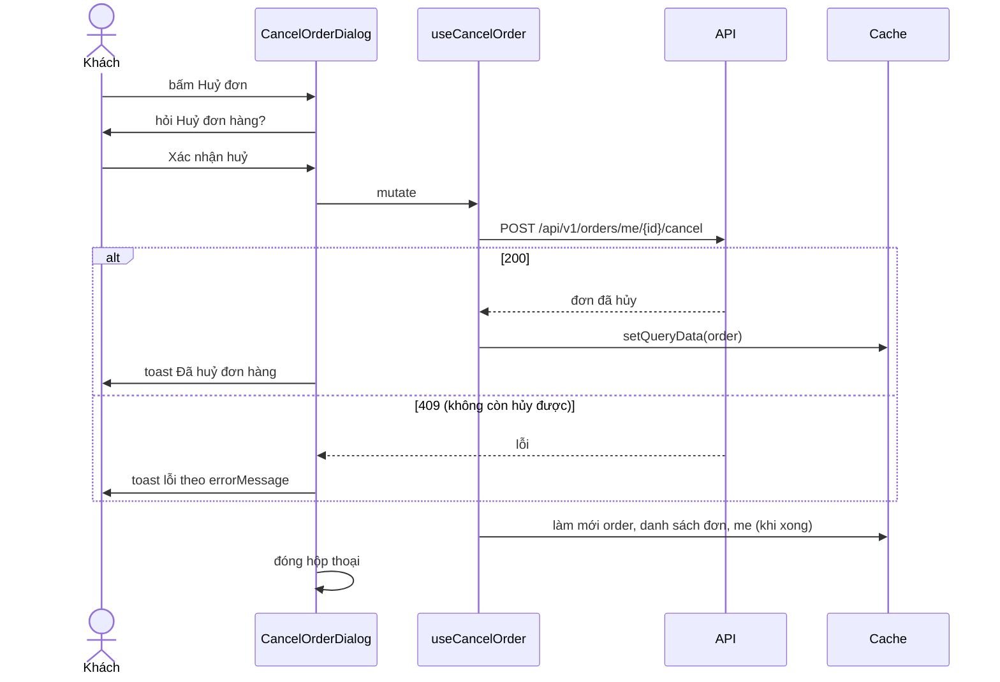
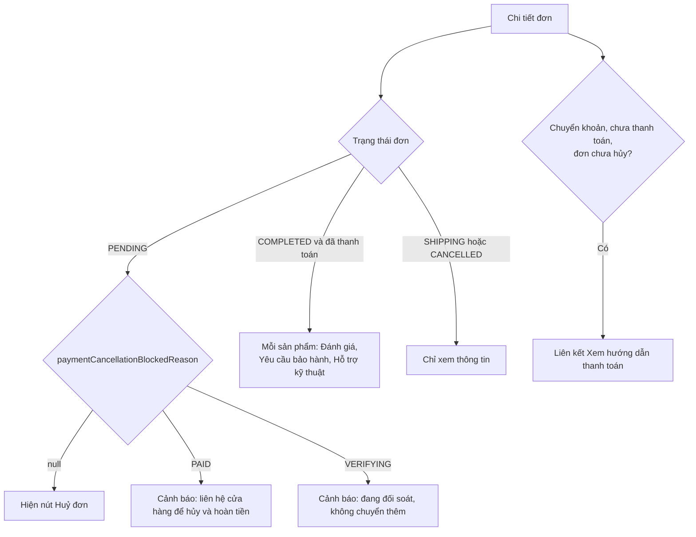

# Đơn hàng (Orders)

Module Orders cho khách xem danh sách đơn, xem chi tiết, hủy đơn đang chờ xác nhận, và đi tiếp tới đánh giá hoặc hậu mãi sau khi nhận hàng. Mọi trạng thái đơn do backend quản lý; giao diện chỉ hiển thị và gửi yêu cầu hủy.

## Tổng quan

| Mục | Giá trị |
| --- | --- |
| Mã nguồn | [src/features/orders](https://github.com/QuocDuy21-10/laptopshop-web/tree/main/src/features/orders) (khách); phía quản trị ở [Admin](admin.md) |
| Route | `/account/orders`, `/account/orders/[id]` (cần đăng nhập) |
| Hook | `useOrders`, `useOrder`, `useCancelOrder` |
| Liên quan | Thanh toán chuyển khoản: [Payments](payments.md); đánh giá và hậu mãi mở ra từ chi tiết đơn |

## Actors và use cases

| Actor | Use case | Route |
| --- | --- | --- |
| Thành viên | Xem danh sách đơn (10 đơn mỗi trang), mới nhất trước | `/account/orders` |
| Thành viên | Xem chi tiết đơn: sản phẩm, giá, giảm giá, người nhận, cách thanh toán | `/account/orders/[id]` |
| Thành viên | Hủy đơn đang chờ xác nhận | nút "Huỷ đơn" ở chi tiết đơn |
| Thành viên | Mở hướng dẫn thanh toán của đơn chuyển khoản chưa trả | liên kết ở chi tiết đơn |
| Thành viên | Viết đánh giá, yêu cầu bảo hành hoặc hỗ trợ kỹ thuật cho sản phẩm đã nhận | từng dòng sản phẩm của đơn hoàn thành |

## Hành trình người dùng

1. Sau khi đặt hàng COD, người dùng đến `/account/orders/{id}?placed=1` và thấy thông báo "Đặt hàng thành công. Cảm ơn bạn đã mua sắm tại LaptopShop!".
2. Từ menu tài khoản, người dùng vào "Đơn hàng của tôi" để xem danh sách; bấm một đơn để xem chi tiết.
3. Khi đơn còn `PENDING` và không bị chặn hủy, người dùng có thể bấm "Huỷ đơn", xác nhận trong hộp thoại; đơn chuyển sang "Đã huỷ" và hàng được trả lại kho.
4. Khi đơn `COMPLETED` và đã thanh toán, mỗi sản phẩm có thêm lối vào đánh giá và, tùy loại cho phép, "Yêu cầu bảo hành" hoặc "Hỗ trợ kỹ thuật".

## Luồng nghiệp vụ

| Việc | Frontend | Backend |
| --- | --- | --- |
| Liệt kê, xem đơn | Gọi API, hiển thị nhãn tiếng Việt | Chỉ trả đơn của chính người dùng, mới nhất trước |
| Hủy đơn | Gửi yêu cầu, hiển thị kết quả | Kiểm tra trạng thái, thanh toán, trả hàng về kho, ghi lịch sử |
| Chặn hủy theo thanh toán | Ẩn nút và hiện cảnh báo theo `paymentCancellationBlockedReason` | Tính `PAID` hoặc `VERIFYING` cho đơn chuyển khoản |
| Quyền hậu mãi theo sản phẩm | Hiện liên kết theo `allowedRequestTypes` | Tính loại yêu cầu được phép |

## Business rules

| Quy tắc | Thực thi bởi | Nguồn |
| --- | --- | --- |
| Vòng đời: `PENDING`, `SHIPPING`, `COMPLETED`, `CANCELLED` | API | [order-status.ts](https://github.com/QuocDuy21-10/laptopshop-api/blob/main/src/modules/orders/order-status.ts#L16-L22) |
| Khách chỉ tự hủy được đơn `PENDING` | API | [orders.service.ts](https://github.com/QuocDuy21-10/laptopshop-api/blob/main/src/modules/orders/orders.service.ts#L419-L423) |
| Nút hủy chỉ hiện khi đơn `PENDING` và `paymentCancellationBlockedReason` là `null` | Web | [OrderDetail.tsx](https://github.com/QuocDuy21-10/laptopshop-web/blob/main/src/features/orders/OrderDetail/OrderDetail.tsx#L118-L122) |
| `paymentCancellationBlockedReason` là `PAID` nếu đơn chuyển khoản đã thanh toán; `VERIFYING` nếu thanh toán đang `VERIFYING` hoặc `REVIEW_REQUIRED`; ngược lại `null` | API | [orders.mapper.ts](https://github.com/QuocDuy21-10/laptopshop-api/blob/main/src/modules/orders/orders.mapper.ts#L36-L43) |
| Đơn chuyển khoản đã thanh toán không hủy được (`PAID_ORDER_CANNOT_CANCEL`) | API | [order-cancellation.service.ts](https://github.com/QuocDuy21-10/laptopshop-api/blob/main/src/modules/orders/order-cancellation.service.ts#L44-L46) |
| Hủy đơn hoàn trả hàng về kho | API | [order-cancellation.service.ts](https://github.com/QuocDuy21-10/laptopshop-api/blob/main/src/modules/orders/order-cancellation.service.ts#L96-L112); hộp thoại nêu điều này |
| Đánh giá và hậu mãi chỉ mở khi đơn `COMPLETED` và `paymentStatus` là `PAYMENT_SUCCESS` | Web (mở lối vào), API (quyết định quyền) | [OrderDetail.tsx](https://github.com/QuocDuy21-10/laptopshop-web/blob/main/src/features/orders/OrderDetail/OrderDetail.tsx#L67-L69) |
| Hậu mãi chỉ hiện loại yêu cầu có trong `allowedRequestTypes` của sản phẩm | API quyết định, Web hiển thị | cùng file |
| Huy hiệu thanh toán bị ẩn với đơn đã hủy chưa từng thanh toán | Web | [OrderBadges.tsx](https://github.com/QuocDuy21-10/laptopshop-web/blob/main/src/features/orders/OrderBadges/OrderBadges.tsx#L8-L10) |

Sơ đồ chuyển trạng thái và quy tắc đầy đủ ở [State machine](../07-diagrams/state-machines.md).

## Sơ đồ

### Hủy đơn

Diễn giải: sau khi thành công, chi tiết đơn được cập nhật ngay bằng kết quả trả về, rồi ba nhóm cache được làm mới (đơn đó, danh sách đơn, `me`). Lỗi `409` có thể là `INVALID_STATUS_TRANSITION`, `PAID_ORDER_CANNOT_CANCEL` hoặc `PAYMENT_VERIFICATION_IN_PROGRESS`, mỗi mã có thông báo tiếng Việt riêng.

### Lối vào từ chi tiết đơn (activity)

## API requests/responses

| Method | Path | Auth | Request | Response | Lỗi thường gặp |
| --- | --- | --- | --- | --- | --- |
| GET | `/api/v1/orders/me` | Có | `page`, `pageSize` (web dùng 10) | `{ data: Order[], meta }` | `401` |
| GET | `/api/v1/orders/me/{id}` | Có | `id` | `{ data: Order }` | `401`, `404` |
| POST | `/api/v1/orders/me/{id}/cancel` | Có | không | `200` `{ data: Order }` | `401`, `404`, `409` không còn hủy được |

Nguồn: [schema.d.ts](https://github.com/QuocDuy21-10/laptopshop-web/blob/main/src/lib/api/schema.d.ts) (các khối `/api/v1/orders/me*`), hook ở [orders/hooks.ts](https://github.com/QuocDuy21-10/laptopshop-web/blob/main/src/features/orders/hooks.ts). Tạo đơn nằm ở [Checkout](checkout.md).

## Data contracts

Chi tiết ở [Data dictionary: Orders](../06-api-and-data/data-dictionary/orders.md): `Order`, `OrderItem`, `flashSaleAllocation`, nhãn trạng thái.

## UI states và xử lý lỗi

| Tình huống | Hiển thị |
| --- | --- |
| Đang tải | `Skeleton` |
| Danh sách trống | "Bạn chưa có đơn hàng nào" kèm nút "Mua sắm ngay" |
| Lỗi tải danh sách hoặc chi tiết | Alert lỗi theo `errorMessage` |
| Đơn không tồn tại (`404`) | "Không tìm thấy đơn hàng" kèm liên kết về danh sách |
| Mã đơn không hợp lệ trên URL | Trang không tìm thấy |
| Vừa đặt hàng (`?placed=1`) | Alert thành công ở đầu trang |
| Đơn Flash Sale | Huy hiệu "Flash Sale" cạnh sản phẩm |
| Hủy thành công, hủy lỗi | Toast "Đã huỷ đơn hàng", hoặc toast lỗi |

## Edge cases

- Tổng đơn bằng 0 được backend tạo với phương thức `FREE` và trạng thái thanh toán thành công; giao diện hiển thị dòng phương thức là COD cho mọi giá trị khác `BANK_TRANSFER` ([OrderDetail.tsx](https://github.com/QuocDuy21-10/laptopshop-web/blob/main/src/features/orders/OrderDetail/OrderDetail.tsx#L106)).
- Các dòng giảm giá ("Tạm tính", "Ưu đãi sản phẩm", "Mã giảm giá") chỉ hiện khi có giá trị lớn hơn 0; dữ liệu cũ thiếu các field này vẫn hiển thị đúng nhờ giá trị dự phòng.
- Đơn đã hủy mà chưa thanh toán không hiện huy hiệu thanh toán, để "Chưa thanh toán" không bị hiểu là còn nợ.
- Trang chi tiết của đơn chuyển khoản đang chờ có liên kết tới hướng dẫn thanh toán; khi đơn đã hủy hoặc đã thanh toán thì liên kết biến mất.

> [!WARNING]
> **Chưa xác minh:** cách trả lại kho khi hủy: backend gọi `moveStock` cho từng dòng sau khi cập nhật trạng thái ([order-cancellation.service.ts](https://github.com/QuocDuy21-10/laptopshop-api/blob/main/src/modules/orders/order-cancellation.service.ts#L96-L112)), nhưng chưa đọc hết hàm để xác nhận dấu của `delta` và việc hoàn suất Flash Sale hay mã giảm giá.

## Bảo mật

- Backend lọc đơn theo `userId` của phiên (`findFirst({ id, userId })`), nên khách không xem hay hủy được đơn của người khác; id sai hoặc không phải của mình đều trả `404`.
- Giao diện ẩn nút hủy theo `paymentCancellationBlockedReason`, nhưng quyết định thật nằm ở backend (`409`).
- Thông tin người nhận (tên, số điện thoại, địa chỉ) hiển thị đúng như đã lưu lúc đặt; không chỉnh sửa được ở giao diện khách.
- Đơn của người khác không bao giờ nằm trong cache của phiên hiện tại: cache bị xóa khi đăng xuất ([Auth](auth.md)).

## Tham chiếu mã nguồn

| Nội dung | File |
| --- | --- |
| Hook | [hooks.ts](https://github.com/QuocDuy21-10/laptopshop-web/blob/main/src/features/orders/hooks.ts) |
| Danh sách | [OrderList.tsx](https://github.com/QuocDuy21-10/laptopshop-web/blob/main/src/features/orders/OrderList/OrderList.tsx) |
| Chi tiết | [OrderDetail.tsx](https://github.com/QuocDuy21-10/laptopshop-web/blob/main/src/features/orders/OrderDetail/OrderDetail.tsx) |
| Hủy đơn | [CancelOrderDialog.tsx](https://github.com/QuocDuy21-10/laptopshop-web/blob/main/src/features/orders/CancelOrderDialog/CancelOrderDialog.tsx) |
| Nhãn và huy hiệu | [labels.ts](https://github.com/QuocDuy21-10/laptopshop-web/blob/main/src/features/orders/labels.ts), [OrderBadges.tsx](https://github.com/QuocDuy21-10/laptopshop-web/blob/main/src/features/orders/OrderBadges/OrderBadges.tsx) |
| Trang | [orders/page.tsx](https://github.com/QuocDuy21-10/laptopshop-web/blob/main/src/app/%28storefront%29/account/orders/page.tsx), [orders/[id]/page.tsx](https://github.com/QuocDuy21-10/laptopshop-web/blob/main/src/app/%28storefront%29/account/orders/%5Bid%5D/page.tsx) |
| Test | [orders.test.tsx](https://github.com/QuocDuy21-10/laptopshop-web/blob/main/tests/features/orders.test.tsx) |
| Backend | [src/modules/orders](https://github.com/QuocDuy21-10/laptopshop-api/tree/main/src/modules/orders) |

## Tài liệu liên quan

- [Đặt hàng (Checkout)](checkout.md)
- [Thanh toán (Payments)](payments.md)
- [State machine](../07-diagrams/state-machines.md)
- [Data dictionary: Orders](../06-api-and-data/data-dictionary/orders.md)
