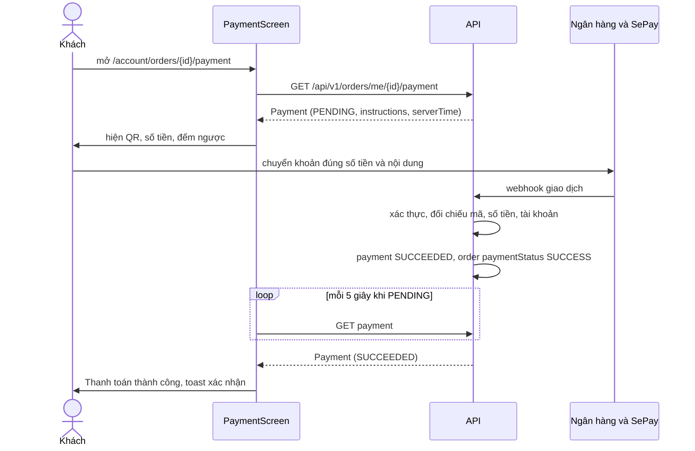
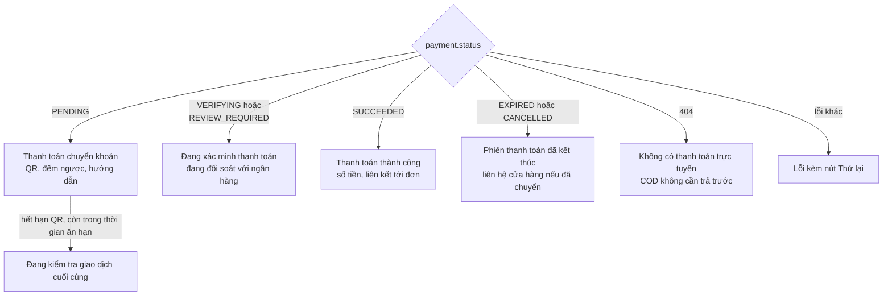

# Thanh toán chuyển khoản (Payments)

Module Payments hiển thị màn hình thanh toán bằng mã QR cho đơn chuyển khoản và theo dõi trạng thái cho tới khi backend xác nhận. **Frontend không bao giờ tự xác nhận thanh toán**: việc đó do backend thực hiện khi nhận được giao dịch ngân hàng (webhook hoặc đối soát). Giao diện chỉ hỏi lại trạng thái theo chu kỳ.

## Tổng quan

| Mục | Giá trị |
| --- | --- |
| Mã nguồn | [src/features/payments](https://github.com/QuocDuy21-10/laptopshop-web/tree/main/src/features/payments) (khách), [src/features/admin/payments](https://github.com/QuocDuy21-10/laptopshop-web/tree/main/src/features/admin/payments) (quản trị) |
| Route khách | `/account/orders/[id]/payment` (cần đăng nhập, không đánh chỉ mục) |
| Route quản trị | `/admin/payments` |
| Hook | `usePaymentStatus`, `usePaymentMethods`; admin: `usePaymentEvents`, `useResolvePaymentEvent`, `usePaymentReviewCases`, `useExtendPaymentReviewCase`, `useReleasePaymentReviewCase` |

## Actors và use cases

| Actor | Use case | Nơi thao tác |
| --- | --- | --- |
| Thành viên | Xem mã QR, số tiền, tài khoản, nội dung chuyển khoản; sao chép thông tin | màn hình thanh toán |
| Thành viên | Chờ hệ thống xác nhận, thấy kết quả tự cập nhật | màn hình thanh toán |
| Admin | Xem giao dịch bất thường và đánh dấu đã xử lý | `/admin/payments`, tab "Giao dịch bất thường" |
| Admin | Gia hạn hoặc giải phóng đơn chờ xác minh | `/admin/payments`, tab "Đơn chờ xác minh" |

## Hành trình người dùng

1. Sau khi đặt đơn chuyển khoản, người dùng đến màn hình thanh toán.
2. Màn hình hiển thị mã QR, số tiền, ngân hàng, chủ tài khoản, số tài khoản và nội dung chuyển khoản; đếm ngược thời gian còn lại.
3. Người dùng quét QR hoặc chuyển khoản thủ công, giữ nguyên số tiền và nội dung chuyển khoản.
4. Màn hình tự hỏi lại trạng thái. Khi backend xác nhận, hiện "Thanh toán thành công" và toast "Thanh toán đã được xác nhận!".
5. Nếu hết hạn mà chưa thấy tiền, màn hình chuyển sang trạng thái đang xác minh với ngân hàng, rồi có thể kết thúc bằng thành công hoặc phiên bị đóng.

## Luồng nghiệp vụ

| Việc | Frontend | Backend |
| --- | --- | --- |
| Tạo thanh toán | Không làm; chỉ chọn `BANK_TRANSFER` ở checkout | Tạo bản ghi thanh toán cùng đơn, sinh mã chuyển khoản và hạn QR |
| Sinh mã QR | Hiển thị ảnh theo `qrImageUrl` | Nhà cung cấp SePay dựng URL `vietqr.app` |
| Nhận giao dịch | Không | Nhận webhook, xác thực, ghi nhận, đối chiếu mã chuyển khoản |
| Xác nhận | Hỏi lại trạng thái, hiển thị | Đặt thanh toán và đơn thành công khi giao dịch khớp |
| Hết hạn, đối soát | Hiển thị trạng thái | Tác vụ bảo trì chuyển trạng thái, mở ca xem xét |
| Xử lý ngoại lệ | Tab admin gọi các thao tác xử lý | Ghi nhận hành động, hủy đơn khi release |

## Business rules

| Quy tắc | Thực thi bởi | Nguồn |
| --- | --- | --- |
| Chỉ tạo thanh toán khi chọn `BANK_TRANSFER`, tổng lớn hơn 0 và backend bật chuyển khoản | API | [orders.service.ts](https://github.com/QuocDuy21-10/laptopshop-api/blob/main/src/modules/orders/orders.service.ts#L84-L86), dòng 191 đến 213 |
| Giao dịch chỉ tự khớp khi: chiều vào, đúng mã chuyển khoản, đúng số tài khoản, đúng số tiền và tiền tệ, đến trước hạn QR, và thanh toán còn ở trạng thái chờ | API | [payment-reconcile.ts](https://github.com/QuocDuy21-10/laptopshop-api/blob/main/src/modules/payments/payment-reconcile.ts#L21-L32) |
| Giao dịch không khớp không bị bỏ: được ghi lại và chuyển sang xem xét với một lý do (`OUTBOUND`, `UNKNOWN_CODE`, `WRONG_ACCOUNT`, `AMOUNT_MISMATCH`, `LATE_PAYMENT`, `INVALID_PAYMENT_STATE`, `PROVIDER_MISMATCH`) | API | [payment-status.ts](https://github.com/QuocDuy21-10/laptopshop-api/blob/main/src/modules/payments/payment-status.ts#L16-L24), [payment-ingestion.service.ts](https://github.com/QuocDuy21-10/laptopshop-api/blob/main/src/modules/payments/payment-ingestion.service.ts#L116-L160) |
| Webhook trùng lặp được nhận diện và không xử lý lại | API | cùng file, dòng 73 đến 104 |
| Webhook được xác thực bằng nhà cung cấp trước khi ghi nhận | API | [payments.controller.ts](https://github.com/QuocDuy21-10/laptopshop-api/blob/main/src/modules/payments/payments.controller.ts#L61-L64) |
| Khách chỉ hủy đơn khi thanh toán còn `PENDING`; đang đối soát thì từ chối `PAYMENT_VERIFICATION_IN_PROGRESS`; đã thanh toán thì `PAID_ORDER_CANNOT_CANCEL` | API | [order-cancellation.service.ts](https://github.com/QuocDuy21-10/laptopshop-api/blob/main/src/modules/orders/order-cancellation.service.ts#L44-L58) |
| Chu kỳ hỏi lại trạng thái: 5 giây khi `PENDING`, 15 giây khi `VERIFYING`, 30 giây khi `REVIEW_REQUIRED`; chậm lại khi lỗi liên tiếp (15 giây sau 1 lần, 30 giây sau 3 lần); dừng ở trạng thái cuối hoặc lỗi 401, 403, 404 | Web | [hooks.ts](https://github.com/QuocDuy21-10/laptopshop-web/blob/main/src/features/payments/hooks.ts#L28-L43) |
| Thời gian đếm ngược tính theo đồng hồ server (`serverTime`), không theo đồng hồ máy khách | Web | [PaymentScreen.tsx](https://github.com/QuocDuy21-10/laptopshop-web/blob/main/src/features/payments/PaymentScreen.tsx#L99-L107) |

Trạng thái và chuyển trạng thái đầy đủ ở [State machine](../07-diagrams/state-machines.md).

## Sơ đồ

### Khách thanh toán và hệ thống xác nhận

Diễn giải: giữa khách và backend không có kênh đẩy; màn hình hỏi lại theo chu kỳ. Khi nhận `SUCCEEDED`, hook làm mới chi tiết đơn và danh sách đơn để các trang đó hiển thị trạng thái mới.

### Màn hình theo trạng thái

Diễn giải: trạng thái `PENDING` hết hạn đếm ngược nhưng chưa tới `cancelAfter` được coi là "thời gian ân hạn"; ảnh QR ẩn đi khi đếm ngược về 0.

## API requests/responses

| Method | Path | Auth | Request | Response | Lỗi thường gặp |
| --- | --- | --- | --- | --- | --- |
| GET | `/api/v1/orders/me/{id}/payment` | Có | `id` đơn hàng | `{ data: Payment }` | `401`, `404` (đơn không có thanh toán trực tuyến) |
| GET | `/api/v1/payments/methods` | Có | không | `{ data: [{ code, enabled }] }` | `401` |
| GET | `/api/v1/admin/payment-events` | Admin | query lọc, phân trang | danh sách `PaymentEvent` | |
| GET | `/api/v1/admin/payment-review-cases` | Admin | query lọc, phân trang | danh sách `PaymentReviewCase` | |
| POST | `/api/v1/admin/payment-events/{id}/resolve` | Admin | `{ note }` | sự kiện đã xử lý | |
| POST | `/api/v1/admin/payment-review-cases/{id}/extend` | Admin | `{ note, holdUntil, version }` | ca đã cập nhật | `409` xung đột phiên bản |
| POST | `/api/v1/admin/payment-review-cases/{id}/release` | Admin | `{ note, confirmation: "RELEASE_STOCK", version }` | ca đã xử lý | `409` xung đột phiên bản |

Webhook `POST /api/v1/webhooks/payments/{provider}` do nhà cung cấp gọi vào backend, không đi qua frontend ([payments.routes.ts](https://github.com/QuocDuy21-10/laptopshop-api/blob/main/src/modules/payments/payments.routes.ts#L30-L36)).

## Data contracts

Chi tiết ở [Data dictionary: Payments](../06-api-and-data/data-dictionary/payments.md): `Payment`, `PaymentInstructions`, `PaymentEvent`, `PaymentReviewCase`, mã lý do xem xét.

## UI states và xử lý lỗi

| Tình huống | Hiển thị |
| --- | --- |
| Đang tải | `Skeleton` |
| `404` | "Không có thông tin thanh toán trực tuyến cho đơn hàng này..." kèm liên kết tới đơn (đơn COD không có thanh toán) |
| Lỗi khác khi chưa có dữ liệu | Alert lỗi kèm nút "Thử lại" |
| Lỗi khi đã có dữ liệu | Vẫn hiển thị dữ liệu cũ, kèm "Tạm thời chưa cập nhật được trạng thái" và "hệ thống sẽ thử lại" |
| Không tải được ảnh QR | Cảnh báo "Không tải được mã QR. Vui lòng chuyển khoản theo thông tin bên dưới."; thông tin chuyển khoản vẫn hiện |
| Sao chép số tài khoản hoặc nội dung | Toast "Đã sao chép"; nếu trình duyệt từ chối: "Không thể sao chép tự động" |
| Hết hạn đếm ngược nhưng còn ân hạn | "Đang kiểm tra giao dịch cuối cùng" |
| Đang đối soát | "Thời hạn sử dụng mã QR đã kết thúc. Hệ thống đang kiểm tra giao dịch với ngân hàng." |
| Phiên đã đóng | "Phiên thanh toán đã kết thúc" kèm lời nhắc liên hệ cửa hàng nếu đã chuyển khoản |

## Edge cases

- Khách chuyển khoản sau khi QR hết hạn: backend đưa giao dịch vào xem xét với lý do `LATE_PAYMENT` thay vì tự xác nhận (điều kiện `occurredAt > expiresAt` trong `classifyPaymentTransaction`).
- Chuyển sai số tiền hoặc sai nội dung: giao dịch vào xem xét (`AMOUNT_MISMATCH`, `UNKNOWN_CODE`) để admin xử lý.
- Tab chạy nền không hỏi lại (`refetchIntervalInBackground: false`); quay lại tab thì hỏi lại ngay (`refetchOnWindowFocus`).
- Màn hình báo thành công chỉ một lần cho mỗi bản ghi thanh toán (theo dõi bằng `notified`).
- Nhãn lý do xem xét ở trang admin chỉ có cho 4 mã (`OUTBOUND`, `UNKNOWN_CODE`, `INVALID_PAYMENT_STATE`, `AMOUNT_MISMATCH`); mã khác (`WRONG_ACCOUNT`, `LATE_PAYMENT`, `PROVIDER_MISMATCH`, `RECONCILIATION_INCONCLUSIVE`) hiển thị nguyên văn ([labels.ts](https://github.com/QuocDuy21-10/laptopshop-web/blob/main/src/features/admin/payments/labels.ts#L14-L22)).
- Ca xem xét có `version`; hai admin thao tác cùng lúc thì người sau nhận lỗi xung đột phiên bản.

> **Điều kiện chuyển `VERIFYING` sang `EXPIRED`** ([payment-maintenance.service.ts](https://github.com/QuocDuy21-10/laptopshop-api/blob/main/src/modules/payments/payment-maintenance.service.ts#L69-L141)): đơn còn `PENDING`; nhà cung cấp và chế độ của thanh toán khớp nhà cung cấp hiện hành; mốc kiểm tra của nhà cung cấp có `consecutiveSuccesses` từ 2 trở lên và cả `previousVerifiedThroughAt` lẫn `verifiedThroughAt` không sớm hơn `cancelAfter` cộng `PAYMENT_RECONCILIATION_SETTLEMENT_SECONDS` (mặc định 300 giây). Khi đủ điều kiện, bước kiểm tra được lặp lại trong giao dịch có khóa hàng rồi mới hủy đơn với lý do `PAYMENT_EXPIRED`. Nếu `reviewAfter` đến trước, thanh toán chuyển `REVIEW_REQUIRED` (lý do `RECONCILIATION_INCONCLUSIVE`) thay vì hết hạn.

> **Nhà cung cấp `fake`** ([fake-payment.provider.ts](https://github.com/QuocDuy21-10/laptopshop-api/blob/main/src/modules/payments/providers/fake-payment.provider.ts#L5-L13), [payment-provider.factory.ts](https://github.com/QuocDuy21-10/laptopshop-api/blob/main/src/modules/payments/payment-provider.factory.ts#L21-L28)): là lớp con của nhà cung cấp SePay ở chế độ `test`, nên dựng cùng URL QR `vietqr.app` và dùng cùng đường webhook; chỉ khác bí mật webhook và token cố định, và tài khoản nhận mặc định khi thiếu cấu hình. Đây là giá trị mặc định của `PAYMENT_PROVIDER`; production có bật chuyển khoản bắt buộc `sepay`.

## Bảo mật

- Frontend chỉ đọc trạng thái; không có thao tác nào ở khách có thể đánh dấu một khoản thanh toán là đã trả. Nguồn sự thật duy nhất là backend.
- Webhook đi vào backend qua đường riêng, đọc thân yêu cầu dạng thô để xác thực chữ ký; nginx cần chuyển `/api/v1/` thẳng tới Express (xem [nginx](../10-operations/nginx-and-proxy.md)).
- Thông tin tài khoản nhận tiền hiển thị cho khách là dữ liệu do backend gửi (`instructions`); frontend không tự dựng.
- Payload thô của webhook được lưu mã hóa khi backend cấu hình khóa (`rawPayload`, `encryptionKeyId`); chưa kiểm tra điều kiện cấu hình.
- Các thao tác admin xử lý ngoại lệ yêu cầu ghi chú (`note`) và với giải phóng đơn phải gửi `confirmation: "RELEASE_STOCK"` để tránh nhấn nhầm.
- Trang thanh toán đặt `robots: noindex, nofollow`.

## Tham chiếu mã nguồn

| Nội dung | File |
| --- | --- |
| Hook trạng thái thanh toán | [hooks.ts](https://github.com/QuocDuy21-10/laptopshop-web/blob/main/src/features/payments/hooks.ts) |
| Màn hình thanh toán | [PaymentScreen.tsx](https://github.com/QuocDuy21-10/laptopshop-web/blob/main/src/features/payments/PaymentScreen.tsx) |
| Trang | [payment/page.tsx](https://github.com/QuocDuy21-10/laptopshop-web/blob/main/src/app/%28storefront%29/account/orders/%5Bid%5D/payment/page.tsx) |
| Admin | [admin/payments](https://github.com/QuocDuy21-10/laptopshop-web/tree/main/src/features/admin/payments), [trang admin](https://github.com/QuocDuy21-10/laptopshop-web/blob/main/src/app/%28admin%29/admin/payments/page.tsx) |
| Cho phép ảnh QR | [next.config.ts](https://github.com/QuocDuy21-10/laptopshop-web/blob/main/next.config.ts) |
| Test | [tests/features/payments](https://github.com/QuocDuy21-10/laptopshop-web/tree/main/tests/features/payments), [payments.test.tsx](https://github.com/QuocDuy21-10/laptopshop-web/blob/main/tests/features/admin/payments.test.tsx) |
| Backend | [src/modules/payments](https://github.com/QuocDuy21-10/laptopshop-api/tree/main/src/modules/payments) |

## Tài liệu liên quan

- [Đặt hàng (Checkout)](checkout.md)
- [Đơn hàng (Orders)](orders.md)
- [State machine](../07-diagrams/state-machines.md)
- [Data dictionary: Payments](../06-api-and-data/data-dictionary/payments.md)
