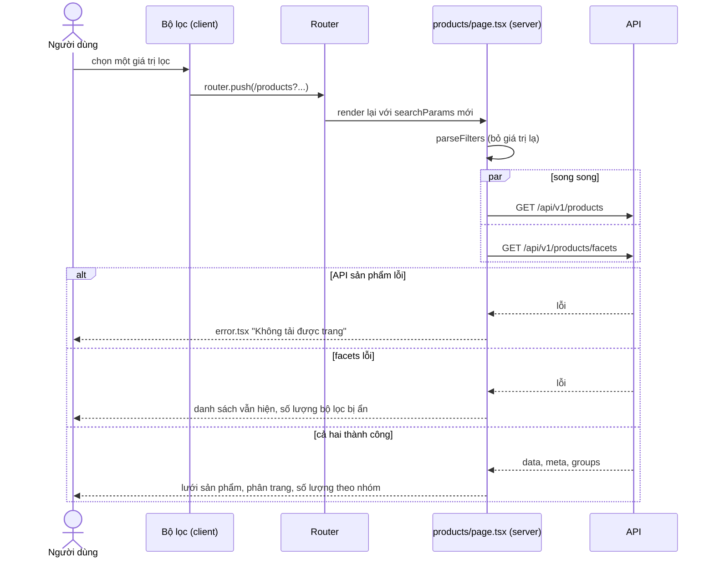
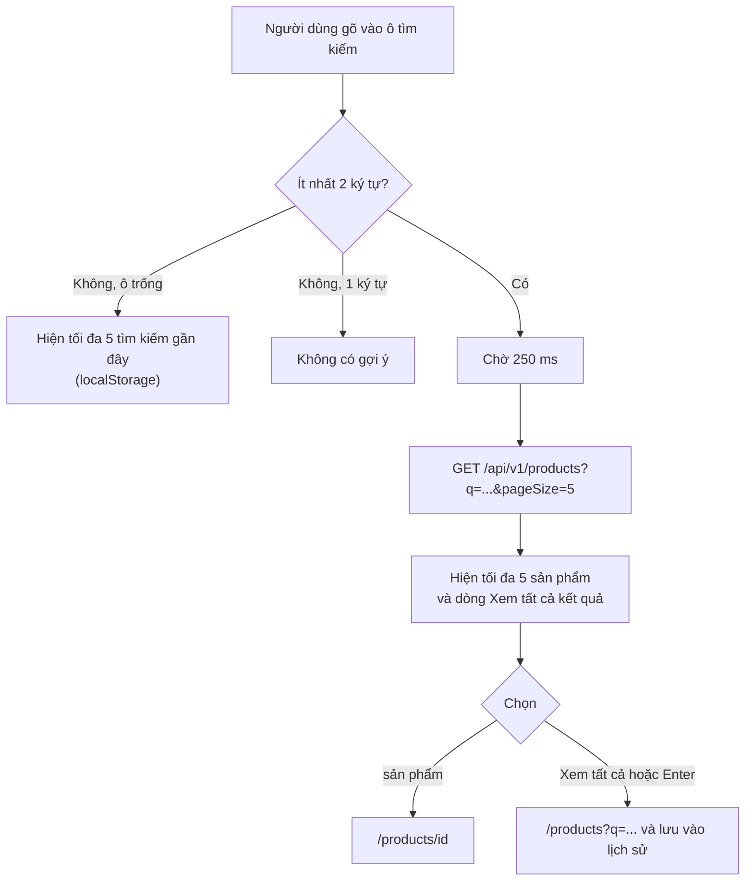

# Sản phẩm (Products)

Module Products phục vụ việc tìm, lọc, sắp xếp và xem chi tiết laptop. Trang danh sách và trang chi tiết là Server Component; bộ lọc, gợi ý tìm kiếm và đếm kết quả theo bộ lọc chạy ở trình duyệt.

## Tổng quan

| Mục | Giá trị |
| --- | --- |
| Mã nguồn | [src/features/products](https://github.com/QuocDuy21-10/laptopshop-web/tree/main/src/features/products) |
| Route | `/products`, `/products/[id]` |
| Tìm kiếm trên header | [SearchBox](https://github.com/QuocDuy21-10/laptopshop-web/tree/main/src/components/layout/SearchBox), [SearchForm](https://github.com/QuocDuy21-10/laptopshop-web/tree/main/src/components/layout/SearchForm) |
| Liên quan | Giỏ hàng, yêu thích, so sánh, khuyến mãi, đánh giá (gắn vào trang chi tiết) |

## Actors và use cases

| Actor | Use case | Route |
| --- | --- | --- |
| Khách vãng lai, Thành viên | Duyệt, tìm theo tên, lọc theo cấu hình, sắp xếp | `/products` |
| Khách vãng lai, Thành viên | Xem chi tiết, thông số, mô tả, đánh giá | `/products/[id]` |
| Khách vãng lai, Thành viên | Gợi ý tìm kiếm và lịch sử tìm kiếm gần đây | ô tìm kiếm trên header |
| Thành viên | Thêm vào giỏ, thêm vào yêu thích | trang chi tiết |

Mọi route sản phẩm đều công khai.

## Hành trình người dùng

1. Người dùng gõ vào ô tìm kiếm (từ 2 ký tự). Danh sách gợi ý hiện tối đa 5 sản phẩm, kèm giá hiện tại và liên kết "Xem tất cả kết quả".
2. Chọn một gợi ý để vào trang chi tiết, hoặc nhấn Enter để tới `/products?q=...`.
3. Ở `/products`, lọc bằng thanh bên (desktop) hoặc nút "Bộ lọc" mở ngăn kéo (mobile). Mỗi lần đổi bộ lọc, địa chỉ URL đổi theo.
4. Bấm vào một sản phẩm để xem chi tiết, thêm vào giỏ, yêu thích hoặc so sánh.

## Luồng nghiệp vụ

| Việc | Frontend | Backend |
| --- | --- | --- |
| Đọc và chuẩn hóa tham số URL | `parseFilters` bỏ giá trị không hợp lệ | Trả `400` với giá trị lọc sai |
| Lọc, sắp xếp, phân trang | Gửi truy vấn từ URL | Thực hiện lọc và trả `data`, `meta` |
| Danh sách bộ lọc và số lượng | Hiển thị `facetDefinitions` và `groups` | Định nghĩa bộ lọc và đếm kết quả |
| Giá bán | Hiển thị `salePrice` và `price` | Tính giá và khuyến mãi |
| Còn hàng hay không | `quantity > 0` | Quản lý tồn kho |

## Business rules

| Quy tắc | Thực thi bởi | Nguồn |
| --- | --- | --- |
| 12 sản phẩm mỗi trang | Web | `PAGE_SIZE` trong [search-params.ts](https://github.com/QuocDuy21-10/laptopshop-web/blob/main/src/features/products/search-params.ts#L29) |
| Chỉ chấp nhận giá trị bộ lọc nằm trong danh sách hợp lệ; giá trị lạ bị bỏ | Web | [search-params.ts](https://github.com/QuocDuy21-10/laptopshop-web/blob/main/src/features/products/search-params.ts#L70-L98) |
| Từ khóa tối đa 100 ký tự | Web | cùng file, dòng 73 |
| Mỗi nhóm lọc chọn tối đa 10 giá trị (hoặc `maxSelections` do API khai báo) | Web | cùng file, dòng 35 và 56 |
| Trang chỉ đánh chỉ mục (SEO) khi không có tham số lọc | Web | [metadata.ts](https://github.com/QuocDuy21-10/laptopshop-web/blob/main/src/features/products/metadata.ts) |
| Tìm theo tên chỉ khớp một phần; nếu từ khóa là tên hãng, gợi ý lọc theo hãng | Web | [brandSearch.ts](https://github.com/QuocDuy21-10/laptopshop-web/blob/main/src/features/products/brandSearch.ts) |
| Lịch sử tìm kiếm: tối đa 5 mục, mới nhất trước, không phân biệt hoa thường | Web | [searchHistory.ts](https://github.com/QuocDuy21-10/laptopshop-web/blob/main/src/features/products/searchHistory.ts) |
| Không bịa dữ liệu sản phẩm; chỉ hiển thị điều API trả về | Web | [CLAUDE.md](https://github.com/QuocDuy21-10/laptopshop-web/blob/main/CLAUDE.md) |

### Tham số URL của `/products`

| Tham số | Kiểu | Giá trị hợp lệ | Ví dụ |
| --- | --- | --- | --- |
| `q` | chuỗi | Từ khóa, tối đa 100 ký tự | `q=zenbook` |
| `page` | số nguyên | Từ 1 trở lên; sai thì về 1 | `page=2` |
| `sort` | chuỗi | `price_asc`, `price_desc`, `rating_desc`, `sold_desc`; không có thì dùng thứ tự mặc định | `sort=price_asc` |
| `factory` | danh sách | Giá trị trong `factoryOptions` của API | `factory=ASUS,DELL` |
| `target` | danh sách | Giá trị trong `targetOptions` của API | `target=GAMING` |
| `price` | danh sách | `under-10m`, `10-15m`, `15-20m`, `over-20m` | `price=10-15m` |
| `cpuBrand` | danh sách | `INTEL`, `AMD`, `APPLE`, `QUALCOMM` (hoặc theo API) | `cpuBrand=AMD` |
| `gpuBrand` | danh sách | `NVIDIA`, `AMD`, `INTEL`, `APPLE`, `QUALCOMM` | `gpuBrand=NVIDIA` |
| `gpuType` | danh sách | `INTEGRATED`, `DEDICATED` | `gpuType=DEDICATED` |
| `ramGb` | danh sách số | Số nguyên từ 1 đến 256 | `ramGb=16,32` |
| `storageGb` | danh sách số | Số nguyên từ 1 đến 16384 | `storageGb=512` |
| `screenSize` | danh sách | `compact`, `standard`, `large` | `screenSize=standard` |
| `resolutionTier` | danh sách | `HD`, `FHD`, `QHD`, `UHD` | `resolutionTier=QHD` |
| `panelType` | danh sách | `IPS`, `OLED`, `MINI_LED`, `TN`, `VA` | `panelType=OLED` |
| `minRefreshHz` | số | `60`, `90`, `120`, `144`, `165`, `240` | `minRefreshHz=144` |
| `minBatteryWh` | số | `40`, `50`, `60`, `80` | `minBatteryWh=60` |
| `maxWeightGrams` | số | `1200`, `1500`, `2000`, `2500`, `3000` | `maxWeightGrams=1500` |
| `minWarrantyMonths` | số | `12`, `24`, `36` | `minWarrantyMonths=24` |
| `minRating` | số | `3`, `4` | `minRating=4` |
| `inStock` | boolean | Chỉ `true` có hiệu lực | `inStock=true` |
| `flashSale` | boolean | Chỉ `true` có hiệu lực | `flashSale=true` |

Danh sách nhiều giá trị ngăn cách bằng dấu phẩy. Nguồn: [search-params.ts](https://github.com/QuocDuy21-10/laptopshop-web/blob/main/src/features/products/search-params.ts#L59-L98) và nhãn giá ở [labels.ts](https://github.com/QuocDuy21-10/laptopshop-web/blob/main/src/features/products/labels.ts#L1-L6). Các bộ lọc kiểu enum có thể được thu hẹp bởi `facetDefinitions` mà API trả về.

## Sơ đồ

### Lọc sản phẩm

Diễn giải:

- Trên desktop, mỗi lần chọn bộ lọc áp dụng ngay (đẩy URL mới, dùng cập nhật lạc quan để giao diện phản hồi tức thì).
- Trên mobile, ngăn kéo giữ bản nháp bộ lọc; chỉ khi bấm nút áp dụng mới đẩy URL. Trong lúc chọn, hook `useProductFacetPreview` (chờ 300 ms sau lần chọn cuối) gọi `GET /api/v1/products/facets` để nút hiển thị "Xem N sản phẩm", và vô hiệu hóa nút khi kết quả là 0.
- Lỗi facets không làm hỏng trang: `getProductFacets(...).catch(() => null)` khiến số lượng bên cạnh mỗi tùy chọn bị ẩn.

### Gợi ý tìm kiếm

Diễn giải: không có endpoint gợi ý riêng, ô tìm kiếm dùng lại `GET /api/v1/products` với `q` và `pageSize=5`. Kết quả chỉ hiển thị khi từ khóa đã debounce trùng với nội dung đang gõ, để tránh hiện gợi ý của chuỗi cũ. `Ctrl/⌘ + K` đưa con trỏ vào ô tìm kiếm.

## API requests/responses

| Method | Path | Auth | Request | Response | Lỗi thường gặp |
| --- | --- | --- | --- | --- | --- |
| GET | `/api/v1/products` | Không | query như bảng tham số trên, cộng `pageSize` | `200` `{ data: CatalogProduct[], meta }` | `400` giá trị lọc sai |
| GET | `/api/v1/products/{id}` | Không | `id` | `{ data: CatalogProduct }` | `404` |
| GET | `/api/v1/products/filters` | Không | không | `{ data: ProductFilterCatalog }` | |
| GET | `/api/v1/products/facets` | Không | như `/products`, bỏ `page`, `pageSize`, `sort`, `flashSale` | `{ data: { total, groups } }` | |

Nguồn kiểu: [schema.d.ts](https://github.com/QuocDuy21-10/laptopshop-web/blob/main/src/lib/api/schema.d.ts#L2899) (khối `/api/v1/products/*`). Phía server, các lời gọi nằm ở [products/server.ts](https://github.com/QuocDuy21-10/laptopshop-web/blob/main/src/features/products/server.ts#L5-L19); phía trình duyệt, facets và gợi ý tìm kiếm gọi qua `api`.

## Data contracts

Chi tiết field ở [Data dictionary: Products](../06-api-and-data/data-dictionary/products.md): `CatalogProduct`, `ProductFilters`, `ProductFilterCatalog`, `FacetDefinition`, `ProductFacets`, `PageMeta`.

## UI states và xử lý lỗi

| Tình huống | Hiển thị |
| --- | --- |
| Không có sản phẩm khớp | "Không tìm thấy laptop phù hợp" kèm nút "Xoá bộ lọc" |
| Từ khóa trùng tên hãng | Alert "Tìm theo tên chỉ khớp một phần máy <hãng>" kèm liên kết lọc theo hãng |
| `GET /products` lỗi | `error.tsx`, nút "Thử lại" |
| Sản phẩm không tồn tại hoặc id không phải số nguyên dương | Trang không tìm thấy (`notFound()`) |
| Facets lỗi | Danh sách vẫn hiện; số lượng ẩn; ngăn kéo báo "Không thể cập nhật số lượng. Bạn vẫn có thể áp dụng bộ lọc." |
| Hết hàng (`quantity` bằng 0) | Badge "Hết hàng" |
| `localStorage` bị chặn | Lịch sử tìm kiếm trống, không báo lỗi |

## Edge cases

- Tham số lạ, giá trị ngoài danh sách, trang bằng hoặc dưới 0 đều được chuẩn hóa thay vì gây lỗi `400`.
- Mô tả chi tiết được tách đoạn theo dòng trống; không có mô tả thì ẩn mục.
- Trang chi tiết dùng `product.shortDesc` làm `description` và `product.name` làm tiêu đề.
- Mỗi lần đổi bộ lọc, `page` về 1.
- Khi quay lại bằng nút Back, lựa chọn bộ lọc đang chờ trên desktop bị bỏ để không giữ trạng thái sai ([DesktopFilters.tsx](https://github.com/QuocDuy21-10/laptopshop-web/blob/main/src/features/products/DesktopFilters/DesktopFilters.tsx#L19-L24)).

> [!WARNING]
> **Chưa xác minh:** dòng "Thanh toán khi nhận hàng (COD)." ở trang chi tiết là chuỗi cố định ([page.tsx](https://github.com/QuocDuy21-10/laptopshop-web/blob/main/src/app/%28storefront%29/products/%5Bid%5D/page.tsx#L64)), trong khi API hỗ trợ cả `BANK_TRANSFER`. Chưa xác minh đây là chủ ý hay sót; cần xác nhận với người phụ trách nội dung.

> [!WARNING]
> **Chưa xác minh:** độ tươi thực tế của dữ liệu. Danh sách và chi tiết dùng `freshServerApi` (`no-store`); chỉ danh mục bộ lọc dùng `catalogServerApi`. Xem cảnh báo về `force-dynamic` ở [Rendering và cache](../02-architecture/rendering-and-caching.md).

## Bảo mật

- Mọi route sản phẩm công khai, không cần đăng nhập; dữ liệu nhạy cảm không đi qua module này.
- Tham số URL được chuẩn hóa và giới hạn độ dài trước khi gửi cho API; backend vẫn kiểm tra lại (`400`).
- Nội dung mô tả hiển thị dưới dạng văn bản trong thẻ đoạn (`
`), không chèn HTML thô.
- Ảnh sản phẩm tải qua `/images/*`, cùng origin, nên đi qua rewrite hoặc nginx.

## Tham chiếu mã nguồn

| Nội dung | File |
| --- | --- |
| Phân tích URL, chuyển sang truy vấn API | [search-params.ts](https://github.com/QuocDuy21-10/laptopshop-web/blob/main/src/features/products/search-params.ts) |
| Cập nhật bộ lọc | [filter-updates.ts](https://github.com/QuocDuy21-10/laptopshop-web/blob/main/src/features/products/filter-updates.ts) |
| Xem trước số lượng theo bộ lọc | [useProductFacetPreview.ts](https://github.com/QuocDuy21-10/laptopshop-web/blob/main/src/features/products/useProductFacetPreview.ts) |
| Bộ lọc desktop, mobile | [DesktopFilters.tsx](https://github.com/QuocDuy21-10/laptopshop-web/blob/main/src/features/products/DesktopFilters/DesktopFilters.tsx), [FilterSheet.tsx](https://github.com/QuocDuy21-10/laptopshop-web/blob/main/src/features/products/FilterSheet/FilterSheet.tsx) |
| Trang danh sách | [products/page.tsx](https://github.com/QuocDuy21-10/laptopshop-web/blob/main/src/app/%28storefront%29/products/page.tsx#L29-L86) |
| Trang chi tiết | [products/[id]/page.tsx](https://github.com/QuocDuy21-10/laptopshop-web/blob/main/src/app/%28storefront%29/products/%5Bid%5D/page.tsx#L33-L81) |
| Gợi ý tìm kiếm | [SearchBox.tsx](https://github.com/QuocDuy21-10/laptopshop-web/blob/main/src/components/layout/SearchBox/SearchBox.tsx) |
| Test | [search-params.test.ts](https://github.com/QuocDuy21-10/laptopshop-web/blob/main/tests/features/search-params.test.ts), [filter-updates.test.ts](https://github.com/QuocDuy21-10/laptopshop-web/blob/main/tests/features/filter-updates.test.ts), [brandSearch.test.ts](https://github.com/QuocDuy21-10/laptopshop-web/blob/main/tests/features/brandSearch.test.ts), [searchHistory.test.ts](https://github.com/QuocDuy21-10/laptopshop-web/blob/main/tests/features/searchHistory.test.ts), [products-metadata.test.ts](https://github.com/QuocDuy21-10/laptopshop-web/blob/main/tests/features/products-metadata.test.ts) |
| Backend | [src/modules/products](https://github.com/QuocDuy21-10/laptopshop-api/tree/main/src/modules/products) |

## Tài liệu liên quan

- [Rendering và cache](../02-architecture/rendering-and-caching.md)
- [Giỏ hàng](cart.md)
- [Data dictionary: Products](../06-api-and-data/data-dictionary/products.md)
- [Danh sách route](../12-reference/routes.md)
