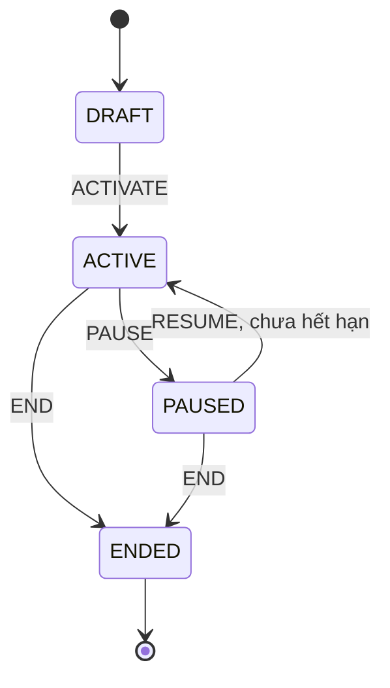
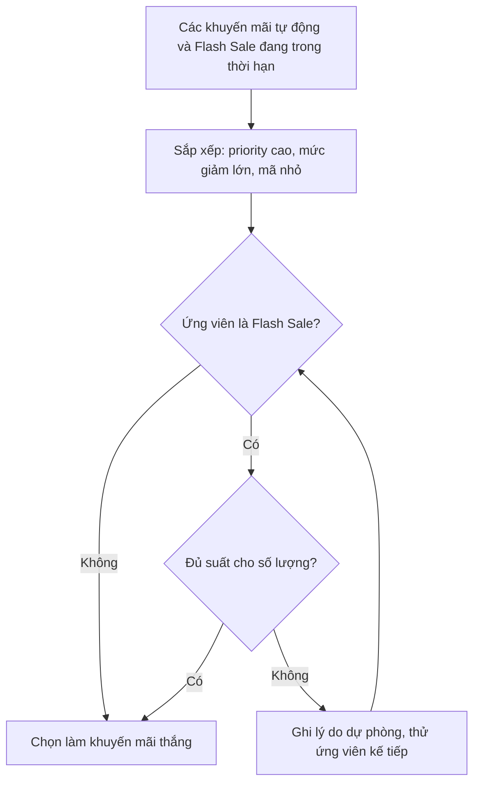

# Khuyến mãi (Promotions)

Backend có ba loại khuyến mãi: mã giảm giá (`COUPON`), giảm giá tự động theo sản phẩm (`AUTOMATIC`) và Flash Sale có số suất (`FLASH_SALE`). Phía khách, module này hiển thị trang mã công khai, thanh khuyến mãi, bộ đếm và số suất Flash Sale, và giá đã giảm. Admin tạo và vận hành khuyến mãi. Mọi phép tính giá, chọn khuyến mãi và giữ suất do backend làm.

## Tổng quan

| Mục | Giá trị |
| --- | --- |
| Mã nguồn | [src/features/promotions](https://github.com/QuocDuy21-10/laptopshop-web/tree/main/src/features/promotions) (khách), [src/features/admin/promotions](https://github.com/QuocDuy21-10/laptopshop-web/tree/main/src/features/admin/promotions) (admin) |
| Route khách | `/promotions` (Server Component, công khai) |
| Route admin | `/admin/promotions`, `/admin/promotions/new`, `/admin/promotions/[id]` |
| Nơi khác dùng | `PromotionPrice` ở thẻ sản phẩm và chi tiết; `FlashSaleAvailability` ở trang sản phẩm; thanh khuyến mãi (`PromoBar`) ở header; giỏ và checkout ([Cart](cart.md), [Checkout](checkout.md)) |
| Backend | [src/modules/promotions](https://github.com/QuocDuy21-10/laptopshop-api/tree/main/src/modules/promotions) |
| Test | [tests/features/promotions](https://github.com/QuocDuy21-10/laptopshop-web/tree/main/tests/features/promotions) |

## Actors và use cases

| Actor | Use case | Route |
| --- | --- | --- |
| Khách vãng lai | Xem danh sách mã công khai, sao chép mã | `/promotions` |
| Khách vãng lai | Xem giá đã giảm, nhãn Flash Sale, bộ đếm, số suất còn lại | thẻ sản phẩm, chi tiết sản phẩm |
| Khách vãng lai | Xem thanh khuyến mãi chạy ở đầu trang | header |
| Thành viên | Nhập mã ở bước thanh toán | `/checkout` |
| Admin | Tạo, sửa, nhân bản, kích hoạt, tạm dừng, tiếp tục, kết thúc khuyến mãi | `/admin/promotions` |
| Admin | Xem tóm tắt, lượt dùng, suất Flash Sale đã giữ | `/admin/promotions/[id]` |

## Hành trình người dùng

1. Khách vào `/promotions`, đọc điều kiện (đơn tối thiểu, giảm tối đa, hạn dùng) và bấm "Sao chép mã".
2. Khách chọn sản phẩm; giá đã giảm hiện kèm nhãn phần trăm, giá gốc gạch.
3. Với Flash Sale, trang sản phẩm hỏi API số suất và hiện bộ đếm ngược; hết giờ thì làm mới.
4. Ở giỏ và checkout, backend tính lại giá chính xác theo số lượng và người mua; mã giảm giá nhập ở checkout ([Checkout](checkout.md)).

## Luồng nghiệp vụ

| Việc | Frontend | Backend |
| --- | --- | --- |
| Mã công khai | Server gọi `GET /promotions/available` (`no-store`) | Chỉ mã `COUPON`, `ACTIVE`, trong thời hạn, `isPublic`, còn lượt |
| Thanh khuyến mãi | Chọn mã đang chạy có hạn kết thúc sớm nhất | Cùng endpoint, cache trang chủ |
| Giá giảm trên sản phẩm | `PromotionPrice` tính phần trăm hiển thị từ `salePrice` và `price` | Chọn khuyến mãi thắng, tính `salePrice` |
| Flash Sale ở trang sản phẩm | Hỏi lại mỗi 12 giây khi tab hiện | Trả suất còn lại, mốc giờ, `serverTime` |
| Admin | Form, nút chuyển trạng thái, chỉnh quota | Kiểm tra, khóa trường sau khi kích hoạt |

## Business rules

| Quy tắc | Thực thi bởi | Nguồn |
| --- | --- | --- |
| Loại: `COUPON`, `AUTOMATIC`, `FLASH_SALE`; trạng thái lưu: `DRAFT`, `ACTIVE`, `PAUSED`, `ENDED` | API | [promotions.schema.ts](https://github.com/QuocDuy21-10/laptopshop-api/blob/main/src/modules/promotions/promotions.schema.ts#L5-L9) |
| Trạng thái hiệu lực: `ACTIVE` thành `SCHEDULED` (chưa đến giờ), `RUNNING`, `EXPIRED` (quá hạn); trạng thái khác giữ nguyên | API | [promotions.mapper.ts](https://github.com/QuocDuy21-10/laptopshop-api/blob/main/src/modules/promotions/promotions.mapper.ts#L9-L19) |
| Chuyển trạng thái: `ACTIVATE` chỉ từ `DRAFT`; `PAUSE` từ `ACTIVE`; `RESUME` từ `PAUSED` và chưa hết hạn; `END` từ `ACTIVE` hoặc `PAUSED`; sai thì `PROMOTION_INVALID_TRANSITION` | API | [promotions.service.ts](https://github.com/QuocDuy21-10/laptopshop-api/blob/main/src/modules/promotions/promotions.service.ts#L443-L455) |
| Flash Sale phải có ít nhất một dòng quota mới kích hoạt được | API | [promotions.service.ts](https://github.com/QuocDuy21-10/laptopshop-api/blob/main/src/modules/promotions/promotions.service.ts#L457-L461) |
| `endsAt` phải sau `startsAt`; giảm theo phần trăm tối đa 100; giá trị nguyên dương | API | [promotions.schema.ts](https://github.com/QuocDuy21-10/laptopshop-api/blob/main/src/modules/promotions/promotions.schema.ts#L96-L121) |
| Mã giảm giá: 3 đến 50 ký tự `A-Z`, `0-9`, `_`, `-` (tự viết hoa); trùng mã thì `COUPON_CODE_TAKEN` | API | [promotions.schema.ts](https://github.com/QuocDuy21-10/laptopshop-api/blob/main/src/modules/promotions/promotions.schema.ts#L17-L23), [promotions.service.ts](https://github.com/QuocDuy21-10/laptopshop-api/blob/main/src/modules/promotions/promotions.service.ts#L188) |
| Phạm vi mã: `ORDER` không được có sản phẩm đích; `PRODUCT` phải có; mã cố định (`FIXED`) không dùng `maxDiscount` | API (web cũng bỏ `maxDiscount` khi `FIXED`) | [promotions.schema.ts](https://github.com/QuocDuy21-10/laptopshop-api/blob/main/src/modules/promotions/promotions.schema.ts#L122-L150), [PromotionForm.tsx](https://github.com/QuocDuy21-10/laptopshop-web/blob/main/src/features/admin/promotions/PromotionForm.tsx#L91-L92) |
| Mặc định mã: mỗi người dùng 1 lần; `maxUses` để trống là không giới hạn | API | [promotions.schema.ts](https://github.com/QuocDuy21-10/laptopshop-api/blob/main/src/modules/promotions/promotions.schema.ts#L31-L42) |
| Giảm tự động bắt buộc có sản phẩm đích; `priority` từ -1.000.000 đến 1.000.000; `stackableWithCoupon` | API | [promotions.schema.ts](https://github.com/QuocDuy21-10/laptopshop-api/blob/main/src/modules/promotions/promotions.schema.ts#L44-L50), [promotions.schema.ts](https://github.com/QuocDuy21-10/laptopshop-api/blob/main/src/modules/promotions/promotions.schema.ts#L152-L167) |
| Flash Sale: 1 đến 500 sản phẩm không trùng, `maxUnitsPerUser` không vượt `totalQuota` | API (web kiểm tra thêm bằng `validateQuotaItems`) | [promotions.schema.ts](https://github.com/QuocDuy21-10/laptopshop-api/blob/main/src/modules/promotions/promotions.schema.ts#L52-L88) |
| Sau khi kích hoạt, khóa `discountKind`, `discountValue`, `startsAt`; `endsAt` chỉ được kéo dài; mục tiêu Flash Sale bị khóa (`PROMOTION_FIELD_LOCKED`) | API | [promotions.service.ts](https://github.com/QuocDuy21-10/laptopshop-api/blob/main/src/modules/promotions/promotions.service.ts#L40-L42), [promotions.service.ts](https://github.com/QuocDuy21-10/laptopshop-api/blob/main/src/modules/promotions/promotions.service.ts#L236-L272) |
| Giảm mỗi đơn vị: phần trăm làm tròn xuống, số tiền cố định; không vượt giá niêm yết | API | [promotion-discount.ts](https://github.com/QuocDuy21-10/laptopshop-api/blob/main/src/modules/promotions/promotion-discount.ts#L3-L9) |
| Khi nhiều khuyến mãi cùng sản phẩm: ưu tiên `priority` cao, rồi mức giảm lớn hơn, rồi mã nhỏ hơn | API | [promotion-selection.ts](https://github.com/QuocDuy21-10/laptopshop-api/blob/main/src/modules/promotions/promotion-selection.ts#L12-L23) |
| Flash Sale thiếu suất (toàn cục hoặc theo người) bị bỏ qua và chuyển sang ứng viên kế tiếp, kèm lý do dự phòng | API | [promotion-selection.ts](https://github.com/QuocDuy21-10/laptopshop-api/blob/main/src/modules/promotions/promotion-selection.ts#L38-L60) |
| Kiểm tra theo người (`userRemainingQuota`) chỉ ở chế độ `EXACT` có người dùng; chế độ `POTENTIAL` chỉ kiểm tra suất toàn cục | API | [promotion-selection.ts](https://github.com/QuocDuy21-10/laptopshop-api/blob/main/src/modules/promotions/promotion-selection.ts#L48-L52) |
| Mã công khai chỉ gồm `COUPON` đang chạy, `isPublic`, còn lượt | API | [promotions.service.ts](https://github.com/QuocDuy21-10/laptopshop-api/blob/main/src/modules/promotions/promotions.service.ts#L799-L813) |
| Thanh khuyến mãi chọn mã đang chạy có `endsAt` sớm nhất | Web | [server.ts](https://github.com/QuocDuy21-10/laptopshop-web/blob/main/src/features/promotions/server.ts#L9-L28) |

## Sơ đồ

### Vòng đời một khuyến mãi (admin)

Khi `ACTIVE`, trạng thái hiệu lực còn là `SCHEDULED`, `RUNNING` hoặc `EXPIRED` tùy thời điểm so với `startsAt` và `endsAt` ([promotions.mapper.ts](https://github.com/QuocDuy21-10/laptopshop-api/blob/main/src/modules/promotions/promotions.mapper.ts#L9-L19)). Nút trong chi tiết admin chỉ cho `ACTIVATE`, `PAUSE`, `RESUME`; `END` có trong API nhưng không thấy nút trong đoạn đã đọc ([PromotionDetail.tsx](https://github.com/QuocDuy21-10/laptopshop-web/blob/main/src/features/admin/promotions/PromotionDetail.tsx#L71-L74)).

### Chọn khuyến mãi cho một sản phẩm

Theo [selectProductPromotion](https://github.com/QuocDuy21-10/laptopshop-api/blob/main/src/modules/promotions/promotion-selection.ts#L28-L60). Mã giảm giá (`COUPON`) không nằm trong luồng này; nó được áp riêng ở báo giá đơn ([Checkout](checkout.md)).

## API requests/responses

Phía khách:

| Method | Path | Auth | Request | Response | Ghi chú |
| --- | --- | --- | --- | --- | --- |
| GET | `/api/v1/promotions/available` | Không | | `PublicPromotion[]` | Trang `/promotions` và thanh khuyến mãi |
| GET | `/api/v1/promotions/flash-sales/availability` | Tùy chọn | `productIds` (1 đến 20) | `{ items, serverTime }` | Có người dùng thì tính theo người |

Phía admin ([hooks.ts](https://github.com/QuocDuy21-10/laptopshop-web/blob/main/src/features/admin/promotions/hooks.ts)): `GET` và `POST /admin/promotions`; `GET` và `PATCH /admin/promotions/{id}`; `PATCH /admin/promotions/{id}/state` (`action`); `GET /admin/promotions/{id}/summary`; `GET /admin/promotions/{id}/allocations`. Backend còn có `POST /{id}/clone` và `GET /{id}/redemptions` ([promotions.routes.ts](https://github.com/QuocDuy21-10/laptopshop-api/blob/main/src/modules/promotions/promotions.routes.ts#L39-L70)).

## Data contracts

`PublicPromotion`, `FlashSaleAvailability` ở [types.ts](https://github.com/QuocDuy21-10/laptopshop-web/blob/main/src/lib/api/types.ts). Chi tiết ở [Data dictionary: Promotions](../06-api-and-data/data-dictionary/promotions.md).

## UI states và xử lý lỗi

- `/promotions`: không có mã thì hiện "Hiện chưa có mã giảm giá công khai." ([PublicPromotions.tsx](https://github.com/QuocDuy21-10/laptopshop-web/blob/main/src/features/promotions/PublicPromotions.tsx#L10)). Trang tải ở server nên không có trạng thái loading riêng.
- Sao chép mã: toast "Đã sao chép mã", hoặc "Không thể sao chép tự động" khi clipboard bị chặn ([CopyCodeButton.tsx](https://github.com/QuocDuy21-10/laptopshop-web/blob/main/src/features/promotions/CopyCodeButton.tsx#L9-L15)).
- `FlashSaleAvailability` không hiện gì khi chưa có dữ liệu hoặc không có suất; chỉ hiện "Còn N suất" khi backend trả `remainingQuota` khác null ([FlashSaleAvailability.tsx](https://github.com/QuocDuy21-10/laptopshop-web/blob/main/src/features/promotions/FlashSaleAvailability.tsx#L8-L21)).
- `PromotionPrice`: với Flash Sale ở chế độ `POTENTIAL` hiện "Giá Flash Sale có thể áp dụng. Hệ thống sẽ kiểm tra lại số suất còn lại ở giỏ hàng." ([PromotionPrice.tsx](https://github.com/QuocDuy21-10/laptopshop-web/blob/main/src/features/promotions/PromotionPrice/PromotionPrice.tsx#L9-L19)).
- Thanh khuyến mãi trả `null` khi API lỗi hoặc dữ liệu hỏng, thanh đơn giản không hiện ([server.ts](https://github.com/QuocDuy21-10/laptopshop-web/blob/main/src/features/promotions/server.ts#L9-L27)).

## Edge cases

- Bộ đếm Flash Sale tính giờ theo `serverTime` cộng khoảng thời gian trôi qua từ lúc nhận dữ liệu, nên không phụ thuộc đồng hồ máy khách; tới mốc thì gọi làm mới ([FlashSaleCountdown.tsx](https://github.com/QuocDuy21-10/laptopshop-web/blob/main/src/features/promotions/FlashSaleCountdown/FlashSaleCountdown.tsx#L26-L42)).
- Tab ẩn thì không hỏi lại suất; quay lại tab hỏi ngay ([hooks.ts](https://github.com/QuocDuy21-10/laptopshop-web/blob/main/src/features/promotions/hooks.ts#L13-L25)).
- Sửa khuyến mãi đã kích hoạt: kéo ngắn `endsAt` bị từ chối (`PROMOTION_FIELD_LOCKED`).
- `RESUME` một khuyến mãi đã quá hạn bị từ chối.

## Bảo mật

- Hai endpoint khách không cần đăng nhập; `availability` dùng `optionalAuthenticate`, dữ liệu theo người chỉ có khi đã đăng nhập ([promotions.routes.ts](https://github.com/QuocDuy21-10/laptopshop-api/blob/main/src/modules/promotions/promotions.routes.ts#L31-L35)).
- Router admin yêu cầu vai trò `ADMIN` ([Admin](admin.md)).
- Giá, giảm, suất do backend quyết định; frontend không tự tính mức giảm hay giữ suất.

## Tham chiếu mã nguồn

- Web: [hooks.ts](https://github.com/QuocDuy21-10/laptopshop-web/blob/main/src/features/promotions/hooks.ts), [server.ts](https://github.com/QuocDuy21-10/laptopshop-web/blob/main/src/features/promotions/server.ts), [PublicPromotions.tsx](https://github.com/QuocDuy21-10/laptopshop-web/blob/main/src/features/promotions/PublicPromotions.tsx), [PromotionForm.tsx](https://github.com/QuocDuy21-10/laptopshop-web/blob/main/src/features/admin/promotions/PromotionForm.tsx).
- Backend: [promotions.schema.ts](https://github.com/QuocDuy21-10/laptopshop-api/blob/main/src/modules/promotions/promotions.schema.ts), [promotions.service.ts](https://github.com/QuocDuy21-10/laptopshop-api/blob/main/src/modules/promotions/promotions.service.ts), [promotion-selection.ts](https://github.com/QuocDuy21-10/laptopshop-api/blob/main/src/modules/promotions/promotion-selection.ts), [promotion-discount.ts](https://github.com/QuocDuy21-10/laptopshop-api/blob/main/src/modules/promotions/promotion-discount.ts).
- Cấu trúc bảng thuộc backend: [schema.prisma](https://github.com/QuocDuy21-10/laptopshop-api/blob/main/prisma/schema.prisma).

> [!WARNING]
> **Chưa xác minh:** (1) các component admin (`PromotionList`, `FlashSaleQuotaEditor`, `FlashSaleAllocations`, `FlashSaleSummary`) và nút `END` trên giao diện; (2) cách giữ suất và hoàn suất ở `flash-sale-quota.ts` (chỉ biết kết quả qua [Orders](orders.md)); (3) `PromoBar` hiển thị ra sao ngoài hàm chọn mã; (4) `promotion-resolver.ts` và `automatic-promotion-policy.ts` chưa đọc.

## Tài liệu liên quan

- [Checkout](checkout.md): mã giảm giá, báo giá, `pricingFingerprint`.
- [Cart](cart.md): ghi chú Flash Sale ở dòng giỏ.
- [Orders](orders.md): hoàn mã và suất khi hủy đơn.
- [Admin](admin.md)
