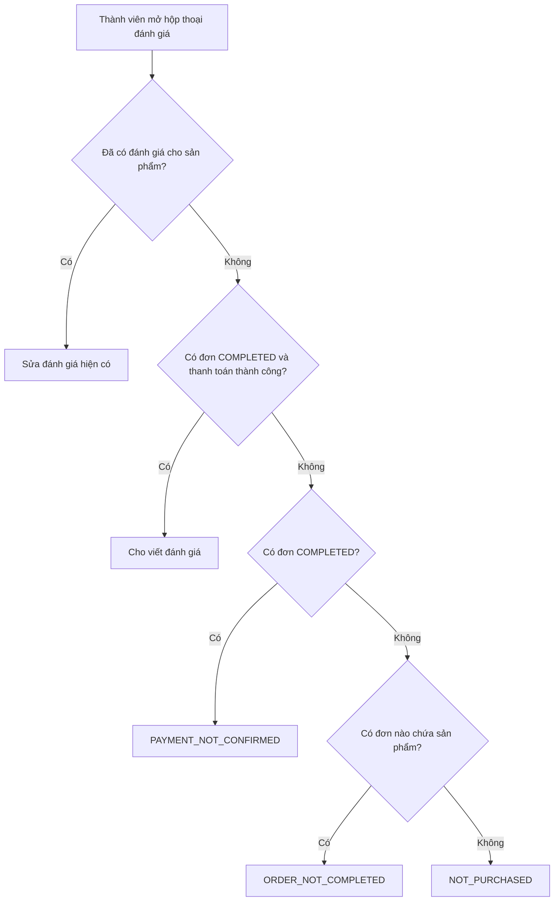
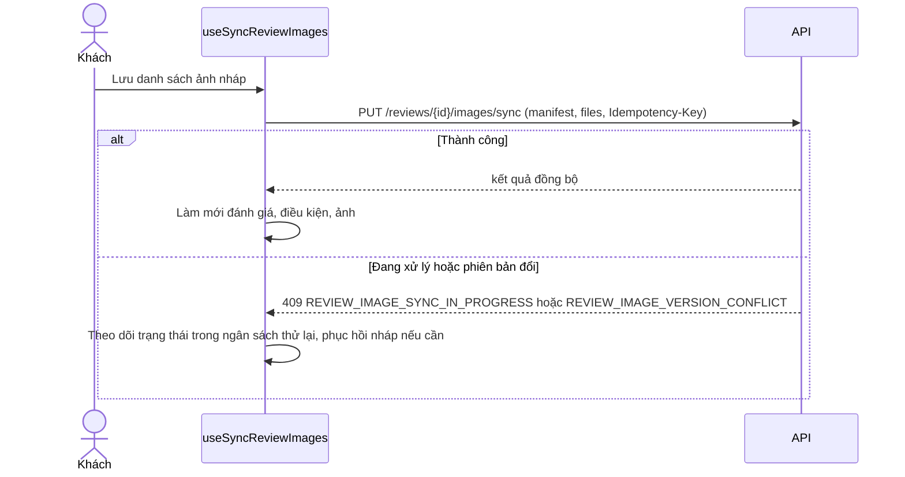

# Đánh giá sản phẩm (Reviews)

Khách đã mua và nhận hàng viết đánh giá có sao, nội dung và tối đa 3 ảnh cho sản phẩm; mọi người xem, lọc, bình chọn hữu ích. Admin kiểm duyệt (ẩn hoặc hiện) và trả lời chính thức. Frontend hiển thị và gửi thao tác; điều kiện được đánh giá và kiểm duyệt do backend quyết định.

## Tổng quan

| Mục | Giá trị |
| --- | --- |
| Mã nguồn | [src/features/reviews](https://github.com/QuocDuy21-10/laptopshop-web/tree/main/src/features/reviews) (khách), [src/features/admin/reviews](https://github.com/QuocDuy21-10/laptopshop-web/tree/main/src/features/admin/reviews) (admin) |
| Nơi hiển thị | phần đánh giá ở trang chi tiết sản phẩm `/products/[id]` |
| Route admin | `/admin/reviews`, `/admin/reviews/[id]` |
| Backend | [src/modules/reviews](https://github.com/QuocDuy21-10/laptopshop-api/tree/main/src/modules/reviews) |
| Test | [tests/features/reviews](https://github.com/QuocDuy21-10/laptopshop-web/tree/main/tests/features/reviews) |

Dữ liệu ban đầu (tóm tắt và trang đầu) được lấy ở server bằng `getInitialReviews`; nếu lỗi khác 404 thì hiện rỗng thay vì làm hỏng trang ([server.ts](https://github.com/QuocDuy21-10/laptopshop-web/blob/main/src/features/reviews/server.ts#L6-L25)).

## Actors và use cases

| Actor | Use case | Nơi thao tác |
| --- | --- | --- |
| Khách vãng lai | Xem tóm tắt, danh sách, ảnh, trả lời chính thức | chi tiết sản phẩm |
| Khách vãng lai | Bấm viết đánh giá hoặc "hữu ích" thì được mời đăng nhập | hộp thoại mời đăng nhập (lý do `review`, `helpful`) |
| Thành viên đã mua | Viết, sửa, xóa đánh giá; thêm, sắp xếp, xóa ảnh | chi tiết sản phẩm |
| Thành viên | Đánh dấu hoặc bỏ đánh dấu "hữu ích" cho đánh giá của người khác | chi tiết sản phẩm |
| Admin | Lọc, xem, ẩn hoặc hiện đánh giá, trả lời, xóa trả lời | `/admin/reviews` |

## Hành trình người dùng

1. Ở chi tiết sản phẩm, khách xem điểm trung bình, phân bố sao và danh sách (sắp xếp mới nhất, cao nhất, thấp nhất; lọc theo sao).
2. Thành viên mở hộp thoại viết đánh giá; giao diện hỏi điều kiện (`eligibility`) trước khi cho viết.
3. Nhập số sao, tiêu đề (tùy chọn), nội dung, chọn hiển thị tên thật hay ẩn danh, thêm tối đa 3 ảnh.
4. Sau khi gửi, đánh giá hiện ngay (trạng thái `PUBLISHED`); người viết có thể sửa hoặc xóa.
5. Admin có thể ẩn đánh giá vi phạm kèm lý do và trả lời chính thức; trả lời hiện dưới đánh giá.

## Luồng nghiệp vụ

| Việc | Frontend | Backend |
| --- | --- | --- |
| Kiểm tra điều kiện | `useReviewEligibility` | Tìm đơn của người dùng chứa sản phẩm; trả lý do nếu không đủ |
| Tạo, sửa | Kiểm tra bằng zod rồi gửi | Kiểm tra lại, yêu cầu họ tên khi không ẩn danh |
| Ảnh | Biên tập danh sách ảnh nháp rồi đồng bộ một lần (`PUT .../images/sync`) | Xử lý ảnh, kiểm tra phiên bản và khóa idempotency |
| Hữu ích | Cập nhật lạc quan, hoàn tác khi lỗi | Chặn tự bình chọn, chỉ đánh giá công khai |
| Kiểm duyệt, trả lời | Form admin | Lưu trạng thái, lý do, nội dung trả lời |

## Business rules

| Quy tắc | Thực thi bởi | Nguồn |
| --- | --- | --- |
| Chỉ được đánh giá khi có đơn `COMPLETED` và thanh toán thành công chứa sản phẩm | API | [reviews.service.ts](https://github.com/QuocDuy21-10/laptopshop-api/blob/main/src/modules/reviews/reviews.service.ts#L129-L159) |
| Lý do không đủ điều kiện: `NOT_PURCHASED`, `ORDER_NOT_COMPLETED`, `PAYMENT_NOT_CONFIRMED`; lỗi `REVIEW_NOT_ELIGIBLE` (403) | API | [reviews.service.ts](https://github.com/QuocDuy21-10/laptopshop-api/blob/main/src/modules/reviews/reviews.service.ts#L100-L103) |
| Mỗi người một đánh giá cho mỗi sản phẩm (`REVIEW_ALREADY_EXISTS`, 409) | API | [reviews.service.ts](https://github.com/QuocDuy21-10/laptopshop-api/blob/main/src/modules/reviews/reviews.service.ts#L279) |
| Đánh giá công khai (không ẩn danh) cần có họ tên trong hồ sơ (`REVIEW_FULL_NAME_REQUIRED`) | API | [reviews.service.ts](https://github.com/QuocDuy21-10/laptopshop-api/blob/main/src/modules/reviews/reviews.service.ts#L111-L120) |
| Sao nguyên 1 đến 5; tiêu đề tối đa 150; nội dung 10 đến 1500 ký tự | Web (zod) và API | [schema.ts](https://github.com/QuocDuy21-10/laptopshop-web/blob/main/src/features/reviews/schema.ts#L6-L19), [reviews.schema.ts](https://github.com/QuocDuy21-10/laptopshop-api/blob/main/src/modules/reviews/reviews.schema.ts#L20-L22) |
| Tối đa 3 ảnh, mỗi ảnh tối đa 3 MB, chỉ JPEG, PNG, WebP | Web và API | [ReviewImagesEditor.tsx](https://github.com/QuocDuy21-10/laptopshop-web/blob/main/src/features/reviews/ReviewImagesEditor/ReviewImagesEditor.tsx#L77-L90), [review-images.constants.ts](https://github.com/QuocDuy21-10/laptopshop-api/blob/main/src/modules/reviews/review-images.constants.ts#L1), [reviews.schema.ts](https://github.com/QuocDuy21-10/laptopshop-api/blob/main/src/modules/reviews/reviews.schema.ts#L109) |
| Đánh giá mới `PUBLISHED`; nếu đã bị ẩn (`HIDDEN`) thì vẫn giữ `HIDDEN` sau khi sửa | API | [reviews.service.ts](https://github.com/QuocDuy21-10/laptopshop-api/blob/main/src/modules/reviews/reviews.service.ts#L319) |
| Ẩn đánh giá bắt buộc có lý do (tối đa 500); hiện lại thì không được kèm lý do | API | [reviews.schema.ts](https://github.com/QuocDuy21-10/laptopshop-api/blob/main/src/modules/reviews/reviews.schema.ts#L72-L90) |
| Trả lời chính thức tối đa 1000 ký tự | API | [reviews.schema.ts](https://github.com/QuocDuy21-10/laptopshop-api/blob/main/src/modules/reviews/reviews.schema.ts#L99) |
| Không tự bình chọn hữu ích cho đánh giá của mình (`REVIEW_HELPFUL_SELF_VOTE`); chỉ đánh giá `PUBLISHED` chưa xóa mới nhận bình chọn | API | [review-helpful.service.ts](https://github.com/QuocDuy21-10/laptopshop-api/blob/main/src/modules/reviews/review-helpful.service.ts#L14-L37) |
| Đánh giá bị xóa mềm (`deletedAt`); sửa hoặc bình chọn đánh giá đã xóa trả `REVIEW_DELETED` | API | [reviews.service.ts](https://github.com/QuocDuy21-10/laptopshop-api/blob/main/src/modules/reviews/reviews.service.ts#L341-L357) |

## Sơ đồ

### Điều kiện được đánh giá

Các nhánh lý do khớp với [resolveReviewEligibility](https://github.com/QuocDuy21-10/laptopshop-api/blob/main/src/modules/reviews/reviews.service.ts#L129-L159). Nhánh "đã có đánh giá" được suy ra từ `willRequireModeration` và `existing` trong phần trả lời điều kiện ([reviews.service.ts](https://github.com/QuocDuy21-10/laptopshop-api/blob/main/src/modules/reviews/reviews.service.ts#L245-L264)).

### Đồng bộ ảnh

`manifest` gồm `expectedVersion` và danh sách ảnh `existing` (theo `imageId`) hoặc `new` (theo `fileIndex`) ([hooks.ts](https://github.com/QuocDuy21-10/laptopshop-web/blob/main/src/features/reviews/hooks.ts#L97-L130)). Backend dùng khóa idempotency và dấu vân tay yêu cầu, từ chối khóa dùng lại với nội dung khác (`IDEMPOTENCY_KEY_REUSED`) ([review-image-sync.service.ts](https://github.com/QuocDuy21-10/laptopshop-api/blob/main/src/modules/reviews/review-image-sync.service.ts#L50-L90)).

## API requests/responses

Phía khách ([hooks.ts](https://github.com/QuocDuy21-10/laptopshop-web/blob/main/src/features/reviews/hooks.ts)):

| Method | Path | Auth | Request | Lỗi thường gặp |
| --- | --- | --- | --- | --- |
| GET | `/api/v1/products/{id}/reviews/summary` | Không | | `404` |
| GET | `/api/v1/products/{id}/reviews` | Không | `page`, `pageSize`, `sort`, `rating` | `404` |
| GET | `/api/v1/products/{id}/reviews/eligibility` | Có | | `401` |
| POST | `/api/v1/products/{id}/reviews` | Có | `rating`, `title?`, `content`, `isAnonymous` | `403 REVIEW_NOT_ELIGIBLE`, `409 REVIEW_ALREADY_EXISTS`, `409 REVIEW_FULL_NAME_REQUIRED` |
| PATCH, DELETE | `/api/v1/reviews/{id}` | Có | các field cần sửa | `404 REVIEW_NOT_FOUND`, `409 REVIEW_DELETED` |
| POST | `/api/v1/reviews/{id}/images` | Có | multipart `images` | |
| PATCH | `/api/v1/reviews/{id}/images/order` | Có | `imageIds` (tối đa 3) | |
| DELETE | `/api/v1/reviews/{id}/images/{imageId}` | Có | | |
| PUT | `/api/v1/reviews/{id}/images/sync` | Có | multipart `manifest`, `files`; header `Idempotency-Key` | `409 REVIEW_IMAGE_VERSION_CONFLICT`, `REVIEW_IMAGE_SYNC_IN_PROGRESS` |
| GET | `/api/v1/reviews/helpful` | Có | `reviewIds` (chia lô) | |
| PUT, DELETE | `/api/v1/reviews/{id}/helpful` | Có | | `409 REVIEW_HELPFUL_SELF_VOTE`, `404 REVIEW_NOT_PUBLIC` |

Phía admin ([hooks.ts](https://github.com/QuocDuy21-10/laptopshop-web/blob/main/src/features/admin/reviews/hooks.ts)): `GET /admin/reviews` (lọc `rating`, `status`, `q`), `GET /admin/reviews/summary`, `GET /admin/reviews/{id}`, `PATCH /admin/reviews/{id}/moderation`, `PUT` và `DELETE /admin/reviews/{id}/reply`.

## Data contracts

Type `PublicReview`, `ReviewSummary`, `ReviewEligibility`, `ReviewImage` lấy từ [types.ts](https://github.com/QuocDuy21-10/laptopshop-web/blob/main/src/lib/api/types.ts). Chi tiết ở [Data dictionary: Reviews](../06-api-and-data/data-dictionary/reviews.md).

## UI states và xử lý lỗi

- Dữ liệu ban đầu lỗi (không phải 404): hiện danh sách rỗng, tóm tắt không có điểm ([server.ts](https://github.com/QuocDuy21-10/laptopshop-web/blob/main/src/features/reviews/server.ts#L19-L24)).
- Lỗi API đi qua `errorMessage`; mã `REVIEW_NOT_ELIGIBLE` có thông báo "Chỉ khách đã mua và hoàn tất đơn hàng mới được đánh giá." ([errors.ts](https://github.com/QuocDuy21-10/laptopshop-web/blob/main/src/lib/api/errors.ts#L58)).
- Lỗi ảnh ở phía trình duyệt: "Ảnh vượt quá 3 MB: tên file" và "Review chỉ được tối đa 3 ảnh." ([ReviewImagesEditor.tsx](https://github.com/QuocDuy21-10/laptopshop-web/blob/main/src/features/reviews/ReviewImagesEditor/ReviewImagesEditor.tsx#L77-L85)).
- Nút "hữu ích" cập nhật lạc quan và hoàn tác khi lỗi ([hooks.ts](https://github.com/QuocDuy21-10/laptopshop-web/blob/main/src/features/reviews/hooks.ts#L150-L160)).

## Edge cases

- Đồng bộ ảnh bị gián đoạn: web lưu ngân sách thử lại trong `sessionStorage` (khóa `laptopshop:review-image-sync-budget:v1:...`), không lưu token, `File` hay DTO ([review-image-sync-budget.ts](https://github.com/QuocDuy21-10/laptopshop-web/blob/main/src/features/reviews/review-image-sync-budget.ts#L5-L8)); khi phục hồi, file được đối chiếu bằng kích thước, kiểu và SHA-256 ([review-image-recovery.ts](https://github.com/QuocDuy21-10/laptopshop-web/blob/main/src/features/reviews/review-image-recovery.ts#L17-L23)).
- Người dùng sửa đánh giá đang bị ẩn: vẫn bị ẩn, điều kiện trả `willRequireModeration` ([reviews.service.ts](https://github.com/QuocDuy21-10/laptopshop-api/blob/main/src/modules/reviews/reviews.service.ts#L252-L258)).
- Chủ đánh giá bị xóa mềm không bình chọn hay sửa được (`REVIEW_DELETED`).

## Bảo mật

- Đọc đánh giá công khai không cần đăng nhập; viết, sửa, xóa, ảnh, bình chọn cần đăng nhập ([reviews.routes.ts](https://github.com/QuocDuy21-10/laptopshop-api/blob/main/src/modules/reviews/reviews.routes.ts#L43-L90)). Thao tác bình chọn đi qua bộ giới hạn tần suất khi được cấu hình ([reviews.routes.ts](https://github.com/QuocDuy21-10/laptopshop-api/blob/main/src/modules/reviews/reviews.routes.ts#L26)).
- Sửa và xóa chỉ trên đánh giá của chính người dùng (`where: { id, userId }`).
- Router admin yêu cầu vai trò `ADMIN` ([Admin](admin.md)).

> [!WARNING]
> **Chưa xác minh:** (1) hành vi chi tiết của quy trình đồng bộ ảnh phía web (`useReviewImageSyncWorkflow.ts`, 589 dòng; chỉ đọc hook, ngân sách và phục hồi); (2) các component admin (bảng, form kiểm duyệt); (3) cách tên người viết được che khi ẩn danh trong DTO công khai. Cần đọc các file đó và `reviews.mapper.ts`.

## Tham chiếu mã nguồn

- Web: [hooks.ts](https://github.com/QuocDuy21-10/laptopshop-web/blob/main/src/features/reviews/hooks.ts), [schema.ts](https://github.com/QuocDuy21-10/laptopshop-web/blob/main/src/features/reviews/schema.ts), [server.ts](https://github.com/QuocDuy21-10/laptopshop-web/blob/main/src/features/reviews/server.ts), [admin hooks.ts](https://github.com/QuocDuy21-10/laptopshop-web/blob/main/src/features/admin/reviews/hooks.ts).
- Backend: [reviews.service.ts](https://github.com/QuocDuy21-10/laptopshop-api/blob/main/src/modules/reviews/reviews.service.ts), [reviews.schema.ts](https://github.com/QuocDuy21-10/laptopshop-api/blob/main/src/modules/reviews/reviews.schema.ts), [review-helpful.service.ts](https://github.com/QuocDuy21-10/laptopshop-api/blob/main/src/modules/reviews/review-helpful.service.ts), [review-image-sync.service.ts](https://github.com/QuocDuy21-10/laptopshop-api/blob/main/src/modules/reviews/review-image-sync.service.ts).
- Cấu trúc bảng thuộc backend: [schema.prisma](https://github.com/QuocDuy21-10/laptopshop-api/blob/main/prisma/schema.prisma).

## Tài liệu liên quan

- [Products](products.md): nơi hiển thị phần đánh giá.
- [Orders](orders.md): điều kiện đơn hoàn tất.
- [Auth](auth.md): hộp thoại mời đăng nhập.
- [Admin](admin.md)
