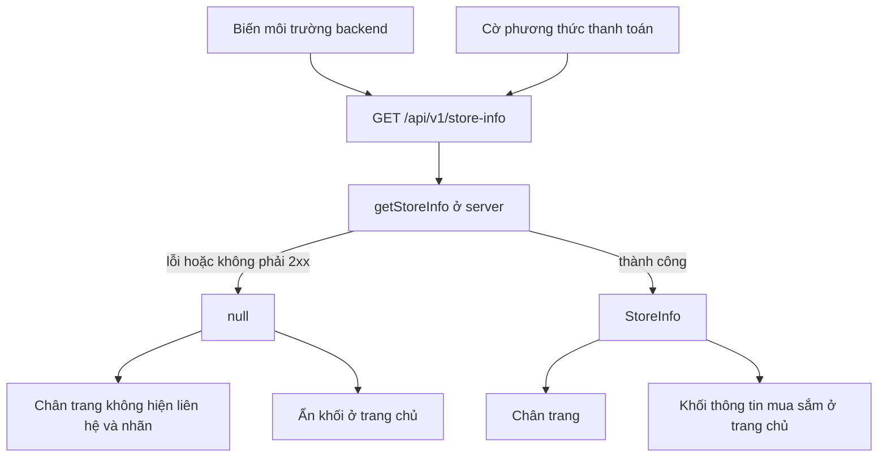

# Thông tin cửa hàng (Store info)

Thông tin liên hệ và dịch vụ của cửa hàng (hotline, email hỗ trợ, giờ hỗ trợ, có hóa đơn VAT, phương thức thanh toán đang bật) hiển thị ở chân trang và ở khối "Thông tin mua sắm" trên trang chủ. Dữ liệu đến từ cấu hình backend; không có giá trị thì giao diện ẩn mục tương ứng và không bao giờ tự bịa nội dung. Module không có trang riêng và không có phần quản trị.

## Tổng quan

| Mục | Giá trị |
| --- | --- |
| Mã nguồn | [src/features/store-info](https://github.com/QuocDuy21-10/laptopshop-web/tree/main/src/features/store-info): `server.ts` (lấy dữ liệu), `labels.ts` (nhãn thanh toán) |
| Nơi hiển thị | [Footer.tsx](https://github.com/QuocDuy21-10/laptopshop-web/blob/main/src/components/layout/Footer/Footer.tsx), [StoreCommitments.tsx](https://github.com/QuocDuy21-10/laptopshop-web/blob/main/src/features/home/StoreCommitments/StoreCommitments.tsx) |
| Route | Không có route riêng |
| Backend | [store-info](https://github.com/QuocDuy21-10/laptopshop-api/blob/main/src/modules/store-info/store-info.controller.ts) |
| Test | [Footer.test.tsx](https://github.com/QuocDuy21-10/laptopshop-web/blob/main/tests/components/Footer.test.tsx), [server.test.ts](https://github.com/QuocDuy21-10/laptopshop-web/blob/main/tests/features/home/server.test.ts) |

## Actors và use cases

| Actor | Use case | Nơi thao tác |
| --- | --- | --- |
| Mọi khách | Xem hotline, email hỗ trợ, giờ hỗ trợ, nhãn thanh toán, hóa đơn VAT | chân trang mọi trang |
| Mọi khách | Xem cùng thông tin dạng thẻ | cuối trang chủ |
| Quản trị hệ thống | Đặt giá trị bằng biến môi trường của backend | cấu hình triển khai |

## Hành trình người dùng

1. Khách cuộn xuống chân trang: thấy hotline kèm giờ hỗ trợ, email hỗ trợ (nếu có) và các nhãn như "Thanh toán COD", "Chuyển khoản QR", "Hóa đơn VAT".
2. Ở trang chủ, cùng thông tin xuất hiện thành dải biểu tượng phía trên khối đánh giá.
3. Khi cửa hàng chưa cấu hình gì, các mục trên biến mất; các liên kết điều hướng trong chân trang vẫn còn.

## Luồng nghiệp vụ

| Việc | Frontend | Backend |
| --- | --- | --- |
| Lấy dữ liệu | `getStoreInfo` (server) gọi `GET /api/v1/store-info`, cache như catalog | Dựng từ biến môi trường, không đọc cơ sở dữ liệu |
| Phương thức thanh toán | Dịch mã sang nhãn tiếng Việt; mã lạ bị bỏ | Chỉ trả phương thức đang bật |
| Hiển thị | Ẩn từng mục không có giá trị | Giá trị chưa đặt là `null` |

## Business rules

| Quy tắc | Thực thi bởi | Nguồn |
| --- | --- | --- |
| Giá trị chưa cấu hình trả `null`; `vatInvoice` mặc định `false` | API | [store-info.controller.ts](https://github.com/QuocDuy21-10/laptopshop-api/blob/main/src/modules/store-info/store-info.controller.ts#L5-L15), [env.ts](https://github.com/QuocDuy21-10/laptopshop-api/blob/main/src/config/env.ts#L96-L99) |
| Giới hạn cấu hình: hotline tối đa 50, email hợp lệ tối đa 255, giờ hỗ trợ tối đa 100 ký tự | API | [env.ts](https://github.com/QuocDuy21-10/laptopshop-api/blob/main/src/config/env.ts#L78-L80) |
| `paymentMethods` chỉ gồm phương thức đang bật: `COD` luôn bật, `BANK_TRANSFER` theo cờ `BANK_TRANSFER_ENABLED` | API | [payments.service.ts](https://github.com/QuocDuy21-10/laptopshop-api/blob/main/src/modules/payments/payments.service.ts#L15-L18) |
| Chỉ hai mã được dịch: `COD` thành "Thanh toán COD", `BANK_TRANSFER` thành "Chuyển khoản QR"; mã khác không hiển thị | Web | [labels.ts](https://github.com/QuocDuy21-10/laptopshop-web/blob/main/src/features/store-info/labels.ts#L2) |
| Lỗi hoặc không có dữ liệu thì trả `null`, không chặn trang | Web | [server.ts](https://github.com/QuocDuy21-10/laptopshop-web/blob/main/src/features/store-info/server.ts#L6-L13) |
| Hotline hiển thị kèm giờ hỗ trợ, nối bằng " · "; có giờ mà không có hotline thì không hiện giờ | Web | [Footer.tsx](https://github.com/QuocDuy21-10/laptopshop-web/blob/main/src/components/layout/Footer/Footer.tsx#L11) |
| Khối trang chủ chỉ liệt kê điều cửa hàng đã cấu hình, không hứa thêm | Web | [StoreCommitments.tsx](https://github.com/QuocDuy21-10/laptopshop-web/blob/main/src/features/home/StoreCommitments/StoreCommitments.tsx#L8-L19) |

## Sơ đồ

`getStoreInfo` được gọi riêng cho chân trang và riêng cho trang chủ trong cùng một lần render; hai lần gọi dùng chung bộ nhớ đệm của `fetch` nếu `revalidate` có hiệu lực ([Rendering và cache](../02-architecture/rendering-and-caching.md)).

## API requests/responses

| Method | Path | Auth | Request | Response | Lỗi thường gặp |
| --- | --- | --- | --- | --- | --- |
| GET | `/api/v1/store-info` | Không | | `{ data: { hotline, supportEmail, supportHours, vatInvoice, paymentMethods } }` | không có; web coi mọi lỗi là `null` |

## Data contracts

`StoreInfo` ở [Data dictionary: Store info](../06-api-and-data/data-dictionary/store-info.md).

## UI states và xử lý lỗi

- Không có trạng thái tải hay lỗi hiển thị: chân trang và khối trang chủ chỉ có hai dạng, có dữ liệu hoặc ẩn mục.
- Chân trang luôn giữ các cột liên kết (danh mục, tiện ích, hỗ trợ) dù không có `StoreInfo` ([Footer.test.tsx](https://github.com/QuocDuy21-10/laptopshop-web/blob/main/tests/components/Footer.test.tsx#L12-L21)).
- Nhãn thanh toán và "Hóa đơn VAT" chỉ hiện khi có ít nhất một nhãn ([Footer.tsx](https://github.com/QuocDuy21-10/laptopshop-web/blob/main/src/components/layout/Footer/Footer.tsx#L12-L15)).

## Edge cases

- `paymentMethods` chứa mã chưa có nhãn (ví dụ phương thức mới): bị bỏ qua, không lỗi.
- `schema.d.ts` mô tả endpoint là "null when not configured" nhưng backend luôn trả một đối tượng, từng trường có thể `null`.
- Backend vừa tắt chuyển khoản: nhãn "Chuyển khoản QR" biến mất sau khi dữ liệu làm mới.

## Bảo mật

- Công khai, chỉ chứa thông tin liên hệ cửa hàng chủ động cấu hình; không dữ liệu cá nhân hay bí mật.
- Mọi giá trị đến từ biến môi trường của máy chủ, người dùng không thay đổi được qua giao diện.

## Tham chiếu mã nguồn

- Web: [server.ts](https://github.com/QuocDuy21-10/laptopshop-web/blob/main/src/features/store-info/server.ts), [labels.ts](https://github.com/QuocDuy21-10/laptopshop-web/blob/main/src/features/store-info/labels.ts), [Footer.tsx](https://github.com/QuocDuy21-10/laptopshop-web/blob/main/src/components/layout/Footer/Footer.tsx), [StoreCommitments.tsx](https://github.com/QuocDuy21-10/laptopshop-web/blob/main/src/features/home/StoreCommitments/StoreCommitments.tsx).
- Backend: [store-info.controller.ts](https://github.com/QuocDuy21-10/laptopshop-api/blob/main/src/modules/store-info/store-info.controller.ts), [store-info.routes.ts](https://github.com/QuocDuy21-10/laptopshop-api/blob/main/src/modules/store-info/store-info.routes.ts), [payments.service.ts](https://github.com/QuocDuy21-10/laptopshop-api/blob/main/src/modules/payments/payments.service.ts).

> [!WARNING]
> **Chưa xác minh:** (1) thời gian cache thực tế của `catalogServerApi` đối với endpoint này (cấu hình 3600 giây, hiệu lực phụ thuộc vấn đề `force-dynamic` ở [Rendering và cache](../02-architecture/rendering-and-caching.md)); (2) phần `STORE_TIME_ZONE` trong `env.ts` có liên quan đến thông tin hiển thị hay không (không thấy trong `toStoreInfoDto`).

## Tài liệu liên quan

- [Home](home.md): khối thông tin mua sắm.
- [Payments](payments.md), [Checkout](checkout.md): phương thức thanh toán.
- [Biến môi trường](../12-reference/env-vars.md)
