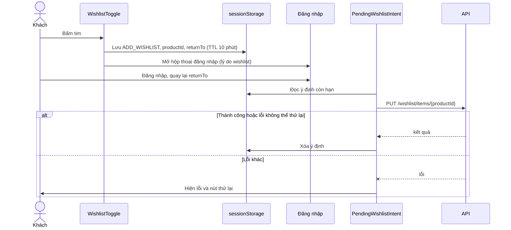
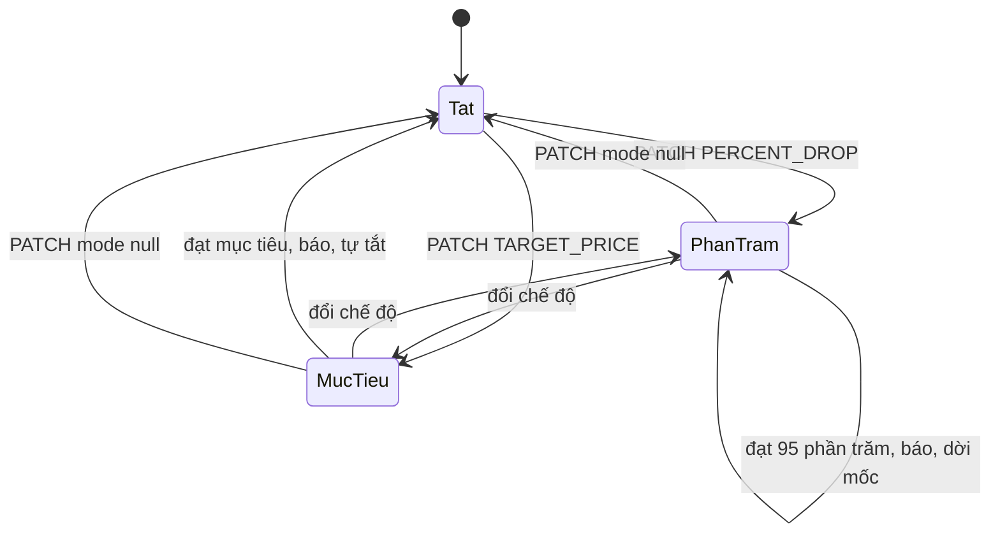

# Danh sách yêu thích (Wishlist)

Thành viên lưu sản phẩm vào danh sách yêu thích (tối đa 100) và có thể bật cảnh báo giá cho từng sản phẩm. Khách vãng lai bấm tim sẽ được mời đăng nhập, và sản phẩm được thêm sau khi đăng nhập xong. Danh sách và cảnh báo lưu ở backend; frontend chỉ hiển thị, cập nhật lạc quan và nhớ ý định chờ đăng nhập.

## Tổng quan

| Mục | Giá trị |
| --- | --- |
| Mã nguồn | [src/features/wishlist](https://github.com/QuocDuy21-10/laptopshop-web/tree/main/src/features/wishlist) |
| Route | `/wishlist` (cần đăng nhập; `?page=` để phân trang) |
| Nơi dùng nút tim | thẻ sản phẩm ([ProductCard.tsx](https://github.com/QuocDuy21-10/laptopshop-web/blob/main/src/features/products/ProductCard/ProductCard.tsx)), lưới sản phẩm, chi tiết sản phẩm, khối Flash Sale ở trang chủ |
| Số đếm ở header | [WishlistLink](https://github.com/QuocDuy21-10/laptopshop-web/tree/main/src/components/layout/WishlistLink) dùng `useWishlistSummary` |
| Backend | [wishlist](https://github.com/QuocDuy21-10/laptopshop-api/tree/main/src/modules/wishlist), [price-alerts](https://github.com/QuocDuy21-10/laptopshop-api/tree/main/src/modules/price-alerts) |
| Test | [tests/features/wishlist](https://github.com/QuocDuy21-10/laptopshop-web/tree/main/tests/features/wishlist) |

## Actors và use cases

| Actor | Use case | Nơi thao tác |
| --- | --- | --- |
| Khách vãng lai | Bấm tim, được mời đăng nhập; sản phẩm thêm sau khi đăng nhập | nút tim, `PendingWishlistIntent` |
| Thành viên | Thêm, bỏ sản phẩm | nút tim, thẻ trong `/wishlist` |
| Thành viên | Xem danh sách theo trang (10 mỗi trang) | `/wishlist` |
| Thành viên | Bật, đổi, tắt cảnh báo giá | hộp thoại "Theo dõi giá" ở thẻ |
| Thành viên | Nhận thông báo khi đạt điều kiện giá | thông báo trong ứng dụng |

## Hành trình người dùng

1. Người dùng bấm tim ở thẻ sản phẩm hoặc trang chi tiết.
2. Đã đăng nhập: tim đổi ngay (cập nhật lạc quan), số đếm ở header đổi theo; lỗi thì hoàn tác và hiện toast.
3. Chưa đăng nhập: ý định lưu vào `sessionStorage`, hộp thoại đăng nhập mở; sau đăng nhập, sản phẩm được thêm tự động.
4. Ở `/wishlist`, người dùng xem giá hiện tại, mở "Theo dõi giá", chọn giảm thêm 5% hoặc giá mục tiêu, lưu.
5. Khi giá đạt điều kiện, backend tạo thông báo; thẻ hiện "Thông báo gần nhất" hoặc "Đã đạt mục tiêu".

## Luồng nghiệp vụ

| Việc | Frontend | Backend |
| --- | --- | --- |
| Thêm | `PUT /wishlist/items/{productId}` (idempotent: đã có thì trả mục cũ) | Khóa hàng người dùng, kiểm tra sản phẩm, giới hạn 100 |
| Bỏ | `DELETE`, không lỗi nếu đã bị xóa | `deleteMany` |
| Trạng thái hàng loạt | `GET /wishlist/status?productIds=` cho các sản phẩm đang hiển thị | Trả `isWishlisted` từng mã |
| Cảnh báo | `PATCH /wishlist/items/{productId}` | Chụp giá hiện tại, kiểm tra, lưu, yêu cầu tính lại |
| Đánh giá giá | | Bộ chạy nền so giá với điều kiện, tạo thông báo |

## Business rules

| Quy tắc | Thực thi bởi | Nguồn |
| --- | --- | --- |
| Tối đa 100 sản phẩm; vượt thì `WISHLIST_LIMIT_REACHED` (409) | API | [wishlist.service.ts](https://github.com/QuocDuy21-10/laptopshop-api/blob/main/src/modules/wishlist/wishlist.service.ts#L112-L117) |
| Chỉ thêm sản phẩm tồn tại và đang bán (`PRODUCT_UNAVAILABLE`) | API | [wishlist.service.ts](https://github.com/QuocDuy21-10/laptopshop-api/blob/main/src/modules/wishlist/wishlist.service.ts#L108-L110) |
| Thêm sản phẩm đã có trả mục hiện có, không lỗi | API | [wishlist.service.ts](https://github.com/QuocDuy21-10/laptopshop-api/blob/main/src/modules/wishlist/wishlist.service.ts#L102-L106) |
| Trạng thái hàng loạt: 1 đến 50 mã, không trùng | API | [wishlist.schema.ts](https://github.com/QuocDuy21-10/laptopshop-api/blob/main/src/modules/wishlist/wishlist.schema.ts#L22-L38) |
| Hai chế độ cảnh báo: `PERCENT_DROP`, `TARGET_PRICE` (cần `targetPrice` nguyên dương); `mode: null` để tắt | API | [wishlist.schema.ts](https://github.com/QuocDuy21-10/laptopshop-api/blob/main/src/modules/wishlist/wishlist.schema.ts#L41-L51) |
| Giá mục tiêu phải thấp hơn giá hiện tại (`INVALID_TARGET_PRICE`, 400) | Web kiểm tra trước, API quyết định | [PriceAlertDialog.tsx](https://github.com/QuocDuy21-10/laptopshop-web/blob/main/src/features/wishlist/PriceAlertDialog/PriceAlertDialog.tsx#L62-L66), [wishlist.service.ts](https://github.com/QuocDuy21-10/laptopshop-api/blob/main/src/modules/wishlist/wishlist.service.ts#L192-L203) |
| `PERCENT_DROP` báo khi giá hiện tại ≤ 95% giá tham chiếu | API (bộ chạy nền) | [price-alert.policy.ts](https://github.com/QuocDuy21-10/laptopshop-api/blob/main/src/modules/price-alerts/price-alert.policy.ts#L23-L31) |
| `TARGET_PRICE` báo khi giá hiện tại ≤ giá mục tiêu; sau đó tự tắt cảnh báo | API | [price-alert.policy.ts](https://github.com/QuocDuy21-10/laptopshop-api/blob/main/src/modules/price-alerts/price-alert.policy.ts#L33-L38), [price-alert.service.ts](https://github.com/QuocDuy21-10/laptopshop-api/blob/main/src/modules/price-alerts/price-alert.service.ts#L119-L128) |
| Cảnh báo chỉ gửi khi sản phẩm đang bán và còn hàng | API | [price-alert.service.ts](https://github.com/QuocDuy21-10/laptopshop-api/blob/main/src/modules/price-alerts/price-alert.service.ts#L146) |
| Mỗi mức giá chỉ báo một lần (khóa chống trùng) | API | [price-alert.service.ts](https://github.com/QuocDuy21-10/laptopshop-api/blob/main/src/modules/price-alerts/price-alert.service.ts#L104-L117) |
| Theo dõi Flash Sale là tùy chọn, chỉ khi cờ `FLASH_SALE_PRICE_ALERT_ENABLED` bật; tắt thì `FLASH_SALE_ALERT_UNAVAILABLE` | API; web ẩn tùy chọn theo `meta.flashSaleAlertEnabled` | [wishlist.service.ts](https://github.com/QuocDuy21-10/laptopshop-api/blob/main/src/modules/wishlist/wishlist.service.ts#L172-L175), [PriceAlertDialog.tsx](https://github.com/QuocDuy21-10/laptopshop-web/blob/main/src/features/wishlist/PriceAlertDialog/PriceAlertDialog.tsx#L78-L79) |
| Ý định chờ đăng nhập hết hạn sau 10 phút; `returnTo` phải là đường dẫn an toàn | Web | [intent.ts](https://github.com/QuocDuy21-10/laptopshop-web/blob/main/src/features/wishlist/intent.ts#L11-L15) |

## Sơ đồ

### Thêm yêu thích khi chưa đăng nhập

`PendingWishlistIntent` xử lý ý định đúng một lần mỗi lần mở trang; với `PRODUCT_UNAVAILABLE`, `NOT_FOUND`, `WISHLIST_ITEM_NOT_FOUND`, `WISHLIST_LIMIT_REACHED` thì không thử lại ([PendingWishlistIntent.tsx](https://github.com/QuocDuy21-10/laptopshop-web/blob/main/src/features/wishlist/PendingWishlistIntent/PendingWishlistIntent.tsx#L16-L28)).

### Vòng đời cảnh báo giá

Hai trạng thái `PhanTram` và `MucTieu` tương ứng `alertMode` `PERCENT_DROP` và `TARGET_PRICE`; `Tat` là `alertMode` bằng null. Khi `PERCENT_DROP` báo, backend giữ chế độ và dời giá tham chiếu, chỉ `TARGET_PRICE` mới tự tắt ([price-alert.service.ts](https://github.com/QuocDuy21-10/laptopshop-api/blob/main/src/modules/price-alerts/price-alert.service.ts#L119-L137)).

## API requests/responses

Nguồn: [hooks.ts](https://github.com/QuocDuy21-10/laptopshop-web/blob/main/src/features/wishlist/hooks.ts). Tất cả cần đăng nhập ([wishlist.routes.ts](https://github.com/QuocDuy21-10/laptopshop-api/blob/main/src/modules/wishlist/wishlist.routes.ts#L21)).

| Method | Path | Request | Response | Lỗi thường gặp |
| --- | --- | --- | --- | --- |
| GET | `/api/v1/wishlist` | `page`, `pageSize` (web dùng 10) | `WishlistPage`, `meta.flashSaleAlertEnabled` | `401` |
| GET | `/api/v1/wishlist/summary` | | `{ itemCount }` | `401` |
| GET | `/api/v1/wishlist/status` | `productIds` | danh sách `{ productId, isWishlisted }` | `400` |
| PUT | `/api/v1/wishlist/items/{productId}` | | `WishlistItem` | `404`, `PRODUCT_UNAVAILABLE`, `409 WISHLIST_LIMIT_REACHED` |
| DELETE | `/api/v1/wishlist/items/{productId}` | | rỗng | |
| PATCH | `/api/v1/wishlist/items/{productId}` | `{ mode, targetPrice?, includeFlashSale? }` hoặc `{ mode: null }` | `WishlistItem` | `WISHLIST_ITEM_NOT_FOUND`, `400 INVALID_TARGET_PRICE`, `409 FLASH_SALE_ALERT_UNAVAILABLE` |

## Data contracts

Type `WishlistItem`, `WishlistPage`, `WishlistStatus`, `WishlistSummary`, `ConfigurePriceAlertInput` ở [types.ts](https://github.com/QuocDuy21-10/laptopshop-web/blob/main/src/lib/api/types.ts). Chi tiết ở [Data dictionary: Wishlist](../06-api-and-data/data-dictionary/wishlist.md).

## UI states và xử lý lỗi

- `/wishlist`: skeleton khi tải; `Alert` lỗi qua `errorMessage`; chưa đăng nhập hiện lời mời kèm liên kết đăng nhập quay lại `/wishlist` ([WishlistView.tsx](https://github.com/QuocDuy21-10/laptopshop-web/blob/main/src/features/wishlist/WishlistView/WishlistView.tsx#L18-L21)).
- Rỗng: `WishlistEmptyState`. Trang vượt quá cuối (ví dụ vừa bỏ mục cuối): thông báo "Trang này không còn sản phẩm" kèm liên kết tới trang cuối, không coi là danh sách rỗng ([WishlistView.tsx](https://github.com/QuocDuy21-10/laptopshop-web/blob/main/src/features/wishlist/WishlistView/WishlistView.tsx#L22-L28)).
- Nút tim: `aria-pressed`, nhãn nêu tên sản phẩm; chỉ khóa nút khi đang tải sau hydrate để tránh lệch hydration ([WishlistToggle.tsx](https://github.com/QuocDuy21-10/laptopshop-web/blob/main/src/features/wishlist/WishlistToggle/WishlistToggle.tsx#L24-L28)). Lỗi thêm hoặc bỏ hiện toast bằng `errorMessage`.
- Thông báo lỗi có sẵn: "Danh sách yêu thích đã đạt giới hạn 100 sản phẩm." ([errors.ts](https://github.com/QuocDuy21-10/laptopshop-web/blob/main/src/lib/api/errors.ts#L65)).
- Hộp thoại cảnh báo: lỗi API hiện ở `Alert`; lỗi giá mục tiêu hiện ở ô nhập.

## Edge cases

- Bấm nhanh nhiều lần: mỗi thao tác tăng một "thế hệ" theo (người dùng, sản phẩm); chỉ lần cuối được hoàn tác khi lỗi, tránh ghi đè trạng thái mới hơn ([hooks.ts](https://github.com/QuocDuy21-10/laptopshop-web/blob/main/src/features/wishlist/hooks.ts#L54-L66), [hooks.ts](https://github.com/QuocDuy21-10/laptopshop-web/blob/main/src/features/wishlist/hooks.ts#L146-L156)).
- Số đếm ở header được điều chỉnh lạc quan chỉ khi trạng thái trước đó biết chắc ([hooks.ts](https://github.com/QuocDuy21-10/laptopshop-web/blob/main/src/features/wishlist/hooks.ts#L84-L102)).
- `sessionStorage` bị chặn: ý định không lưu được, `savePendingWishlistIntent` trả `false` và người dùng phải bấm lại sau đăng nhập ([intent.ts](https://github.com/QuocDuy21-10/laptopshop-web/blob/main/src/features/wishlist/intent.ts#L46-L62)).
- Ý định hỏng, hết hạn hoặc có `returnTo` không an toàn bị bỏ và xóa ([intent.ts](https://github.com/QuocDuy21-10/laptopshop-web/blob/main/src/features/wishlist/intent.ts#L25-L77)).
- Sản phẩm bị ngừng bán sau khi đã yêu thích: không cấu hình cảnh báo được (`PRODUCT_UNAVAILABLE`), nhưng vẫn tắt được ([wishlist.service.ts](https://github.com/QuocDuy21-10/laptopshop-api/blob/main/src/modules/wishlist/wishlist.service.ts#L146-L170)).
- Lệch giữa giao diện và backend: câu "Khi đạt giá mục tiêu, hệ thống gửi một thông báo rồi tự động tắt cảnh báo" đúng với `TARGET_PRICE`; với `PERCENT_DROP` backend giữ cảnh báo và dời mốc ([PriceAlertDialog.tsx](https://github.com/QuocDuy21-10/laptopshop-web/blob/main/src/features/wishlist/PriceAlertDialog/PriceAlertDialog.tsx#L148-L150)).

## Bảo mật

- `/wishlist` bị chặn ở [proxy.ts](https://github.com/QuocDuy21-10/laptopshop-web/blob/main/src/proxy.ts) khi chưa có cookie phiên; quyền thật do backend (`authenticate`), mọi truy vấn lọc theo `userId` của phiên.
- Ý định lưu trong `sessionStorage` chỉ chứa `productId` và `returnTo` đã qua `safeNext`, không chứa token.
- Giá, mức giảm, điều kiện kích hoạt do backend quyết định; frontend không tự tính.

## Tham chiếu mã nguồn

- Web: [hooks.ts](https://github.com/QuocDuy21-10/laptopshop-web/blob/main/src/features/wishlist/hooks.ts), [intent.ts](https://github.com/QuocDuy21-10/laptopshop-web/blob/main/src/features/wishlist/intent.ts), [schema.ts](https://github.com/QuocDuy21-10/laptopshop-web/blob/main/src/features/wishlist/schema.ts), [WishlistToggle.tsx](https://github.com/QuocDuy21-10/laptopshop-web/blob/main/src/features/wishlist/WishlistToggle/WishlistToggle.tsx), [PriceAlertDialog.tsx](https://github.com/QuocDuy21-10/laptopshop-web/blob/main/src/features/wishlist/PriceAlertDialog/PriceAlertDialog.tsx).
- Backend: [wishlist.service.ts](https://github.com/QuocDuy21-10/laptopshop-api/blob/main/src/modules/wishlist/wishlist.service.ts), [price-alert.policy.ts](https://github.com/QuocDuy21-10/laptopshop-api/blob/main/src/modules/price-alerts/price-alert.policy.ts), [price-alert.service.ts](https://github.com/QuocDuy21-10/laptopshop-api/blob/main/src/modules/price-alerts/price-alert.service.ts).
- Cấu trúc bảng thuộc backend: [schema.prisma](https://github.com/QuocDuy21-10/laptopshop-api/blob/main/prisma/schema.prisma).

> [!WARNING]
> **Chưa xác minh:** (1) lịch chạy và cách kích hoạt bộ đánh giá giá (`price-alert.runner.ts`, `pricing-events.ts`), chỉ mới đọc chính sách và phần tạo thông báo; (2) cách tính `priceSnapshot` và `stablePrice` (`resolveAlertPriceSnapshots`); (3) giao diện thẻ `WishlistCard` ngoài các dòng trạng thái cảnh báo.

## Tài liệu liên quan

- [Products](products.md): nơi đặt nút tim.
- [Auth](auth.md): hộp thoại mời đăng nhập và `safeNext`.
- [Cart](cart.md): cùng cơ chế ý định chờ đăng nhập.
