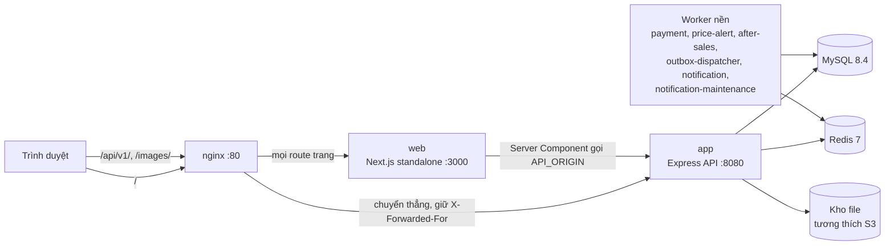
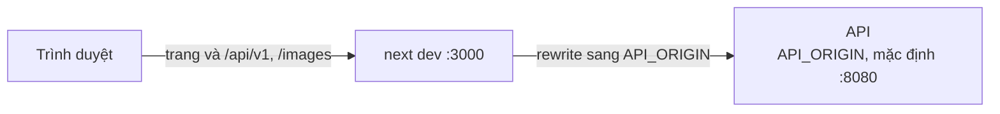

# C4 Container

Sơ đồ mức 2: các tiến trình và kho dữ liệu chạy khi triển khai bằng Docker Compose, và cách request đi giữa chúng.

## Production (Docker Compose + nginx)

### Thành phần

| Container | Mô tả | Nguồn |
| --- | --- | --- |
| nginx | Cổng vào cổng 80. `/api/v1/` và `/images/` tới `app:8080`, còn lại tới `web:3000` | [nginx.conf](https://github.com/QuocDuy21-10/laptopshop-web/blob/main/deploy/nginx.conf) |
| web | Ứng dụng repo này, build `output: "standalone"`, chạy `node server.js` | [Dockerfile](https://github.com/QuocDuy21-10/laptopshop-web/blob/main/Dockerfile) |
| app | Express API, cổng 8080 | [docker-compose.yml](https://github.com/QuocDuy21-10/laptopshop-api/blob/main/docker-compose.yml) |
| Worker nền | Sáu service riêng trong compose của backend | cùng file trên |
| MySQL, Redis | `mysql:8.4`, `redis:7-alpine` | cùng file trên, [schema.prisma](https://github.com/QuocDuy21-10/laptopshop-api/blob/main/prisma/schema.prisma) |
| Kho file | Dịch vụ S3-compatible lưu ảnh đánh giá và hậu mãi (compose dùng `rustfs`) | cùng file trên |

Các cạnh `workers`, `mysql`, `redis`, `files` ở trên là mô tả cấp cao dựa trên compose và cấu hình của backend, không phải đặc tả từng kết nối.

### Đường đi dữ liệu

- Trang HTML: trình duyệt, nginx, `web`. Khi dựng trang, `web` gọi `app` trực tiếp bằng `API_ORIGIN`.
- Dữ liệu từ trình duyệt: gọi `/api/v1/*` cùng origin, nginx chuyển thẳng tới `app`, không qua `web`.
- Lý do bỏ qua Next: rewrite của Next làm mất `X-Forwarded-For`, khiến rate limiter của API coi mọi người dùng là một IP. Xem [nginx và proxy](../10-operations/nginx-and-proxy.md).

## Môi trường phát triển

Ở máy dev không có nginx: mọi request đi vào Next, và Next rewrite `/api/v1/:path*` và `/images/:path*` sang `API_ORIGIN` ([next.config.ts](https://github.com/QuocDuy21-10/laptopshop-web/blob/main/next.config.ts)).

### Tình huống ngoại lệ

| Tình huống | Hệ quả |
| --- | --- |
| `API_ORIGIN` sai lúc build | Rewrite được biên dịch vào build nên sai cho tới khi build lại ([runbook](../10-operations/runbooks/api-unreachable.md)). |
| Một worker dừng | Web không biết trực tiếp; tính năng phụ thuộc worker (thanh toán, thông báo) có thể chậm. Chưa kiểm tra chi tiết từng worker. |
| nginx bỏ qua cấu hình | Request `/api/v1` đi qua Next, mất địa chỉ IP thật. |

## Đọc tiếp

- [C4 System Context](c4-context.md)
- [Triển khai](../10-operations/deployment.md)
