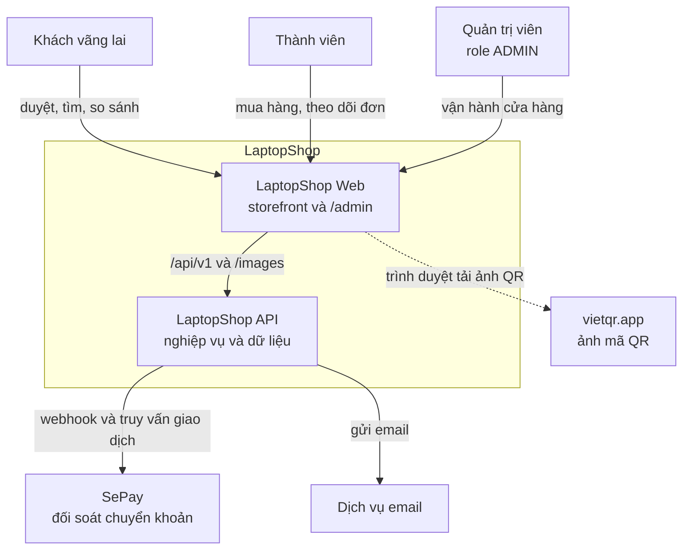

# C4 System Context

Sơ đồ mức 1 cho thấy LaptopShop Web nằm ở đâu trong bức tranh lớn: ai dùng nó và nó phụ thuộc hệ thống nào.

### Thành phần

| Thành phần | Vai trò | Nguồn xác minh |
| --- | --- | --- |
| Khách vãng lai | Xem trang chủ, danh mục, so sánh, tư vấn, khuyến mãi | Route không nằm trong [guarded-routes.ts](https://github.com/QuocDuy21-10/laptopshop-web/blob/main/src/lib/guarded-routes.ts) |
| Thành viên | Giỏ hàng, đặt hàng, tài khoản, hậu mãi | Route được bảo vệ |
| Quản trị viên | Dùng `/admin`; `AdminGuard` yêu cầu `role` là `ADMIN` | [AdminGuard.tsx](https://github.com/QuocDuy21-10/laptopshop-web/blob/main/src/features/admin/AdminGuard.tsx) |
| LaptopShop Web | Repo này | |
| LaptopShop API | Backend [laptopshop-api](https://github.com/QuocDuy21-10/laptopshop-api) | [app.ts](https://github.com/QuocDuy21-10/laptopshop-api/blob/main/src/app.ts) |
| vietqr.app | Nơi ảnh QR được tải. URL do nhà cung cấp SePay của backend tạo | [sepay-payment.provider.ts](https://github.com/QuocDuy21-10/laptopshop-api/blob/main/src/modules/payments/providers/sepay-payment.provider.ts#L82-L93), allowlist trong [next.config.ts](https://github.com/QuocDuy21-10/laptopshop-web/blob/main/next.config.ts) |
| SePay | Nhà cung cấp thanh toán, backend nhận webhook tại `/api/v1/webhooks/payments` | [payments.routes.ts](https://github.com/QuocDuy21-10/laptopshop-api/blob/main/src/modules/payments/payments.routes.ts) |
| Email | Backend hỗ trợ SMTP hoặc HTTP (`EMAIL_PROVIDER`) | [env.ts](https://github.com/QuocDuy21-10/laptopshop-api/blob/main/src/config/env.ts) |

### Đường đi dữ liệu

- Người dùng chỉ làm việc với Web. Web không có cơ sở dữ liệu; mọi dữ liệu đi qua API.
- Web không nói chuyện với SePay hay email. Các tích hợp này thuộc backend; sơ đồ vẽ để người đọc hiểu bối cảnh.
- Ngoại lệ duy nhất từ trình duyệt: ảnh QR tải trực tiếp từ `vietqr.app` (nét đứt).

### Tình huống ngoại lệ

| Tình huống | Hệ quả với Web |
| --- | --- |
| API không phản hồi | Trang catalog hiện lỗi "Không tải được trang"; trang chủ chỉ ẩn khối bị lỗi. Xem [Rendering và cache](../02-architecture/rendering-and-caching.md). |
| Ảnh QR không tải được | `PaymentScreen` hiện thông báo và hướng dẫn chuyển khoản thủ công ([PaymentScreen.tsx](https://github.com/QuocDuy21-10/laptopshop-web/blob/main/src/features/payments/PaymentScreen.tsx#L121-L136)). |

> [!WARNING]
> **Chưa xác minh:** nhà cung cấp thanh toán mặc định `fake` của backend trả `qrImageUrl` thế nào. Chỉ nhà cung cấp SePay được xác nhận tạo URL `vietqr.app`. Cần đọc `fake-payment.provider.ts` trong backend.

## Đọc tiếp

- [C4 Container](c4-container.md)
- [Tổng quan kiến trúc](../02-architecture/overview.md)
