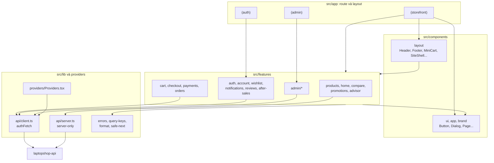

# Component frontend

Sơ đồ này cho thấy các tầng mã nguồn trong `src/` và hướng phụ thuộc giữa chúng. Các mũi tên dựa trên kết quả đếm `import` trong mã nguồn, không phải ý định thiết kế.

### Thành phần

| Tầng | Vai trò | Ví dụ |
| --- | --- | --- |
| `src/app` | Trang và layout; ghép feature lại | [src/app](https://github.com/QuocDuy21-10/laptopshop-web/tree/main/src/app) |
| `components/layout` | Khung trang (header, footer, giỏ mini). Là nhóm duy nhất trong `components` import từ `features` | [Header](https://github.com/QuocDuy21-10/laptopshop-web/tree/main/src/components/layout/Header) |
| `components/ui`, `app`, `brand` | Thành phần thuần giao diện, không import `features` | [Button](https://github.com/QuocDuy21-10/laptopshop-web/tree/main/src/components/ui/Button) |
| `features/*` | Logic và giao diện theo nghiệp vụ, mỗi module có `hooks.ts` hoặc `server.ts` | [features](https://github.com/QuocDuy21-10/laptopshop-web/tree/main/src/features) |
| `lib/api` | Client gọi API. `lib` không import `features` | [api](https://github.com/QuocDuy21-10/laptopshop-web/tree/main/src/lib/api) |

### Phụ thuộc giữa các feature

Kết quả đếm `import "@/features/<module khác>"` (chỉ liệt kê các phụ thuộc chính):

| Feature | Phụ thuộc vào |
| --- | --- |
| `checkout` | `cart`, `payments`, `account` |
| `cart` | `products`, `auth`, `account` |
| `products` | `wishlist`, `cart`, `promotions`, `compare` |
| `home` | `products`, `store-info`, `wishlist`, `promotions` |
| `wishlist` | `account`, `products`, `auth` |
| `reviews` | `account`, `auth` |
| `admin` | `orders`, `account`, `after-sales`, `reviews` |

`products` và `cart` phụ thuộc lẫn nhau (nút thêm vào giỏ nằm trong `products`, hiển thị sản phẩm nằm trong `cart`). `account` cung cấp `useMe`, nên nhiều module phụ thuộc vào đó.

### Đường đi dữ liệu và ngoại lệ

- Server Component trong `app` gọi `features/*/server.ts`, rồi `lib/api/server.ts`.
- Component client gọi hook trong `features/*/hooks.ts`, rồi `lib/api/client.ts` (`authFetch`).
- `Providers.tsx` đăng ký handler hết phiên cho `client.ts` và bọc cây component bằng TanStack Query.
- Trang `/admin` bọc thêm `AdminProviders` (Ant Design). Quy tắc: CSS-in-JS chỉ xuất hiện ở nhánh này.
- Nếu `lib` import từ `features` thì đã phá hướng phụ thuộc; hiện không có trường hợp nào.

## Đọc tiếp

- [Data flow](data-flow.md)
- [Quy ước](../08-development/conventions.md)
