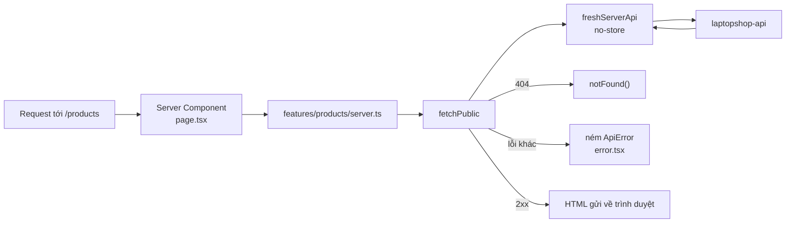
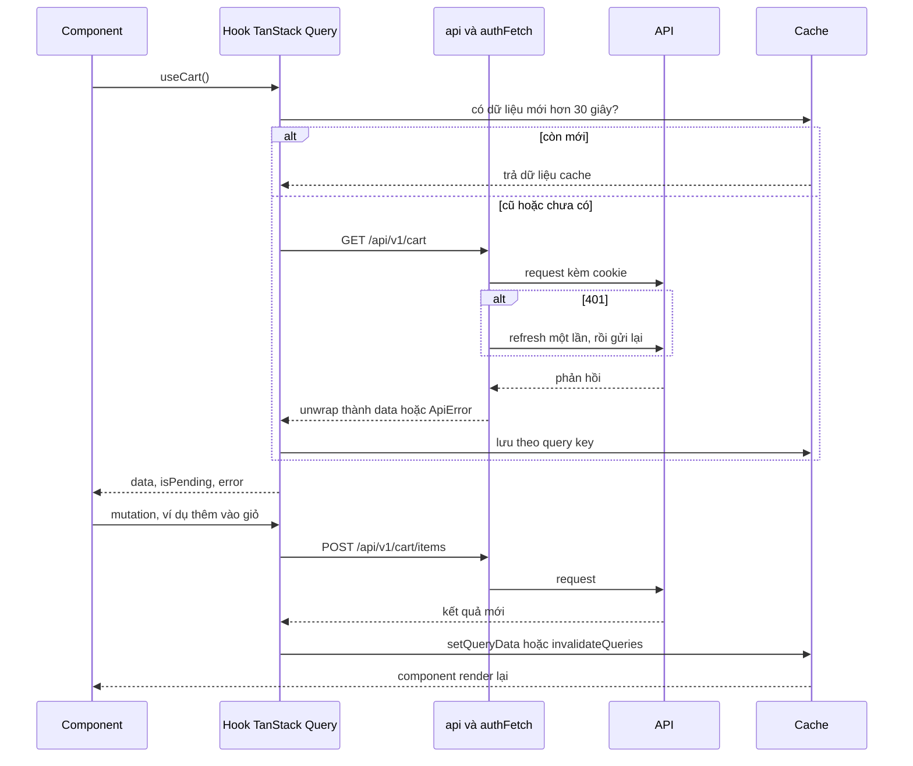

# Data flow

Hai luồng dữ liệu chính của ứng dụng: trang catalog dựng trên server, và dữ liệu theo người dùng lấy từ trình duyệt.

## Luồng 1: trang catalog dựng trên server

### Thành phần

| Bước | Thành phần | Ghi chú |
| --- | --- | --- |
| 1 | `page.tsx` | Đọc `searchParams`, gọi hàm trong `server.ts` |
| 2 | `fetchPublic` | Đổi `404` thành `notFound()`, lỗi khác thành `ApiError` |
| 3 | `freshServerApi` hoặc `catalogServerApi`, `homeServerApi` | Chính sách cache ở [Rendering và cache](../02-architecture/rendering-and-caching.md) |

### Tình huống ngoại lệ

| Tình huống | Kết quả |
| --- | --- |
| Sản phẩm không tồn tại (`404`) | Trang "không tìm thấy" |
| API lỗi hoặc mất kết nối | `error.tsx` hiện "Không tải được trang" và nút "Thử lại" |
| Một khối của trang chủ lỗi | Chỉ khối đó bị ẩn, `settle` ghi log và trả giá trị dự phòng |

## Luồng 2: dữ liệu theo người dùng

### Diễn giải

- Hook không gọi `fetch` thô mà gọi `api` (bọc `authFetch`), nên `401` tự được làm mới một lần ([chi tiết](../02-architecture/auth-session.md)).
- Sau mutation, hook cập nhật cache bằng kết quả trả về hoặc đánh dấu cache cũ để tải lại ([Query keys](../06-api-and-data/query-keys.md)).
- Dữ liệu được coi là mới trong 30 giây (`staleTime`), trừ hook đặt giá trị riêng.

### Tình huống ngoại lệ

| Tình huống | Kết quả |
| --- | --- |
| Refresh thất bại | Xóa `me`, chuyển về đăng nhập nếu đang ở trang riêng tư |
| Lỗi `4xx` hoặc lỗi mạng | Không retry; component nhận lỗi và hiển thị qua `errorMessage` |
| Lỗi `5xx` | Retry tối đa 2 lần |
| Mutation lỗi | Cache giữ nguyên; giao diện báo lỗi |

## Đọc tiếp

- [Lớp gọi API](../06-api-and-data/api-layer.md)
- [Xử lý lỗi API](../06-api-and-data/errors.md)
