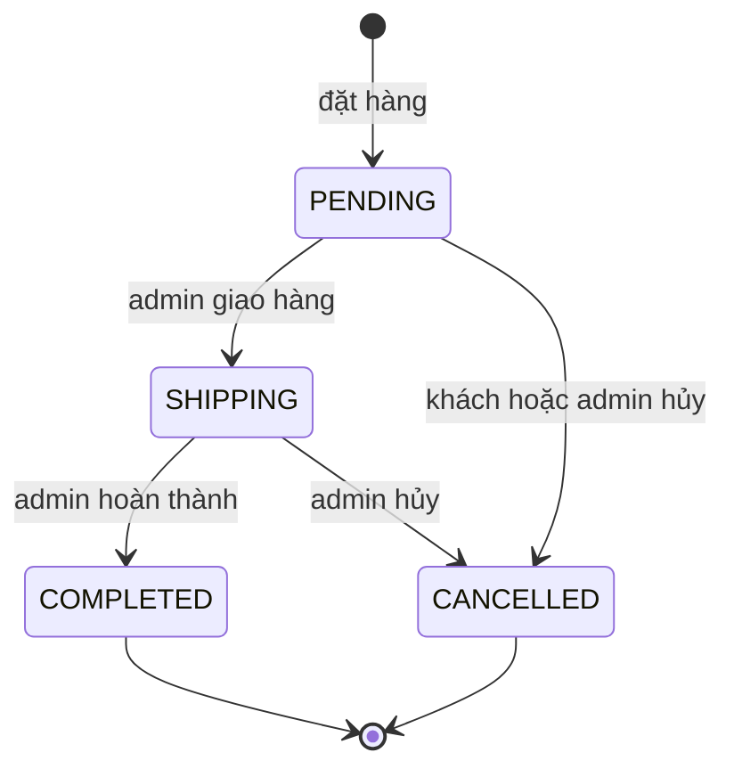
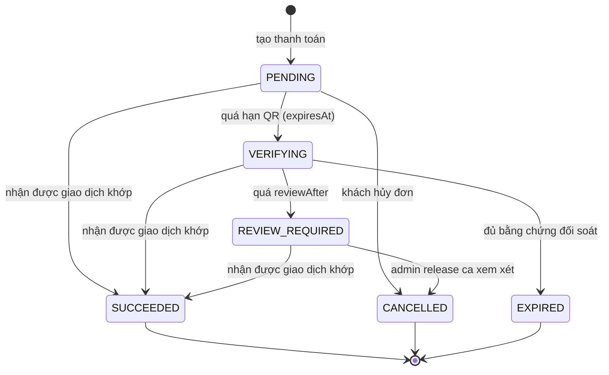

# State machine

Hai vòng đời quan trọng nhất: đơn hàng và thanh toán chuyển khoản. Backend quyết định mọi chuyển trạng thái; frontend chỉ hiển thị và gửi yêu cầu.

## Đơn hàng

| Trạng thái | Nhãn hiển thị | Ai chuyển được |
| --- | --- | --- |
| `PENDING` | Chờ xác nhận | Khách hủy; admin giao hoặc hủy |
| `SHIPPING` | Đang giao | Admin hoàn thành hoặc hủy |
| `COMPLETED` | Hoàn thành | Không |
| `CANCELLED` | Đã huỷ | Không |

Nguồn: bảng `NEXT_STATUS` trong [transitions.ts](https://github.com/QuocDuy21-10/laptopshop-web/blob/main/src/features/admin/orders/transitions.ts) khớp với `TRANSITIONS` trong [order-status.ts](https://github.com/QuocDuy21-10/laptopshop-api/blob/main/src/modules/orders/order-status.ts); nhãn trong [labels.ts](https://github.com/QuocDuy21-10/laptopshop-web/blob/main/src/features/orders/labels.ts).

Quy tắc bổ sung của backend ([orders.service.ts](https://github.com/QuocDuy21-10/laptopshop-api/blob/main/src/modules/orders/orders.service.ts#L338-L417)):

- Khách chỉ tự hủy được đơn `PENDING`.
- Đơn chuyển khoản chưa thanh toán thành công mà chuyển sang `SHIPPING` hoặc `COMPLETED` thì bị từ chối với `PAYMENT_REQUIRED`.
- Đơn chuyển khoản đã thanh toán không hủy được (`PAID_ORDER_CANNOT_CANCEL`); cần xử lý hoàn tiền ngoài hệ thống.
- Đơn COD khi hoàn thành tự đặt `paymentStatus` thành thành công, và chi tiết đơn nhận ngày bắt đầu, kết thúc bảo hành.
- Chuyển trạng thái không hợp lệ trả `INVALID_STATUS_TRANSITION` (HTTP 409).

Trạng thái thanh toán ở cấp đơn (`paymentStatus`): `PAYMENT_UNPAID` (Chưa thanh toán), `PAYMENT_SUCCESS` (Đã thanh toán), `PAYMENT_FAILED` (Thanh toán chưa hoàn tất).

## Thanh toán chuyển khoản

| Trạng thái | Ý nghĩa | Nguồn |
| --- | --- | --- |
| `PENDING` | Đang chờ khách chuyển khoản | giá trị mặc định của model `Payment` |
| `VERIFYING` | QR đã quá hạn, hệ thống đối soát với nhà cung cấp | [payment-maintenance.service.ts](https://github.com/QuocDuy21-10/laptopshop-api/blob/main/src/modules/payments/payment-maintenance.service.ts#L34-L44) |
| `REVIEW_REQUIRED` | Đối soát chưa kết luận, tạo ca xem xét (`PaymentReviewCase`) cho admin | cùng file, dòng 46 đến 67 |
| `SUCCEEDED` | Đã khớp giao dịch, ghi `paidAt` | [payment-ingestion.service.ts](https://github.com/QuocDuy21-10/laptopshop-api/blob/main/src/modules/payments/payment-ingestion.service.ts#L187-L200) |
| `EXPIRED` | Hết hạn, đơn bị hủy theo nhánh "expire" | [order-cancellation.service.ts](https://github.com/QuocDuy21-10/laptopshop-api/blob/main/src/modules/orders/order-cancellation.service.ts#L58-L93) |
| `CANCELLED` | Bị hủy cùng đơn | cùng file |

Chú ý khi đọc sơ đồ:

- Khách chỉ hủy được khi thanh toán còn `PENDING`. Khi đã `VERIFYING` hoặc `REVIEW_REQUIRED`, yêu cầu hủy bị từ chối với `PAYMENT_VERIFICATION_IN_PROGRESS`.
- Admin "release" một ca xem xét sẽ hủy đơn và đặt thanh toán thành `CANCELLED`; "extend" chỉ dời thời điểm xem xét tiếp theo, không đổi trạng thái thanh toán.
- Tên trạng thái thanh toán cấp đơn (`PAYMENT_*`) khác tên trạng thái của bản ghi `Payment` (`PENDING`...). Đừng nhầm hai bộ.

Giao diện khách hiển thị từng trạng thái như sau ([PaymentScreen.tsx](https://github.com/QuocDuy21-10/laptopshop-web/blob/main/src/features/payments/PaymentScreen.tsx#L78-L116)):

| Trạng thái `Payment` | Tiêu đề màn hình |
| --- | --- |
| `PENDING` | Thanh toán chuyển khoản (đang chờ xác nhận, có mã QR và đếm ngược) |
| `VERIFYING`, `REVIEW_REQUIRED` | Đang xác minh thanh toán (đang đối soát giao dịch) |
| `SUCCEEDED` | Thanh toán thành công |
| `EXPIRED`, `CANCELLED` | Phiên thanh toán đã kết thúc |

Chi tiết ở [Payments](../04-features/payments.md).

> **Điều kiện chuyển `VERIFYING` sang `EXPIRED`** ([payment-maintenance.service.ts](https://github.com/QuocDuy21-10/laptopshop-api/blob/main/src/modules/payments/payment-maintenance.service.ts#L69-L141)): đơn còn `PENDING`; nhà cung cấp và chế độ của thanh toán khớp nhà cung cấp hiện hành; mốc kiểm tra của nhà cung cấp có `consecutiveSuccesses` từ 2 trở lên và cả `previousVerifiedThroughAt` lẫn `verifiedThroughAt` không sớm hơn `cancelAfter` cộng `PAYMENT_RECONCILIATION_SETTLEMENT_SECONDS` (mặc định 300 giây). Khi đủ điều kiện, bước kiểm tra được lặp lại trong giao dịch có khóa hàng rồi mới hủy đơn với lý do `PAYMENT_EXPIRED`. Nếu `reviewAfter` đến trước, thanh toán chuyển `REVIEW_REQUIRED` (lý do `RECONCILIATION_INCONCLUSIVE`) thay vì hết hạn.

Cấu trúc bảng `payments` (khóa, index, ràng buộc) thuộc backend: xem [schema.prisma](https://github.com/QuocDuy21-10/laptopshop-api/blob/main/prisma/schema.prisma).

## Đọc tiếp

- [Tài liệu Orders](../04-features/orders.md)
- [Tài liệu Payments](../04-features/payments.md)
