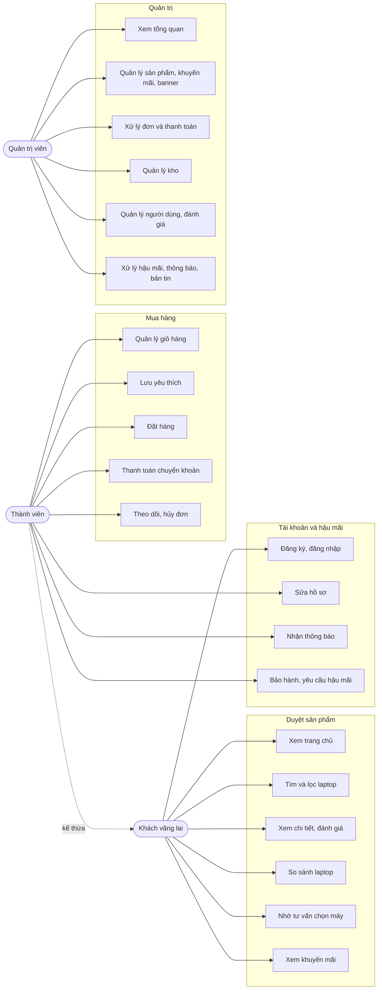

# Use case

Sơ đồ nhóm các use case theo actor. Mỗi use case ứng với ít nhất một route có thật trong `src/app`.

### Ánh xạ use case sang route

| Use case | Route | Cần đăng nhập |
| --- | --- | --- |
| Xem trang chủ | `/` | Không |
| Tìm và lọc laptop | `/products` | Không |
| Xem chi tiết, đánh giá | `/products/[id]` | Không |
| So sánh laptop | `/compare` | Không |
| Nhờ tư vấn chọn máy | `/advisor` | Không |
| Xem khuyến mãi | `/promotions` | Không |
| Đăng ký, đăng nhập, quên mật khẩu | `/register`, `/login`, `/forgot-password` | Không |
| Quản lý giỏ hàng | `/cart` | Có |
| Lưu yêu thích | `/wishlist` | Có |
| Đặt hàng | `/checkout` | Có |
| Thanh toán chuyển khoản | `/account/orders/[id]/payment` | Có |
| Theo dõi, hủy đơn | `/account/orders`, `/account/orders/[id]` | Có |
| Sửa hồ sơ | `/account` | Có |
| Nhận thông báo | `/account/notifications`, `/account/notifications/settings` | Có |
| Bảo hành, hậu mãi | `/account/warranties`, `/account/after-sales` | Có |
| Quản trị (các use case 16 đến 21) | `/admin/*` | Có, kèm role `ADMIN` |

### Ghi chú

- "Thành viên kế thừa khách" nghĩa là người đã đăng nhập vẫn dùng được mọi chức năng công khai.
- Thêm vào giỏ hoặc yêu thích khi chưa đăng nhập mở hộp thoại mời đăng nhập, rồi tiếp tục thao tác sau khi đăng nhập ([routing](../02-architecture/routing-and-guards.md)).
- Trang quản trị chỉ mô tả ở mức nhóm; chi tiết ở [Admin](../04-features/admin.md).
- Danh sách đầy đủ route: [Danh sách route](../12-reference/routes.md).

## Đọc tiếp

- [Danh sách module](../04-features/README.md)
- [LaptopShop là gì](../01-product/overview.md)
